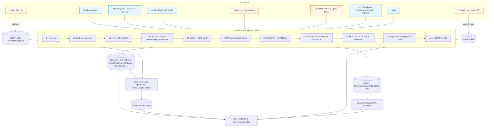

# ภาค A บทที่ 1 บทนำและภาพรวมระบบ

> ภาค A ของคู่มือ SEA-HAF (Southeast Asia Hybrid Air-quality Forecast) อธิบายวิธีการของระบบในรูปแบบส่วนวิธีการ (Methods section) ของบทความวิชาการ
> บทนี้กล่าวถึงปัญหา เป้าหมาย และโครงสร้างการไหลของข้อมูลรายชั่วโมง บทที่ 2 อธิบายข้อมูลนำเข้าและการควบคุมคุณภาพ ส่วนบทที่ 3 ให้สมการและค่าพารามิเตอร์ของทุกขั้นตอน
> ค่าพารามิเตอร์ทุกตัวในภาค A อ่านจากโค้ดใน branch ที่จัดทำคู่มือ (`claude/modest-brahmagupta-4lvuaz`, ตรงกับ `origin/main` ขณะเขียน) และกำกับตำแหน่งต้นทางด้วยหมายเหตุ `<!-- src: ... -->`

---

## 1.1 ปัญหา PM2.5 และควันไฟในเอเชียตะวันออกเฉียงใต้ภาคพื้นทวีป

ฝุ่นละอองขนาดไม่เกิน 2.5 ไมโครเมตร (fine particulate matter, PM2.5) เป็นปัญหาคุณภาพอากาศที่เกิดซ้ำทุกปีในเอเชียตะวันออกเฉียงใต้ภาคพื้นทวีป (mainland Southeast Asia) ได้แก่ ไทย ลาว เมียนมา กัมพูชา และเวียดนาม
ในฤดูแล้ง ภาคเหนือของไทยและพื้นที่ชายแดนรับควันจากการเผาในที่โล่ง (open biomass burning) ทั้งไฟป่าและการเผาเศษวัสดุการเกษตร
ความเข้มข้นจึงขึ้นลงเร็วตามตำแหน่งไฟ ทิศลม ความสูงชั้นผสม (mixing height) และภูมิประเทศแบบหุบเขา
ช่วงนอกฤดูเผาไหม้ แหล่งกำเนิดในเมือง เช่น การจราจรในกรุงเทพมหานคร มีบทบาทมากกว่า

ในโค้ด ฤดูหมอกควันที่ใช้ฝึกผู้เชี่ยวชาญ hindcast คือ 18 ธันวาคม ถึง 30 เมษายน (วันที่ตามเวลาไทย)
<!-- src: scripts/hindcast.mjs:14 -->
ส่วนฤดูกาลที่ใช้แบ่งคลังข้อมูลฝึกของ ML คือฤดูของกรมอุตุนิยมวิทยา ได้แก่ ฤดูร้อน 16 ก.พ.–15 พ.ค. ฤดูฝน 16 พ.ค.–15 ต.ค. และฤดูหนาว 16 ต.ค.–15 ก.พ.
<!-- src: scripts/ml.mjs:16, scripts/ml.mjs:39-44 -->

## 1.2 ช่องว่างของระบบที่มีอยู่

แบบจำลองเคมี-การขนส่งระดับโลก (global chemistry-transport model) ที่ให้บริการแบบเปิดมีสองระบบหลักที่ SEA-HAF ใช้

- **CAMS** (Copernicus Atmosphere Monitoring Service; Inness et al., 2019)
- **SILAM** ของสถาบันอุตุนิยมวิทยาฟินแลนด์ (Finnish Meteorological Institute, FMI; Sofiev et al., 2015)

ทั้งสองระบบให้พยากรณ์ PM2.5 รายชั่วโมงหลายวันล่วงหน้า แต่มีข้อจำกัดที่ระบบนี้ตั้งใจแก้

1. **ความละเอียดเชิงพื้นที่หยาบ** เมื่อเทียบกับความแปรปรวนในหุบเขา SEA-HAF อ่าน CAMS ที่สถานีและบนกริด 0.5° และอ่าน SILAM บนกริด 0.2°
   <!-- src: scripts/update.mjs:42, scripts/update.mjs:114 -->
2. **ไบแอสเชิงระบบ** (systematic bias) ที่ขึ้นกับสถานี ฤดู และช่วงเวลาของวัน ตัวอย่างจากผลตรวจย้อนหลังที่เก็บในไฟล์โมเดล hindcast คือ ในฤดูเผาไหม้ปี 2024 ค่าเฉลี่ย 24 ชม. ของ CAMS ที่ lead 48 ชม. มี bias −12.61 µg/m³ และ RMSE 25.35 µg/m³ ที่สถานี Air4Thai
   <!-- src: data/static/hc-model.json (cv["2024"]["48"].cams) -->
3. **การปล่อยจากไฟที่ไม่แน่นอน** ผลการเผาไหม้ที่เกิดจริงในวันนั้นอาจต่างจากที่แบบจำลองประมาณไว้มาก
4. **แบบจำลองไม่ใช้ค่าตรวจวัดภาคพื้นดินแบบรายชั่วโมง** ทั้งที่ประเทศไทยมีสถานีอ้างอิงของกรมควบคุมมลพิษ (Air4Thai) ที่รายงานทุกชั่วโมง

นอกจากนี้ บริการเตือนภัยที่ใช้งานได้ฟรี เปิดเผยวิธี และตรวจสอบย้อนหลังได้ทุกชั่วโมงยังมีน้อย

## 1.3 เป้าหมายของ SEA-HAF

SEA-HAF เป็นระบบพยากรณ์แบบลูกผสม (hybrid) ฟิสิกส์–สถิติ–การเรียนรู้ของเครื่อง (machine learning, ML) มีเป้าหมายดังนี้

1. **พยากรณ์ PM2.5 รายชั่วโมงหลายวันล่วงหน้า** สำหรับเมือง สถานี และแผนที่ ช่วงพยากรณ์จริงขึ้นกับแบบจำลองต้นทาง
   - CAMS ผ่าน Open-Meteo ขอข้อมูล `past_days=2&forecast_days=4` และ pipeline ต้องการให้ CAMS มีค่าถึงอย่างน้อย 24 ชม. ข้างหน้า มิฉะนั้นจะหยุดทำงาน
     <!-- src: scripts/update.mjs:338, scripts/update.mjs:443 -->
   - SILAM หนึ่งรอบมี 5 วันของ UTC (`d0`–`d4`) จึงยาวถึงประมาณ 5 วัน
     <!-- src: scripts/silam.py:6-8, scripts/silam.py:21 -->
   - เป้าหมาย "1–120 ชม." ในแผนคู่มือจึงเป็นจริงเฉพาะ SILAM ส่วน CAMS ได้สั้นกว่า (ดู ISSUES_A.md)
2. **ปรับแก้ด้วยค่าตรวจวัดทุกชั่วโมง** ใช้ทั้งสถานีอ้างอิงและเซนเซอร์ราคาประหยัด (low-cost sensor) ที่ผ่านการตรวจ ผ่านการปรับแก้ไบแอสหลายขั้น (บทที่ 3)
3. **ให้กฎการเตือนที่ชัดเจน** ใช้เกณฑ์ PM2.5 ของกรมควบคุมมลพิษ (PCD) ซึ่งมีผลตั้งแต่ 1 มิถุนายน 2023
   <!-- src: index.html:994-1001 -->
4. **ทำงานเป็นระบบปฏิบัติการ (operational) แบบฟรีและไม่มี dependency**
   - pipeline หลักเขียนด้วย Node.js ไม่ใช้แพ็กเกจภายนอก
   - ใช้ Python เฉพาะสองขั้นตอน ได้แก่ อ่าน SILAM (NetCDF-4) และอ่านฝน ECMWF open data (GRIB2)
     <!-- src: scripts/update.mjs:2, .github/workflows/update.yml:89-99 -->
   - รันบน GitHub Actions และเผยแพร่บน GitHub Pages กับ Cloudflare Pages
5. **ตรวจสอบตัวเองได้** ทุกขั้นตอนบันทึก log รายชั่วโมง ขั้นตอนที่เพิ่มเข้ามาภายหลังต้องผ่านประตู (gate) ที่ตัดสินจากผลจริง ก่อนจะถูกเผยแพร่ (หัวข้อ 3.7)

## 1.4 ภาพรวมระบบ

### 1.4.1 องค์ประกอบหลัก

| องค์ประกอบ | ไฟล์ | หน้าที่ |
|---|---|---|
| pipeline รายชั่วโมง | `scripts/update.mjs` | ดึงข้อมูล ปรับแก้ และเขียน JSON ให้หน้าเว็บ |
| การตรวจรายชั่วโมง | `scripts/verify.mjs` | RMSE / bias / r ตาม lead → `data/verify.json` (หน้าต่าง 30 วัน) |
| ห่วงโซ่ SILAM | `scripts/silam.py`, `scripts/silam.mjs`, `scripts/silam_chain.mjs` | รัน `update.mjs` ซ้ำด้วย SILAM แทน CAMS |
| ฝน ECMWF 0.25° | `scripts/ecmwf_pr.py` | ฝนพยากรณ์สำหรับแสดงบนหน้าเว็บ |
| ความแม่นยำบนหน้าเว็บ | `scripts/accuracy.mjs` | คะแนน 100 − NRMSE → `data/accuracy.json` |
| สมรรถนะ (หน้า dev) | `scripts/perf.mjs` | `perf.html` (ภาค B/C) |
| หน้าเว็บ | `index.html` (โค้ดหน้าเว็บทั้งหมด), `index_modern.html` (layout ใหม่) | แผนที่ Leaflet รันแบบจำลองควันไฟในเบราว์เซอร์ |

<!-- src: .github/workflows/update.yml:89-133, scripts/verify.mjs:9 -->

แบบจำลองควันไฟใช้โค้ดชุดเดียวกันทั้งในเบราว์เซอร์และใน pipeline โดย `scripts/model.mjs` ตัดโค้ดระหว่างเครื่องหมาย `/*MODEL-START*/` กับ `/*MODEL-END*/` ใน `index.html` มารันใน `node:vm`
ทำให้การ assimilation ใน pipeline กับสิ่งที่หน้าเว็บแสดงไม่แยกกัน
<!-- src: scripts/model.mjs:1-14, index.html:980-1418 -->

### 1.4.2 การไหลของข้อมูลรายชั่วโมง

แผนภาพด้านล่างแสดงเส้นทางของข้อมูลจากแหล่งต้นทางจนถึงหน้าเว็บ ลำดับขั้นใน `update.mjs` ตรงกับหมายเลขหัวข้อในโค้ด (1, 2, 3a–3e, 4, 4c, 5, 7)



**รูปที่ A1.1** การไหลของข้อมูลรายชั่วโมงของ SEA-HAF
<!-- src: scripts/update.mjs:384-1224, .github/workflows/update.yml:89-133, scripts/silam_chain.mjs:42-64 -->

แผนภาพเดียวกันแบบข้อความ สำหรับฉบับพิมพ์ที่ไม่รองรับ mermaid

```
 Air4Thai  OpenAQ  FIRMS   CAMS(Open-Meteo)  ECMWF IFS(Open-Meteo)  เรดาร์/ThaiWater/GSMaP/PARDIG  IQAir
    \        |       |           |                 |                        |                     /
     +-------+-------+-----------+-----------------+------------------------+--------------------+
                                           |
                     scripts/update.mjs (GitHub Actions, ทุกชั่วโมง)
   สถานี -> CAMS -> ค่าวัด+QC -> อุตุฯ/ฝน -> hotspot -> assimilation -> Kalman -> พยากรณ์สถานี
        -> ML v1/v2 -> nowcast -> regression kriging -> JSON + CSV logs
                                           |
            +------------------------------+---------------------------+
            |                              |                           |
   data/latest.json ฯลฯ          data/history/*.csv (branch history)   state.json (Actions cache)
            |                              |
   silam_chain.mjs (update.mjs ซ้ำ, HSW_MODEL=silam) -> data/silam/latest.json
            |
   accuracy.mjs / perf.mjs -> _site -> GitHub Pages -> Cloudflare Pages -> หน้าเว็บ
```

### 1.4.3 รอบเวลาของ GitHub Actions

| รายการ | ค่า | ที่มา |
|---|---|---|
| ตัวเรียกหลัก | cron ภายนอก (cron-job.org) สั่ง `workflow_dispatch` ทุกชั่วโมงที่นาที :07 | `.github/workflows/update.yml:5` (ความเห็น) |
| ตัวเรียกสำรอง | `cron: '37 */3 * * *'` (ทุก 3 ชม.) | `.github/workflows/update.yml:5` |
| เรียกเมื่อ push | เมื่อแก้ `scripts/**`, `index.html`, `index_modern.html`, `chat/**`, `assets/**` หรือ `update.yml` บน `main` | `.github/workflows/update.yml:7-9` |
| การรันซ้อน | `concurrency: hourly-update`, ไม่ยกเลิกงานที่กำลังรัน | `.github/workflows/update.yml:21-23` |
| เวลาสูงสุดของงาน | 25 นาที | `.github/workflows/update.yml:28` |
| งบเวลาของขั้นที่เลือกได้ | ข้ามขั้นที่ไม่จำเป็นหลังนาทีที่ 16; หยุด fallback ของ OpenAQ ที่นาทีที่ 6 | `scripts/update.mjs:49` |
| Node.js | 22 | `.github/workflows/update.yml:36` |

<!-- src: .github/workflows/update.yml:1-36, scripts/update.mjs:47-49 -->

ขั้นที่ข้ามได้เมื่อเกินงบเวลา ได้แก่ เฟรมเรดาร์, GSMaP/มาตรวัดฝน/การวินิจฉัยฝน, และการลดขนาดอุณหภูมิกับ weather ML
พยากรณ์หลักและ state จึงยังถูกเขียนก่อนงานถูกตัดที่ 25 นาที
<!-- src: scripts/update.mjs:371, 528, 531, 661 -->

ลำดับ step ใน `update.yml` มีดังนี้

1. คืน state จาก Actions cache
2. คืน log จาก branch `history` และคลังฝึก ML จาก branch `mltrain`
3. ตั้งค่า host key ของ GSMaP
4. `silam.py`
5. `ecmwf_pr.py`
6. `update.mjs` ตามด้วย `verify.mjs`
7. `silam_chain.mjs`
8. `perf.mjs`
9. `accuracy.mjs`
10. บันทึก Actions cache
11. commit `data/static` ไปที่ `main` และ log ไปที่ branch `history`
12. บันทึกคลังฝึกไปที่ branch `mltrain`
13. สร้าง `_site`
14. deploy ไป GitHub Pages
15. deploy ไป Cloudflare Pages (ถ้ามี secret)

<!-- src: .github/workflows/update.yml:38-302 -->
ขั้น SILAM, ECMWF open data, perf และ accuracy ตั้ง `continue-on-error: true` จึงไม่ทำให้งานล้ม
การ deploy ไป Cloudflare ก็ไม่หยุดการ deploy ไป GitHub Pages
<!-- src: .github/workflows/update.yml:91, 97, 114, 125, 131, 287 -->

### 1.4.4 State ที่เก็บใน Actions cache และใน git

SEA-HAF เก็บข้อมูลไว้สามแบบ ตามความถี่ที่เปลี่ยนและขนาด

**(ก) Actions cache** เก็บไฟล์ใหญ่ที่เปลี่ยนทุกรอบ ซึ่งไม่ commit ลง git มี 16 ไฟล์ ได้แก่

- `data/state.json`, `data/met.json`, `data/latest.json`
- `data/rk-bias.json`, `data/rk-bias-A.json`
- `data/landcover.bin`, `data/verify.json`
- `data/gsmap-cache.json`, `data/radar-cache.json`
- `data/met-web.json`, `data/t2-corr.json`, `data/rain-obs.json`
- `data/wx-ml.json`, `data/perf.json`, `data/perf-series.json`, `data/ml-field.json`

key ของ cache คือ `pipeline-state-<run_id>-<attempt>` และคืนค่าด้วย prefix `pipeline-state-`
<!-- src: .github/workflows/update.yml:38-59, 135-156 -->
ห้ามเพิ่มไฟล์ในรายการนี้ เพราะจะเปลี่ยน key ของ cache และรอบถัดไปจะเริ่มโดยไม่มี state
ตัวอย่างคือ cache ของ PARDIG ถูกเก็บไว้ภายใน `gsmap-cache.json` แทนการเพิ่มไฟล์ใหม่
<!-- src: scripts/update.mjs:540, CLAUDE.md (Working notes) -->

ใน `state.json` มีสถานะของตัวกรองและการเรียนรู้ เช่น

| กุญแจ | ความหมาย |
|---|---|
| `kf`, `kfA`, `kfSlow` | สถานะ Kalman filter ต่อสถานี |
| `incFc` | increment ของ assimilation ที่พยากรณ์ไว้ |
| `assimKappa` | κ ของ assimilation |
| `ml`, `ml2` | น้ำหนักและผู้เชี่ยวชาญ ML v1, v2 |
| `pmNow`, `pmNowFc` | ประตูและค่าพยากรณ์เก็บไว้ของ nowcast |
| `obsHist` | ค่าวัด 50 ชม. ล่าสุด |
| `daily` | ค่ารายวันของ low-cost check |
| `cams` | พยากรณ์ CAMS ที่ดึงไว้ |
| `stations` | รายชื่อสถานี |
| `wxml` | weather ML |
| `obsRainCheck` | ผลตรวจฝน PARDIG กับ GSMaP |
| `gaugeRain` | ค่ามาตรวัดฝน |
| `radarFactor` | ตัวคูณปรับเรดาร์ |
| `spikeSeen` | spike ที่เคย reset ตัวกรองแล้ว |
| `iqair` | ค่า IQAir |

<!-- src: scripts/update.mjs:375, 503, 838, 961, 1041, 549, 533, 610, 840 -->
ถ้า cache หาย ตัวกรอง Kalman จะเริ่มจาก b = 0 และน้ำหนัก ML จะเริ่มจากผู้เชี่ยวชาญ `base` ใหม่ (รายละเอียดในภาค C)

**(ข) branch `history`** เก็บ log รายรอบ (`obs-`, `fcst-`, `map-`, `rainfc-`, `rainobs-`, `climfc-`, `a4t-`, `wxf-`, `hot-`, `pmday-`, `silam-`, `ecpr-` ฯลฯ) ย้อนหลัง 35 วัน
ทุกวัน branch นี้ถูกแทนด้วย commit เดียว (squash) ที่เก็บเฉพาะไฟล์ที่ยังอยู่ในช่วง 35 วัน
<!-- src: .github/workflows/update.yml:158-184 -->

**(ค) branch `mltrain`** เก็บคลังฝึก ML ย้อนหลัง 2 ปี (730 วัน)
<!-- src: .github/workflows/update.yml:186-202, scripts/ml.mjs:46 -->

`main` เก็บเฉพาะไฟล์คงที่ใน `data/static/` เช่น DEM, climatology ของสถานี (`pm-clim.json`), โมเดล hindcast (`hc-model.json`) และขอบเขตการปกครอง

### 1.4.5 สองโมเดล: ห่วงโซ่ CAMS และห่วงโซ่ SILAM

SILAM ไม่มีโปรแกรมแยก `scripts/silam_chain.mjs` รัน `scripts/update.mjs` ครั้งที่สองด้วยตัวแปรสภาพแวดล้อม `HSW_MODEL=silam` และ `HSW_DATA=data/silam-run`
SILAM จึงผ่านขั้นตอนเดียวกับ CAMS ได้แก่ Kalman filter, พยากรณ์ที่สถานี, ML v1/v2, nowcast, regression kriging และ log
<!-- src: scripts/silam_chain.mjs:1-11, 51; scripts/update.mjs:108-115 -->

ความต่างระหว่างสองรอบที่กำหนดในโค้ด

| ประเด็น | รอบ CAMS | รอบ SILAM |
|---|---|---|
| แหล่งพยากรณ์ | Open-Meteo air-quality API (`camsSeries`) | สารสกัดจาก `silam.py` (`loadSilam`, เก็บได้ 3 รอบ อายุไม่เกิน 4 วัน) |
| กริดโมเดล | `gridBbox` [92.0, 5.5, 110.0, 24.0], `gridStep` 0.5° | [92.0, 5.4, 110.0, 24.2], 0.2° |
| fire-emission assimilation | เปิด (`assimilate: true`) | **ปิด** (`CFG.assimilate = false`) เพราะ SILAM มีการปล่อยจากไฟของตัวเอง (ตัดสินเมื่อ 21 พ.ย. 2026) |
| ผู้เชี่ยวชาญ hindcast | โหลด (`setHindcastModel`) | ไม่โหลด เพราะฝึกจาก CAMS |
| ค่าวัด | ดึงจากแหล่งและเก็บคำตอบ HTTP ไว้ใน `HSW_HTTP_CACHE` | อ่านคำตอบชุดเดียวกันจาก `HSW_HTTP_CACHE` |
| ขั้นที่ไม่ขึ้นกับโมเดล PM2.5 (เรดาร์, ฝนสังเกต, อุณหภูมิ, weather ML, IQAir, รายชื่อสถานี, แผนที่เฉลี่ยรายวัน) | ทำ | ไม่ทำ (นำจากรอบ CAMS) |
| รายชื่อสถานี, `met.json` | สร้าง/รีเฟรช | ใช้ของรอบ CAMS ตามที่เป็น |
| state ของโมเดล | กุญแจหลักใน `state.json` | `state.silamState` เฉพาะ `MODEL_KEYS` |
| log | `data/history/`, `data/mltrain/` | `data/history/silam/`, `data/mltrain/silam/` |
| ไฟล์หน้าเว็บ | `data/latest.json` ฯลฯ | `data/silam/latest.json`, `rk-bias*.json`, `ml-field.json` |

<!-- src: scripts/update.mjs:112-115, 185-188, 196, 371, 381, 388, 422-429, 479, 514, 1057, 1141, 1160, 1188; scripts/silam_chain.mjs:19, 25-31, 47-61 -->

`MODEL_KEYS` คือ `kf`, `kfA`, `kfSlow`, `incFc`, `assimKappa`, `ml`, `ml2`, `spikeSeen`, `pmNow`, `pmNowFc`
กุญแจอื่นของ state ใช้ร่วมกันและมาจากรอบ CAMS ทุกครั้ง
<!-- src: scripts/silam_chain.mjs:19 -->
เมื่อมีกุญแจ state ใหม่ต่อโมเดลใน `update.mjs` ต้องเพิ่มลงใน `MODEL_KEYS` ด้วย
<!-- src: CLAUDE.md (Working notes) -->

**สถานะการใช้งาน**
- หน้าเว็บสาธารณะแสดง CAMS เท่านั้น
- ชั้น SILAM (`lySilam`) ซ่อนอยู่และเปิดได้ในหน้า developer
- ค่าเริ่มต้นของหน้าเว็บ คำเตือนที่แสดงก่อน และการ์ดความแม่นยำยังเป็น CAMS จนกว่า log ที่เปรียบเทียบจะแสดงว่า SILAM ดีอย่างน้อยเท่ากัน

<!-- src: index.html:871, README.md (Second forecast model), CLAUDE.md (Working notes) -->
ถ้ารอบ SILAM ล้ม `silam_chain.mjs` จะลบ `data/silam/` และไม่ใส่รายการ `silam` ใน `latest.json` หน้าเว็บจึงซ่อนชั้นนี้เอง
<!-- src: scripts/silam_chain.mjs:53, 60 -->

### 1.4.6 ผลิตภัณฑ์หลัก

| ผลิตภัณฑ์ | ไฟล์ | หมายเหตุ |
|---|---|---|
| พยากรณ์ที่สถานีและกริด CAMS ดิบ | `data/latest.json` | `stations[]` มี `raw`, `corr`, `corrA`, `corrM`, `fc24*`, `held` |
| สนามปรับแก้แผนที่ 0.025° | `data/rk-bias.json`, `data/rk-bias-A.json` | integer ×1000 เก็บผลต่างตามแกน x |
| สนามปรับแก้ ML 0.1° | `data/ml-field.json` | ทุก 3 ชม. ถึง 24 ชม. |
| อุตุนิยมวิทยาสำหรับหน้าเว็บ | `data/met-web.json`, `data/met-traj.json` | 36 ชม. ย้อนหลังถึง 75 ชม. ข้างหน้า |
| ฝนสังเกตและเรดาร์ | `data/rain-obs.json` | |
| ฝน ECMWF 0.25° | `data/ecmwf-pr.json` | |
| อุณหภูมิลดขนาด | `data/t2-corr.json` | |
| weather ML | `data/wx-ml.json` | |
| ความแม่นยำ | `data/accuracy.json` | |
| แผนที่ค่าเฉลี่ยรายวัน | `data/pm-days/*.json`, `data/pm-mean.json` | |

<!-- src: scripts/update.mjs:650-655, 918-923, 1030-1031, 1131-1136, 1167-1183; scripts/pmmean.mjs:8-11 -->

หน้าเว็บประกอบค่า PM2.5 ที่แต่ละจุดตามลำดับต่อไปนี้ (บทที่ 3 สมการ A.30–A.32)

1. CAMS ดิบบนกริด แบบ bilinear
2. บวก increment ของควันไฟ (ถ้ามี)
3. คูณด้วยสนามไบแอสของ regression kriging ที่จางตาม lead
4. คูณด้วยสนาม ML

<!-- src: index.html:2863-2864, 2165-2169, 2152-2158 -->

## 1.5 โครงของภาค A

- **บทที่ 2** แหล่งข้อมูลนำเข้าทุกแหล่ง (ความละเอียด ความถี่ ความหน่วง ตัวแปร สคริปต์ที่อ่าน สัญญาอนุญาต) และการควบคุมคุณภาพค่าวัด
- **บทที่ 3** วิธีการครบทุกขั้น
  - แบบจำลองควันไฟและ assimilation
  - อุตุนิยมวิทยา
  - การปรับแก้ PM2.5 หลายขั้น
  - ฝน
  - weather ML
  - กฎการเตือน
  - หลักการออกแบบที่ใช้ประตูตัดสิน

## เอกสารอ้างอิงของบทนี้

ดูรายการรวมท้ายบทที่ 3 (Inness et al., 2019; Sofiev et al., 2015)
