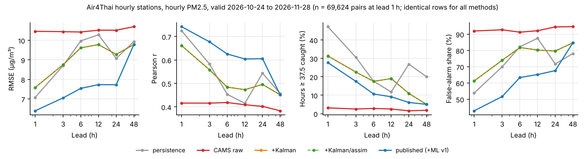
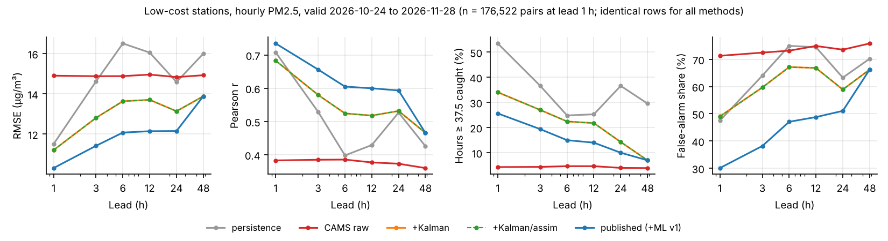
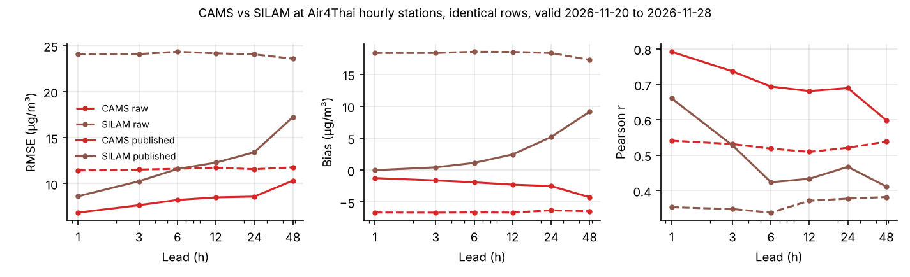
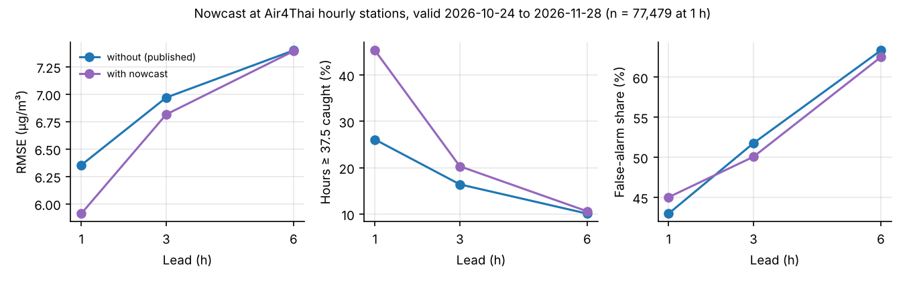
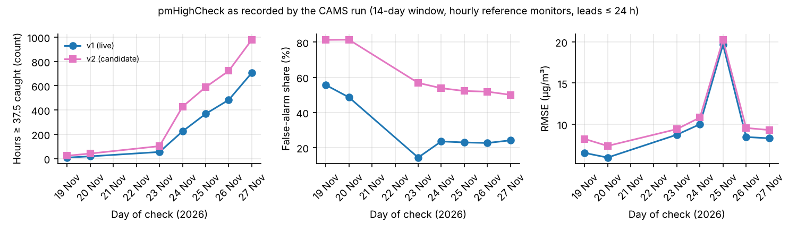
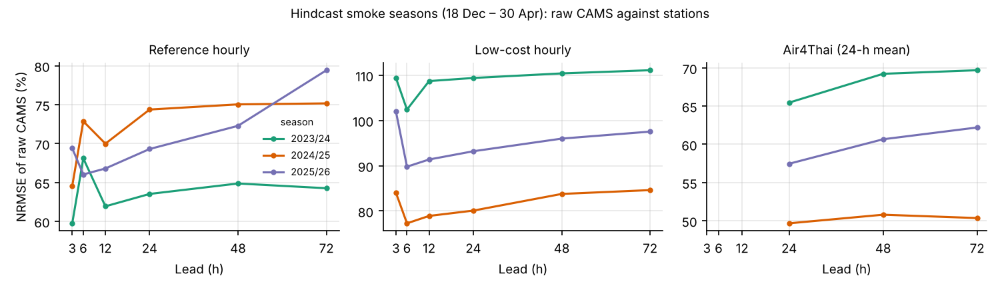
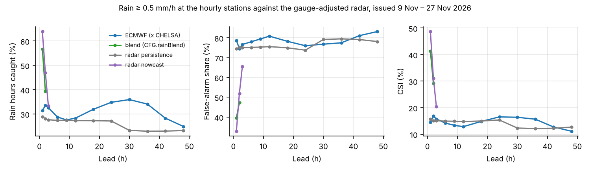
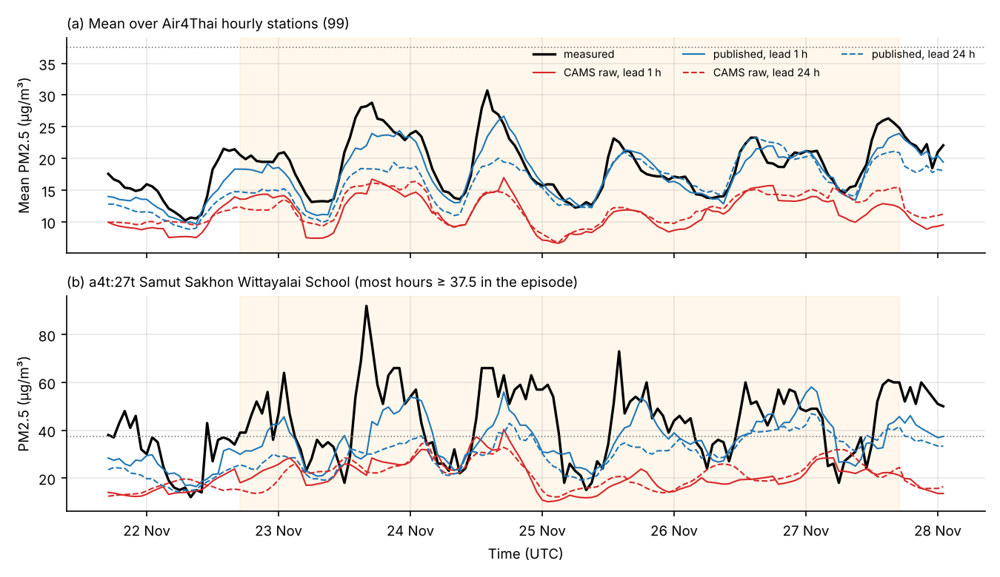
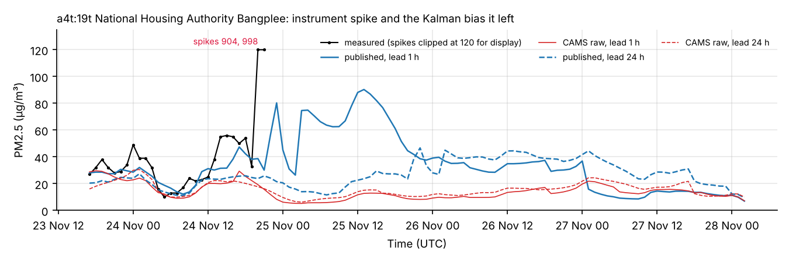

# ภาค B การประเมินผลแบบจำลอง (Model evaluation)

> ตัวเลขทุกตัวในบทนี้คำนวณใหม่จาก log ของระบบด้วยสคริปต์ใน `docs/manual/figs/` (ภาคผนวก B.ก) ตารางฉบับเต็มอยู่ใน
> `docs/manual/figs/tables/*.csv` ข้อมูลรายชั่วโมงมาจาก branch `history` (สถานะ ณ commit `bf4ceb8`, 28 พ.ย. 2026 02:11 UTC)
> และข้อมูลย้อนหลังฤดูหมอกควันมาจาก branch `hindcast` (commit `f726812`) ผลที่อ้างจากการทดสอบก่อนหน้าระบุไว้ชัดว่าเป็น
> "การทดสอบก่อนหน้า (prior test)" พร้อมช่วงเวลาที่ผู้ทดสอบระบุไว้

## B.1 การออกแบบการตรวจ (Evaluation design)

### B.1.1 ช่วงข้อมูลและสถานี

ระบบเขียน log การพยากรณ์ทุกชั่วโมงลงไฟล์ `fcst-YYYYMMDDTHH.csv` หนึ่งไฟล์ต่อหนึ่งรอบ (issue hour) โดยเก็บค่าพยากรณ์ของทุกสถานีที่
lead 1, 3, 6, 12, 24 และ 48 ชม. (`CFG.logLeads` ใน `scripts/update.mjs`) ค่าวัดจริงรายชั่วโมงอ่านจากไฟล์ `obs-*.csv` ของแต่ละรอบ
และจากคลังรายวันของ Air4Thai (`a4t-*.csv`) โดยใช้ลำดับความสำคัญและการตัด spike (spike check: ค่า > 300 µg/m³ และ > 5 เท่าของค่าสูงสุด
ใน 3 ชม. ก่อนหน้า) แบบเดียวกับ `loadObsHourly` ใน `scripts/ml2.mjs` และ `dropSpikes` ใน `scripts/obsqc.mjs`

branch `history` เก็บ log ย้อนหลัง 35 วัน ดังนั้นช่วงที่ตรวจได้จริงคือรอบที่ออกระหว่าง **24 ต.ค. 2026 00:00 ถึง 28 พ.ย. 2026 02:00 UTC**
(839 รอบ, 36 วันตามเวลา UTC) ได้แถวพยากรณ์ 2,379,072 แถว ค่าวัดรายชั่วโมง 305,756 ค่า (ถูกตัดเป็น spike 8 ค่า) และคู่พยากรณ์–ค่าวัด
1,782,985 คู่ (รวมทุก lead) ไฟล์รายเดือนรุ่นเก่า `fcst-2026-10.csv` (เฉพาะ 1 ต.ค. 2026 และมีเพียง 6 คอลัมน์) ไม่ได้นำมาใช้

สถานีแบ่งเป็น 5 กลุ่มตามรหัสและผู้ให้ข้อมูลใน `data/history/stations.json` (ตารางที่ B.1)

- **Air4Thai hourly** (รหัส `a4t:*`) สถานีอ้างอิง (reference monitor) ของกรมควบคุมมลพิษที่ส่งค่ารายชั่วโมงจริง เป็นกลุ่มหลักของการตรวจ
- **Bangkok BMA (24-h)** สถานีของกรุงเทพมหานครที่รายงานค่าเฉลี่ยเคลื่อนที่ 24 ชม. จึงตรวจด้วยค่าพยากรณ์เฉลี่ย 24 ชม. (`blend24`) แทน
- **Air4Thai via OpenAQ** สำเนาของ Air4Thai บน OpenAQ ซึ่งเป็นค่าเฉลี่ยเคลื่อนที่ 24 ชม. เช่นกัน (จับคู่ได้เพียง 2 สถานี)
- **Other reference** สถานีอ้างอิงนอกประเทศไทย ส่วนที่เป็นรายชั่วโมงและจับคู่ได้คือเครือข่ายฮานอย 2 สถานี
- **Low-cost** เซนเซอร์ราคาประหยัด (ส่วนใหญ่ AirGradient ในไทยและลาว) ค่าใน log เป็นค่าดิบของเซนเซอร์ ไม่ได้ปรับมาตรฐาน

**ตารางที่ B.1** สถานีและจำนวนคู่ข้อมูล (รอบที่ออก 24 ต.ค. 2026 00:00 – 28 พ.ย. 2026 02:00 UTC; ค่าสถิติของค่าวัดคิดที่ lead 1 ชม.)

| กลุ่ม | ฐานเวลา | สถานีใน log | สถานีที่จับคู่ได้ | คู่ทุก lead | คู่ที่ lead 1 ชม. | ค่าเฉลี่ย (µg/m³) | P99 | สูงสุด | % ชม. ≥ 37.5 |
|---|---|---|---|---|---|---|---|---|---|
| Air4Thai hourly | รายชั่วโมง | 104 | 103 | 455,869 | 77,479 | 15.4 | 47.0 | 181 | 2.8 |
| Bangkok BMA | 24 ชม. | 68 | 68 | 271,013 | 46,019 | 19.3 | 37.2 | 53 | 0.9 |
| Air4Thai via OpenAQ | 24 ชม. | 5 | 2 | 1,855 | 322 | 9.0 | 16.1 | 16 | 0.0 |
| Other reference | รายชั่วโมง/24 ชม. | 13 | 9 | 8,280 | 1,432 | 31.3 | 88.9 | 120 | 32.6 |
| Low-cost | รายชั่วโมง | 312 | 286 | 1,045,968 | 177,573 | 15.5 | 61.9 | 338 | 7.2 |

ช่วงตุลาคม–พฤศจิกายนเป็นช่วงก่อนฤดูหมอกควัน ชั่วโมงที่ค่าวัด ≥ 37.5 µg/m³ ที่สถานี Air4Thai รายชั่วโมงมีเพียงร้อยละ 2.8
จึงต้องอ่านผลเรื่องการจับชั่วโมงฝุ่นสูงด้วยความระมัดระวัง (หัวข้อ B.10)

### B.1.2 การแบ่งตาม lead และการเลือกแถว

ผลทุกตารางแยกตาม lead 1, 3, 6, 12, 24 และ 48 ชม. ซึ่งเป็น lead ทั้งหมดที่ระบบเก็บไว้ใน log (log ไม่มี lead ที่ยาวกว่า 48 ชม.
ยกเว้น `climfc-*.csv` ที่เก็บ 24–120 ชม. ทุก 3 ชม. เพื่อใช้ fit climatology blend) การเปรียบเทียบระหว่างขั้นตอนใช้ **แถวเดียวกัน
(identical rows)** เสมอ คือแถวที่มีค่าทุกขั้นและมีค่า persistence ครบ เพื่อไม่ให้ความต่างของกลุ่มตัวอย่างปนกับความต่างของวิธี

คอลัมน์ใน `fcst-*.csv` ที่ใช้เป็นขั้นตอนของการปรับแก้ (เขียนที่ `scripts/update.mjs` บรรทัด 1204–1211)

| ขั้น | คอลัมน์ | ความหมาย |
|---|---|---|
| persistence | `obs_last` | ค่าวัดล่าสุดที่รู้ ณ เวลาออกพยากรณ์ |
| CAMS raw | `cams_raw` | CAMS ที่พิกัดสถานี ไม่ปรับแก้ |
| +Kalman | `corrected` | Kalman filter บน log-ratio ของ CAMS (`kf`, `kfSlow`) |
| +Kalman/assim | `correctedA` | Kalman บน CAMS + increment จาก fire assimilation |
| ML v1 | `correctedML1` (ก่อน 17 พ.ย. ใช้ `correctedML`) | การปรับแก้ ML ที่ใช้งานจริง (ใช้ที่ lead ≤ 24 ชม.) |
| ML v2 | `correctedML2` | ตัวเลือก (candidate) ML v2 ยังไม่เผยแพร่ |
| published | `correctedML` (ถ้าว่างใช้ `correctedA`) | ค่าที่เผยแพร่ก่อน nowcast |
| nowcast | `correctedPre` / `correctedNC` | ค่าก่อนและหลัง nowcast (มีใน log ตั้งแต่ 28 พ.ย. 2026) |
| 24 ชม. | `cams24`, `corr24`, `blend24`, `blend24A` | ค่าเฉลี่ย 24 ชม. สำหรับสถานีที่รายงานค่าเฉลี่ย 24 ชม. |

Regression kriging (RK) ปรับแก้เฉพาะแผนที่ ไม่ได้ปรับค่าพยากรณ์ของสถานี จึงตรวจแยกจาก `map-*.csv` ซึ่งเก็บค่าแผนที่แบบ
leave-one-out ที่แต่ละสถานี (หัวข้อ B.3.4)

## B.2 ตัววัดผล (Verification metrics)

ให้ $F_i$ เป็นค่าพยากรณ์ $O_i$ เป็นค่าวัด ($i = 1,\dots,n$) และ $\bar O$ เป็นค่าเฉลี่ยของค่าวัด

ความเอนเอียง (bias, mean error)

$$\mathrm{Bias} = \frac{1}{n}\sum_{i=1}^{n}(F_i - O_i) \tag{B.1}$$

ความคลาดเคลื่อนสัมบูรณ์เฉลี่ย (mean absolute error, MAE)

$$\mathrm{MAE} = \frac{1}{n}\sum_{i=1}^{n}\lvert F_i - O_i\rvert \tag{B.2}$$

รากที่สองของความคลาดเคลื่อนกำลังสองเฉลี่ย (root-mean-square error, RMSE)

$$\mathrm{RMSE} = \sqrt{\frac{1}{n}\sum_{i=1}^{n}(F_i - O_i)^2} \tag{B.3}$$

RMSE ที่ปรับด้วยค่าเฉลี่ยของค่าวัด (normalised RMSE, NRMSE) ซึ่งหน้าเว็บใช้เป็น "ความแม่นยำ = 100 − NRMSE" (`scripts/accuracy.mjs`)

$$\mathrm{NRMSE} = 100\,\frac{\mathrm{RMSE}}{\bar O}\ (\%) \tag{B.4}$$

สัมประสิทธิ์สหสัมพันธ์ของเพียร์สัน (Pearson correlation coefficient, r)

$$r = \frac{\sum_i (F_i-\bar F)(O_i-\bar O)}{\sqrt{\sum_i (F_i-\bar F)^2\,\sum_i (O_i-\bar O)^2}} \tag{B.5}$$

สำหรับชั่วโมงฝุ่นสูง ใช้เกณฑ์ $T = 37.5$ µg/m³ (`ML2.thr`, `ACC.thr`) ให้ $a$ = จำนวนชั่วโมงที่ $O \ge T$ และ $F \ge T$ (จับได้, hit),
$b$ = $F \ge T$ แต่ $O < T$ (เตือนเกิน, false alarm) และ $c$ = $O \ge T$ แต่ $F < T$ (พลาด, miss)
ร้อยละของชั่วโมงสูงที่จับได้ (probability of detection, POD) และสัดส่วนการเตือนเกิน (false-alarm ratio, FAR) คือ

$$\mathrm{POD} = 100\,\frac{a}{a+c} \tag{B.6}$$

$$\mathrm{FAR} = 100\,\frac{b}{a+b} \tag{B.7}$$

FAR ในบทนี้คือสัดส่วนของการเตือนที่ไม่เกิดจริง ตรงกับ `highScore` ใน `scripts/ml2.mjs` และ `pmNowCheck` ใน `scripts/pmnow.mjs`

ความถูกต้องของระดับสี (colour-band hit rate) ใช้ขอบระดับสีของไทย 15 / 25 / 37.5 / 75 µg/m³ (`ACC.bands`) โดย $k(v)$ คือจำนวนขอบที่ $v$
มากกว่า (`band` ใน `scripts/accuracy.mjs`)

$$\mathrm{Band} = \frac{100}{n}\sum_{i=1}^{n}\mathbf{1}\left[k(F_i) = k(O_i)\right] \tag{B.8}$$

ทักษะเทียบกับแบบอ้างอิง (skill score) ใช้แบบ MSE skill score โดยแบบอ้างอิงคือ persistence (SS<sub>pers</sub>) หรือ CAMS ดิบ (SS<sub>raw</sub>)
ค่าบวกแปลว่าดีกว่าแบบอ้างอิง

$$\mathrm{SS} = 100\left(1 - \frac{\mathrm{MSE}}{\mathrm{MSE}_{\mathrm{ref}}}\right) = 100\left(1 - \frac{\mathrm{RMSE}^2}{\mathrm{RMSE}_{\mathrm{ref}}^2}\right) \tag{B.9}$$

สำหรับฝน ใช้เกณฑ์ชั่วโมงฝน ≥ 0.5 มม./ชม. (`fit_rain_blend.py`, `obsRainCheck`) โดยใช้ POD (B.6), FAR (B.7) และ critical success index

$$\mathrm{CSI} = 100\,\frac{a}{a+b+c} \tag{B.10}$$

พร้อม frequency bias $= (a+b)/(a+c)$ (มากกว่า 1 คือพยากรณ์ฝนบ่อยเกินจริง) ไม่ตัดสินจาก error บน $\ln(R+0.2)$ เพียงอย่างเดียว เพราะ error นี้ลดลงได้ด้วยการพยากรณ์ฝนน้อยลงทุกที่

## B.3 ผลแบบสะสมทีละขั้น (Incremental results)

### B.3.1 สถานี Air4Thai รายชั่วโมง

**ตารางที่ B.2** ผลทีละขั้นที่สถานี Air4Thai รายชั่วโมง 103 สถานี ค่าพยากรณ์ที่ valid 24 ต.ค. 2026 01:00 – 28 พ.ย. 2026 01:00 UTC
(n = 69,624 / 69,466 / 68,891 / 68,613 / 67,244 / 64,792 คู่ที่ lead 1 / 3 / 6 / 12 / 24 / 48 ชม.; ชั่วโมงที่ค่าวัด ≥ 37.5 = 2,048 / 2,038 / 2,060 / 2,080 / 2,017 / 1,987)
หน่วยของ bias, MAE, RMSE คือ µg/m³; NRMSE, POD, FAR, Band, SS เป็นร้อยละ

| lead (ชม.) | ขั้น | Bias | MAE | RMSE | NRMSE | r | POD | FAR | Band | SS<sub>pers</sub> | SS<sub>raw</sub> |
|---|---|---|---|---|---|---|---|---|---|---|---|
| 1 | persistence | 0.07 | 4.54 | 7.08 | 45 | 0.72 | 47 | 54 | 69 | 0 | 54 |
| 1 | CAMS raw | -4.46 | 7.52 | 10.46 | 67 | 0.42 | 3 | 92 | 60 | -118 | 0 |
| 1 | +Kalman | -0.55 | 5.15 | 7.58 | 49 | 0.66 | 31 | 61 | 65 | -15 | 47 |
| 1 | published (+ML v1) | -0.67 | 4.27 | 6.39 | 41 | 0.74 | 28 | 43 | 69 | 18 | 63 |
| 3 | persistence | 0.04 | 5.73 | 8.71 | 56 | 0.58 | 31 | 70 | 63 | 0 | 30 |
| 3 | CAMS raw | -4.48 | 7.50 | 10.44 | 67 | 0.42 | 3 | 93 | 60 | -44 | 0 |
| 3 | +Kalman | -0.65 | 6.00 | 8.76 | 56 | 0.56 | 23 | 74 | 61 | -1 | 30 |
| 3 | published (+ML v1) | -0.83 | 4.73 | 7.05 | 45 | 0.68 | 18 | 52 | 66 | 34 | 54 |
| 6 | persistence | -0.02 | 6.68 | 9.97 | 64 | 0.45 | 18 | 82 | 58 | 0 | 8 |
| 6 | CAMS raw | -4.49 | 7.51 | 10.43 | 67 | 0.42 | 3 | 91 | 60 | -9 | 0 |
| 6 | +Kalman | -0.79 | 6.64 | 9.62 | 62 | 0.48 | 18 | 82 | 59 | 7 | 15 |
| 6 | published (+ML v1) | -0.93 | 5.10 | 7.54 | 48 | 0.63 | 11 | 63 | 64 | 43 | 48 |
| 12 | persistence | -0.16 | 6.94 | 10.28 | 66 | 0.41 | 12 | 87 | 57 | 0 | 4 |
| 12 | CAMS raw | -4.53 | 7.60 | 10.52 | 67 | 0.41 | 2 | 92 | 60 | -5 | 0 |
| 12 | +Kalman | -1.25 | 6.80 | 9.78 | 62 | 0.47 | 19 | 80 | 59 | 10 | 14 |
| 12 | published (+ML v1) | -1.03 | 5.26 | 7.73 | 49 | 0.60 | 9 | 65 | 63 | 43 | 46 |
| 24 | persistence | -0.06 | 6.06 | 9.07 | 58 | 0.54 | 27 | 72 | 61 | 0 | 26 |
| 24 | CAMS raw | -4.38 | 7.52 | 10.52 | 68 | 0.40 | 2 | 94 | 60 | -34 | 0 |
| 24 | +Kalman | -2.07 | 6.43 | 9.28 | 60 | 0.50 | 11 | 80 | 61 | -5 | 22 |
| 24 | published (+ML v1) | -1.16 | 5.21 | 7.73 | 50 | 0.61 | 6 | 68 | 64 | 27 | 46 |
| 48 | persistence | -0.21 | 6.73 | 9.94 | 64 | 0.46 | 20 | 78 | 58 | 0 | 14 |
| 48 | CAMS raw | -4.41 | 7.64 | 10.70 | 69 | 0.38 | 2 | 95 | 59 | -16 | 0 |
| 48 | +Kalman | -3.14 | 6.88 | 9.78 | 63 | 0.45 | 5 | 85 | 60 | 3 | 16 |
| 48 | published (+ML v1) | -3.14 | 6.88 | 9.78 | 63 | 0.45 | 5 | 85 | 60 | 3 | 16 |

หมายเหตุ: ขั้น +Kalman/assim ให้ค่าเท่ากับ +Kalman แทบทุกแถว (ความต่างสัมบูรณ์เฉลี่ยของ `correctedA` กับ `corrected` เท่ากับ 0.002 µg/m³
ทั้ง log) จึงไม่แสดงแยก ตารางเต็มอยู่ที่ `tables/B_incr_air4thai.csv` ที่ lead 48 ชม. ML v1 ไม่ทำงาน (`MLCFG.applyMaxLeadH = 24`) ค่าที่เผยแพร่จึงเท่ากับ +Kalman



**รูปที่ B.1** RMSE, r, POD และ FAR ตาม lead ของแต่ละขั้นที่สถานี Air4Thai รายชั่วโมง (แถวเดียวกับตารางที่ B.2)

ผลหลักจากตารางที่ B.2 และรูปที่ B.1

1. **CAMS ดิบต่ำกว่าค่าจริงอย่างสม่ำเสมอ** (bias ประมาณ −4.4 ถึง −4.5 µg/m³ เมื่อค่าวัดเฉลี่ย 15.6 µg/m³) และแทบไม่จับชั่วโมงฝุ่นสูงเลย
   (POD 2–3 % โดยการเตือนที่ออกไปเกิดจริงเพียง 5–9 %) r อยู่ที่ 0.38–0.42 และแทบไม่เปลี่ยนตาม lead เพราะความคลาดเคลื่อนหลักเป็นความคลาดเคลื่อนเชิงระบบ ไม่ใช่ความคลาดเคลื่อนจากการพยากรณ์ล่วงหน้า
2. **Kalman filter ลดความเอนเอียงได้มากที่ lead สั้น** (bias −0.55 ที่ 1 ชม.) แต่ผลลดลงตาม lead (−3.14 ที่ 48 ชม.) สอดคล้องกับการลดน้ำหนักของ bias ตาม `biasLeadEfoldH`
   Kalman เพียงอย่างเดียวยังแพ้ persistence ที่ lead 1–3 ชม. (SS<sub>pers</sub> −15 และ −1)
3. **ML v1 ลด RMSE ต่อจาก Kalman ทุก lead ≤ 24 ชม.** (6.39 เทียบ 7.58 ที่ 1 ชม., 7.73 เทียบ 9.28 ที่ 24 ชม.) และทำให้ค่าที่เผยแพร่ดีกว่า persistence ทุก lead
   (SS<sub>pers</sub> 18–43 %) ดีกว่า CAMS ดิบ 46–63 % (SS<sub>raw</sub>) ที่ lead ≤ 24 ชม.
4. **แต่ ML v1 จับชั่วโมงฝุ่นสูงได้น้อยกว่า Kalman** (POD 28 เทียบ 31 % ที่ 1 ชม.; 6 เทียบ 11 % ที่ 24 ชม.) แลกกับ FAR ที่ต่ำลง (43 เทียบ 61 % ที่ 1 ชม.)
   นี่คือปัญหาที่ทำให้พัฒนา ML v2 (หัวข้อ B.6): การเรียนรู้บน $\ln(\mathrm{PM}+1)$ ให้ค่ามัธยฐาน จึงดึงค่าสูงลง
5. ที่ lead 24 ชม. persistence (ค่าเดียวกันเมื่อวาน ณ ชั่วโมงเดียวกันโดยประมาณ) จับชั่วโมงสูงได้ 27 % มากกว่าค่าที่เผยแพร่ (6 %) แสดงว่าชั่วโมงฝุ่นสูงในช่วงนี้มีรูปแบบรายวันที่ซ้ำ ซึ่ง ML v1 ยังไม่ใช้

### B.3.2 เซนเซอร์ราคาประหยัดและสถานีอ้างอิงฮานอย

**ตารางที่ B.3** ผลทีละขั้นที่เซนเซอร์ราคาประหยัด 282 ตัว (valid 24 ต.ค. 2026 01:00 – 28 พ.ย. 2026 01:00 UTC; n = 176,522 / 174,106 / 169,724 / 163,251
ที่ lead 1 / 6 / 24 / 48 ชม.; ชั่วโมง ≥ 37.5 = 12,657 / 12,504 / 12,070 / 11,647) ค่าวัดเป็นค่าดิบของเซนเซอร์

| lead | ขั้น | Bias | RMSE | r | POD | FAR | Band | SS<sub>pers</sub> | SS<sub>raw</sub> |
|---|---|---|---|---|---|---|---|---|---|
| 1 | persistence | 0.22 | 11.50 | 0.71 | 53 | 47 | 69 | 0 | 40 |
| 1 | CAMS raw | -5.17 | 14.90 | 0.38 | 4 | 71 | 57 | -68 | 0 |
| 1 | +Kalman | -1.40 | 11.20 | 0.68 | 34 | 49 | 65 | 5 | 43 |
| 1 | published (+ML v1) | -1.77 | 10.31 | 0.73 | 26 | 30 | 68 | 20 | 52 |
| 6 | persistence | 0.09 | 16.50 | 0.40 | 25 | 75 | 54 | 0 | -23 |
| 6 | CAMS raw | -5.11 | 14.88 | 0.39 | 5 | 73 | 57 | 19 | 0 |
| 6 | +Kalman | -1.86 | 13.63 | 0.52 | 22 | 67 | 59 | 32 | 16 |
| 6 | published (+ML v1) | -2.07 | 12.07 | 0.60 | 15 | 47 | 61 | 46 | 34 |
| 24 | persistence | 0.22 | 14.59 | 0.53 | 37 | 63 | 57 | 0 | 3 |
| 24 | CAMS raw | -4.83 | 14.83 | 0.37 | 4 | 74 | 57 | -3 | 0 |
| 24 | +Kalman | -3.19 | 13.14 | 0.53 | 14 | 59 | 60 | 19 | 22 |
| 24 | published (+ML v1) | -2.16 | 12.15 | 0.59 | 10 | 51 | 61 | 31 | 33 |
| 48 | persistence | 0.16 | 16.00 | 0.43 | 30 | 70 | 53 | 0 | -15 |
| 48 | CAMS raw | -4.60 | 14.92 | 0.36 | 4 | 76 | 57 | 13 | 0 |
| 48 | +Kalman | -3.94 | 13.88 | 0.47 | 7 | 66 | 59 | 25 | 13 |
| 48 | published (+ML v1) | -3.94 | 13.88 | 0.47 | 7 | 66 | 59 | 25 | 13 |



**รูปที่ B.2** ตัววัดผลตาม lead ที่เซนเซอร์ราคาประหยัด (แถวเดียวกับตารางที่ B.3 ทุก lead; ตารางเต็ม `tables/B_incr_lowcost.csv`)

ลำดับของขั้นเหมือนกับที่ Air4Thai แต่ค่าความคลาดเคลื่อนสูงกว่า (NRMSE ของค่าเผยแพร่ 66–90 % เทียบกับ 41–63 %) เนื่องจากเซนเซอร์มีความแปรปรวนสูงและ
ค่าเกิน 37.5 บ่อยกว่า (7.2 % ของชั่วโมง) ข้อควรระวังคือ Kalman และ ML ของเซนเซอร์แต่ละตัวเรียนจากค่าของเซนเซอร์ตัวนั้นเอง ผลนี้จึงเป็นความใกล้เคียงกับค่าที่เซนเซอร์อ่าน ไม่ใช่ความใกล้เคียงกับค่าจริง

**ตารางที่ B.4** สถานีอ้างอิงรายชั่วโมงของเครือข่ายฮานอย 2 สถานี (valid 24 ต.ค. 2026 01:00 – 28 พ.ย. 2026 02:00 UTC; n = 1,348 / 1,329 / 1,305 / 1,258 ที่ lead 1 / 6 / 24 / 48 ชม.;
ชั่วโมง ≥ 37.5 = 465 / 460 / 456 / 433)

| lead | ขั้น | Bias | RMSE | r | POD | FAR | Band | SS<sub>pers</sub> | SS<sub>raw</sub> |
|---|---|---|---|---|---|---|---|---|---|
| 1 | persistence | -0.20 | 12.70 | 0.80 | 78 | 21 | 56 | 0 | 74 |
| 1 | CAMS raw | 5.28 | 24.99 | 0.44 | 55 | 43 | 32 | -287 | 0 |
| 1 | +Kalman | -2.54 | 18.80 | 0.52 | 55 | 33 | 40 | -119 | 43 |
| 1 | published (+ML v1) | -6.78 | 17.19 | 0.62 | 42 | 23 | 40 | -83 | 53 |
| 6 | CAMS raw | 6.23 | 25.81 | 0.44 | 58 | 43 | 31 | -105 | 0 |
| 6 | +Kalman | 1.69 | 29.25 | 0.30 | 50 | 45 | 32 | -163 | -28 |
| 6 | published (+ML v1) | -5.48 | 19.73 | 0.46 | 40 | 33 | 36 | -20 | 42 |
| 24 | CAMS raw | 7.52 | 26.53 | 0.44 | 62 | 42 | 32 | -59 | 0 |
| 24 | +Kalman | 2.12 | 23.23 | 0.42 | 58 | 40 | 36 | -22 | 23 |
| 24 | published (+ML v1) | -4.99 | 19.09 | 0.47 | 42 | 34 | 36 | 18 | 48 |
| 48 | CAMS raw | 10.89 | 28.82 | 0.44 | 71 | 46 | 30 | -45 | 0 |
| 48 | published (= +Kalman) | 8.56 | 27.96 | 0.45 | 69 | 41 | 32 | -36 | 6 |

ที่ฮานอยซึ่งระดับฝุ่นสูงกว่ามาก (ค่าเฉลี่ย 32.4 µg/m³, 35 % ของชั่วโมงเกิน 37.5) CAMS ดิบสูงกว่าค่าจริงเล็กน้อยแทนที่จะต่ำกว่า
Kalman ที่ lead 6–12 ชม. ทำให้แย่ลง (SS<sub>raw</sub> −28 % ที่ 6 ชม.) ส่วน ML v1 ลด RMSE ได้แต่ทำให้ bias ติดลบ (−4 ถึง −7 µg/m³ ที่ lead 1–24 ชม.) และ POD ลดจาก 55–62 % เหลือ 40–42 %
จำนวนสถานีมีเพียง 2 สถานี ผลนี้จึงใช้เป็นข้อสังเกตเท่านั้น

### B.3.3 สถานีที่รายงานค่าเฉลี่ย 24 ชม.

**ตารางที่ B.5** ห่วงโซ่ค่าเฉลี่ย 24 ชม. ที่สถานี BMA และสำเนา OpenAQ รวม 75 สถานี (valid 24 ต.ค. 2026 01:00 – 28 พ.ย. 2026 02:00 UTC)
ค่าวัดคือค่าเฉลี่ย 24 ชม. ที่สถานีรายงาน ML ไม่ได้ใช้กับสถานีกลุ่มนี้ (`blend24ML` ว่าง) และ fire assimilation ไม่เปลี่ยนค่า (`blend24A` = `blend24`)

| lead | ขั้น | n | Bias | MAE | RMSE | NRMSE | r | Band | SS<sub>raw</sub> |
|---|---|---|---|---|---|---|---|---|---|
| 1 | CAMS raw 24 ชม. | 46,416 | 0.90 | 5.86 | 7.59 | 39 | 0.46 | 50 | 0 |
| 1 | +Kalman 24 ชม. | 46,416 | 0.10 | 3.17 | 4.19 | 22 | 0.83 | 70 | 69 |
| 1 | blend24 (เผยแพร่) | 46,416 | 0.00 | 0.46 | 0.71 | 4 | 0.99 | 96 | 99 |
| 6 | CAMS raw 24 ชม. | 46,157 | 0.66 | 5.85 | 7.60 | 40 | 0.43 | 51 | 0 |
| 6 | blend24 (เผยแพร่) | 46,157 | 0.02 | 1.66 | 2.27 | 12 | 0.94 | 84 | 91 |
| 24 | CAMS raw 24 ชม. | 44,965 | -0.03 | 5.58 | 7.17 | 37 | 0.40 | 49 | 0 |
| 24 | +Kalman 24 ชม. | 44,965 | -0.44 | 4.43 | 5.83 | 30 | 0.63 | 60 | 34 |
| 24 | blend24 (เผยแพร่) | 44,965 | -0.11 | 3.74 | 4.85 | 25 | 0.69 | 64 | 54 |
| 48 | CAMS raw 24 ชม. | 43,488 | -0.16 | 5.91 | 7.94 | 41 | 0.23 | 50 | 0 |
| 48 | +Kalman 24 ชม. | 43,488 | -0.48 | 4.93 | 6.83 | 35 | 0.43 | 57 | 26 |
| 48 | blend24 (เผยแพร่) | 43,488 | -0.26 | 4.23 | 5.53 | 29 | 0.59 | 59 | 52 |

ที่ lead สั้น ค่าเฉลี่ย 24 ชม. ที่สิ้นสุด ณ เวลาที่พยากรณ์ประกอบด้วยชั่วโมงที่วัดแล้วเกือบทั้งหมด (23 ใน 24 ชม. ที่ lead 1 ชม.) ผลที่ lead 1–12 ชม. จึงสูงเกินจริง
ตัวเลขที่มีความหมายคือที่ lead 24 และ 48 ชม. ซึ่งเป็นสองค่าที่ `scripts/accuracy.mjs` ใช้ ที่ lead 24 ชม. ค่าที่เผยแพร่ลด RMSE จาก 7.17 เป็น 4.85 µg/m³ (SS<sub>raw</sub> 54 %)

### B.3.4 แผนที่ regression kriging

**ตารางที่ B.6** ค่าเฉลี่ย 24 ชม. ที่เวลาวิเคราะห์ (lead 0) จาก `map-*.csv` แผนที่ RK แบบ leave-one-out เทียบกับ CAMS ดิบที่จุดเดียวกัน
(รอบ 24 ต.ค. 2026 00:00 – 28 พ.ย. 2026 02:00 UTC; `map` = RK บน CAMS, `mapA` = RK บน CAMS + assimilation increment) ค่าวัดของเซนเซอร์ราคาประหยัดถูกแปลงสู่มาตรฐานอ้างอิงด้วย `scaleLowcost` ก่อนเข้า kriging

| รุ่น | จุด | วิธี | รอบ | จุด | n | ค่าวัดเฉลี่ย | Bias | RMSE | NRMSE | r | Band |
|---|---|---|---|---|---|---|---|---|---|---|---|
| map | อ้างอิง | CAMS raw 24 ชม. | 839 | 179 | 130,004 | 17.3 | -1.68 | 7.74 | 45 | 0.60 | 55 |
| map | อ้างอิง | RK (leave-one-out) | 839 | 179 | 130,004 | 17.3 | -1.41 | 5.45 | 31 | 0.76 | 66 |
| map | ราคาประหยัด | CAMS raw 24 ชม. | 839 | 246 | 172,803 | 12.2 | -1.33 | 8.44 | 69 | 0.56 | 66 |
| map | ราคาประหยัด | RK (leave-one-out) | 839 | 246 | 172,803 | 12.2 | -0.05 | 5.16 | 42 | 0.85 | 78 |
| mapA | อ้างอิง | CAMS raw 24 ชม. | 497 | 178 | 76,501 | 18.3 | -1.99 | 8.31 | 45 | 0.56 | 51 |
| mapA | อ้างอิง | RK (leave-one-out) | 497 | 178 | 76,501 | 18.3 | -1.15 | 5.45 | 30 | 0.76 | 65 |

การตรวจแบบ leave-one-out เป็นการตรวจที่ไม่ใช้ค่าของสถานีที่ถูกตรวจ แผนที่ RK ลด RMSE ที่สถานีอ้างอิงจาก 7.74 เป็น 5.45 µg/m³ (−30 %) และเพิ่ม r จาก 0.60 เป็น 0.76
ผลของ `mapA` แทบเท่ากับ `map` อีกครั้งเพราะ increment ของ fire assimilation แทบเป็นศูนย์ในช่วงนี้

## B.4 CAMS เทียบกับ SILAM

**ตารางที่ B.7** CAMS เทียบ SILAM บนแถวเดียวกัน (สถานี รอบ และ lead เดียวกัน) รอบที่ออก 20 พ.ย. 2026 22:00 – 28 พ.ย. 2026 01:00 UTC
(valid 20 พ.ย. 23:00 – 28 พ.ย. 02:00 UTC; สถานี Air4Thai รายชั่วโมง 100 สถานี, เซนเซอร์ราคาประหยัด 267 ตัว) ทั้งสองโมเดลผ่านห่วงโซ่การปรับแก้ชุดเดียวกัน (`silam_chain.mjs`)

| กลุ่ม | lead | วิธี | n | Bias | RMSE | NRMSE | r | POD | FAR | Band |
|---|---|---|---|---|---|---|---|---|---|---|
| Air4Thai | 1 | CAMS raw | 15,789 | -6.64 | 11.44 | 65 | 0.54 | 1 | 45 | 56 |
| Air4Thai | 1 | SILAM raw | 15,789 | 18.34 | 24.05 | 137 | 0.35 | 72 | 92 | 19 |
| Air4Thai | 1 | CAMS published | 15,789 | -1.26 | 6.86 | 39 | 0.79 | 31 | 26 | 68 |
| Air4Thai | 1 | SILAM published | 15,789 | -0.02 | 8.63 | 49 | 0.66 | 34 | 54 | 60 |
| Air4Thai | 6 | CAMS published | 15,291 | -1.92 | 8.23 | 46 | 0.69 | 10 | 32 | 62 |
| Air4Thai | 6 | SILAM published | 15,291 | 1.13 | 11.60 | 65 | 0.42 | 16 | 84 | 48 |
| Air4Thai | 24 | CAMS raw | 13,603 | -6.31 | 11.57 | 63 | 0.52 | 0 | 100 | 53 |
| Air4Thai | 24 | SILAM raw | 13,603 | 18.34 | 24.05 | 132 | 0.38 | 76 | 91 | 19 |
| Air4Thai | 24 | CAMS published | 13,603 | -2.51 | 8.60 | 47 | 0.69 | 7 | 17 | 61 |
| Air4Thai | 24 | SILAM published | 13,603 | 5.18 | 13.42 | 73 | 0.47 | 37 | 82 | 43 |
| Air4Thai | 48 | CAMS published | 11,367 | -4.26 | 10.33 | 55 | 0.60 | 5 | 63 | 56 |
| Air4Thai | 48 | SILAM published | 11,367 | 9.14 | 17.24 | 92 | 0.41 | 48 | 87 | 34 |
| Low-cost | 1 | CAMS published | 28,133 | -2.24 | 10.87 | 65 | 0.76 | 23 | 25 | 67 |
| Low-cost | 1 | SILAM published | 28,133 | -0.86 | 12.29 | 74 | 0.67 | 31 | 53 | 62 |
| Low-cost | 24 | CAMS published | 24,139 | -3.59 | 13.22 | 76 | 0.65 | 6 | 44 | 58 |
| Low-cost | 24 | SILAM published | 24,139 | 1.35 | 15.17 | 87 | 0.51 | 29 | 69 | 52 |



**รูปที่ B.3** RMSE, bias และ r ของ CAMS และ SILAM ทั้งค่าดิบ (เส้นประ) และค่าที่ผ่านการปรับแก้ (เส้นทึบ) ที่สถานี Air4Thai รายชั่วโมง

SILAM ดิบสูงกว่าค่าจริงมาก (bias +17 ถึง +18 µg/m³, RMSE ราว 24 µg/m³ เป็นสองเท่าของ CAMS ดิบ) การปรับแก้ลดความคลาดเคลื่อนของ SILAM ได้มาก
แต่ที่ทุก lead ค่า SILAM ที่ผ่านการปรับแก้ยังมี RMSE สูงกว่าและ r ต่ำกว่า CAMS ที่ผ่านการปรับแก้ SILAM จับชั่วโมงฝุ่นสูงได้มากกว่า (POD 16–48 % เทียบ 5–31 % ที่ lead 1–48 ชม.)
แต่การเตือนส่วนใหญ่ไม่เกิดจริง (FAR 54–87 %) ผลในช่วง 7 วันนี้จึงสนับสนุนการคง CAMS เป็นค่าเริ่มต้นของหน้าเว็บ ตามกฎของโครงการที่ให้เปลี่ยนเมื่อ log แสดงว่า SILAM ดีอย่างน้อยเท่า CAMS
ช่วงข้อมูลยังสั้น (7 วันในฤดูก่อนหมอกควัน) จึงยังไม่พอสรุปสำหรับฤดูหมอกควัน

## B.5 Nowcast ระยะสั้น 1–6 ชม.

Nowcast (`scripts/pmnow.mjs`) นำ error ของชั่วโมงที่วัดล่าสุดมาปรับค่าพยากรณ์ที่ lead $L$ ≤ 6 ชม. ด้วย

$$F^{\mathrm{nc}}_L = (F_L + 1)\exp\!\left[e^{-L/\tau}\,\varepsilon\right] - 1,\qquad \varepsilon = \mathrm{clip}\!\left(\ln(O_0+1) - \ln(F_0+1),\ \pm 1.5\right),\ \tau = 2\ \text{ชม.} \tag{B.11}$$

โดย $O_0$ คือค่าวัดล่าสุดและ $F_0$ คือค่าพยากรณ์ที่รอบก่อนหน้าทำไว้สำหรับชั่วโมงนั้น คอลัมน์ `correctedPre` / `correctedNC` เริ่มมีใน log ตั้งแต่ 28 พ.ย. 2026 01:00 UTC
(594 แถวที่สถานีอ้างอิงรายชั่วโมงและ lead ≤ 6 ชม. ซึ่งยังไม่มีค่าวัดมาตรวจ ณ เวลาที่ตัดข้อมูล) ดังนั้นแถวที่ตรวจได้ทั้งหมดถูกสร้างใหม่ (rebuilt) แบบเดียวกับที่ `pmNowCheck` ทำ:
ค่าก่อน nowcast = `correctedML` และ error ล่าสุด = ค่าวัดของชั่วโมงที่สิ้นสุด ณ เวลาออก − 1 ชม. เทียบกับพยากรณ์ lead 1 ชม. ของรอบที่ออกก่อนหน้า 2 ชม.
แถวที่มี error ให้ใช้มีร้อยละ 97

**ตารางที่ B.8** Nowcast ตาม lead (valid 24 ต.ค. 2026 01:00 – 28 พ.ย. 2026 02:00 UTC; สถานี Air4Thai รายชั่วโมง 103 สถานี, สถานีอ้างอิงรายชั่วโมงทั้งหมด 107 สถานี)

| ชุด | lead | วิธี | n | Bias | MAE | RMSE | r | ชม. ≥ 37.5 | จับได้ | POD | เตือน | FAR | Band |
|---|---|---|---|---|---|---|---|---|---|---|---|---|---|
| Air4Thai | 1 | ไม่มี nowcast (เผยแพร่) | 77,479 | -0.65 | 4.25 | 6.35 | 0.74 | 2,175 | 567 | 26 | 994 | 43 | 70 |
| Air4Thai | 1 | มี nowcast | 77,479 | -0.23 | 3.81 | 5.91 | 0.79 | 2,175 | 985 | 45 | 1,791 | 45 | 73 |
| Air4Thai | 3 | ไม่มี nowcast (เผยแพร่) | 77,264 | -0.81 | 4.67 | 6.97 | 0.68 | 2,179 | 357 | 16 | 740 | 52 | 67 |
| Air4Thai | 3 | มี nowcast | 77,264 | -0.74 | 4.55 | 6.81 | 0.69 | 2,179 | 442 | 20 | 885 | 50 | 68 |
| Air4Thai | 6 | ไม่มี nowcast (เผยแพร่) | 76,942 | -0.93 | 4.99 | 7.40 | 0.63 | 2,183 | 220 | 10 | 600 | 63 | 65 |
| Air4Thai | 6 | มี nowcast | 76,942 | -0.92 | 4.99 | 7.39 | 0.63 | 2,183 | 231 | 11 | 616 | 62 | 65 |
| อ้างอิงทั้งหมด | 1 | ไม่มี nowcast (เผยแพร่) | 78,836 | -0.76 | 4.39 | 6.69 | 0.74 | 2,642 | 763 | 29 | 1,248 | 39 | 70 |
| อ้างอิงทั้งหมด | 1 | มี nowcast | 78,836 | -0.27 | 3.96 | 6.28 | 0.78 | 2,642 | 1,260 | 48 | 2,190 | 42 | 73 |
| อ้างอิงทั้งหมด | 3 | ไม่มี nowcast (เผยแพร่) | 78,617 | -0.91 | 4.86 | 7.42 | 0.67 | 2,646 | 525 | 20 | 992 | 47 | 67 |
| อ้างอิงทั้งหมด | 3 | มี nowcast | 78,617 | -0.82 | 4.74 | 7.30 | 0.69 | 2,646 | 628 | 24 | 1,181 | 47 | 68 |
| อ้างอิงทั้งหมด | 6 | ไม่มี nowcast (เผยแพร่) | 78,290 | -1.01 | 5.16 | 7.78 | 0.64 | 2,647 | 402 | 15 | 872 | 54 | 65 |
| อ้างอิงทั้งหมด | 6 | มี nowcast | 78,290 | -0.99 | 5.15 | 7.78 | 0.64 | 2,647 | 414 | 16 | 896 | 54 | 65 |



**รูปที่ B.4** RMSE, POD และ FAR ของค่าที่เผยแพร่ก่อนและหลัง nowcast ที่สถานี Air4Thai รายชั่วโมง

Nowcast ให้ผลชัดที่ lead 1 ชม. (POD 26 → 45 %, RMSE 6.35 → 5.91 µg/m³, FAR เพิ่มเล็กน้อย 43 → 45 %) ผลลดลงที่ 3 ชม. และแทบเป็นศูนย์ที่ 6 ชม.
ตามค่า $e^{-L/\tau}$ (0.61, 0.22 และ 0.05 ที่ 1, 3 และ 6 ชม.)

**สถานะของประตู (gate)** state ของระบบ (`state.pmNow.check`) ไม่ได้ถูกเก็บใน git และ log รายวัน `ml-YYYYMMDD.json` ถึงวันที่ 27 พ.ย. 2026 ยังไม่มีคีย์ `nowcast`
จึง**ยังไม่มีการตัดสินของประตูที่บันทึกไว้** ตารางที่ B.9 คำนวณการตรวจแบบ `pmNowCheck` ซ้ำจาก log (14 วันก่อนเที่ยงคืนเวลาไทยของ 28 พ.ย. 2026, lead 1–6 ชม. รวมกัน)
เป็นค่าที่ประตูน่าจะเห็น ไม่ใช่ค่าที่ระบบบันทึก

**ตารางที่ B.9** การตรวจของประตู nowcast ที่คำนวณซ้ำ (valid 13 พ.ย. 2026 17:00 – 27 พ.ย. 2026 16:00 UTC, สถานีอ้างอิงรายชั่วโมง)

| n | ชม. ≥ 37.5 | จับได้ (ไม่มี / มี nowcast) | FAR % (ไม่มี / มี) | RMSE (ไม่มี / มี) | ข้อมูลพอตัดสิน | ผ่านเกณฑ์ |
|---|---|---|---|---|---|---|
| 96,171 | 5,154 | 1,270 / 1,648 | 48.8 / 47.3 | 7.992 / 7.829 | ใช่ (n ≥ 20,000, ชม. สูง ≥ 50) | ผ่าน (จับได้มากกว่า, FAR ไม่มากกว่า, RMSE ไม่มากกว่า) |

**การทดสอบก่อนหน้า (prior test)** ที่บันทึกใน `scripts/pmnow.mjs` และ README: Air4Thai รายชั่วโมง 16–27 พ.ย. 2026 ที่ lead 1 ชม. จับชั่วโมงสูงได้ 31 → 52 %,
FAR 42 → 42 %, RMSE 6.93 → 6.58 เมื่อคำนวณซ้ำจาก log ในช่วงเดียวกัน (valid 15 พ.ย. 17:00 – 27 พ.ย. 16:00 UTC, n = 27,061, ชั่วโมงสูง 1,203)
ได้ POD 30 → 51 %, FAR 42 → 43 %, RMSE 6.95 → 6.57 µg/m³ และที่ lead 3 ชม. POD 19 → 23 %, FAR 50 → 49 %, RMSE 7.71 → 7.54 (`tables/B_nowcast_prior.csv`)
ใกล้เคียงกับการทดสอบก่อนหน้าภายใน 1 จุดร้อยละ ความต่างเล็กน้อยน่าจะมาจากการสร้างแถวใหม่และขอบเขตเวลา

**ผลลบ (negative result)** การทดลองใช้ regression กับตัวแปร ECMWF สำหรับ nowcast ไม่ผ่านการทดสอบเพราะน้ำหนักไม่เสถียร (รายงานโดยผู้พัฒนา)
ไม่มีโค้ดหรือ log ของการทดลองนี้ใน repository จึงคำนวณซ้ำไม่ได้ (ดู `ISSUES_B.md`)

## B.6 ML v1 เทียบ ML v2

ML v2 (`scripts/ml2.mjs`) เป็นตัวเลือกที่คำนวณคู่กับ ML v1 ทุกชั่วโมงแต่ยังไม่เผยแพร่ ประตู `pmHighCheck` จะเปิดใช้ v2 เมื่อใน 14 วันล่าสุด ที่สถานีอ้างอิงรายชั่วโมงและ lead ≤ 24 ชม.
v2 จับชั่วโมง ≥ 37.5 ได้ไม่น้อยกว่า, FAR ไม่มากกว่า และ RMSE ไม่มากกว่า v1 และต้องมีข้อมูลอย่างน้อย 20,000 แถวและชั่วโมงสูง 100 ชั่วโมง (`ML2.minRows`, `ML2.minHigh`)

**ตารางที่ B.10** v1 เทียบ v2 บนแถวเดียวกัน (valid 18 พ.ย. 2026 22:00 – 28 พ.ย. 2026 02:00 UTC, สถานีอ้างอิงรายชั่วโมง 104 สถานี)

| lead | n | ชม. ≥ 37.5 | จับได้ v1 | จับได้ v2 | FAR v1 (%) | FAR v2 (%) | RMSE v1 | RMSE v2 | Bias v1 | Bias v2 |
|---|---|---|---|---|---|---|---|---|---|---|
| 1 | 16,534 | 881 | 294 | 362 | 26 | 44 | 6.80 | 7.51 | -0.96 | -0.72 |
| 3 | 16,328 | 868 | 202 | 274 | 23 | 53 | 7.51 | 8.51 | -1.25 | -0.94 |
| 6 | 16,028 | 851 | 121 | 184 | 27 | 61 | 7.90 | 9.14 | -1.35 | -1.06 |
| 12 | 15,402 | 844 | 120 | 196 | 25 | 53 | 8.06 | 9.19 | -1.49 | -1.40 |
| 24 | 14,234 | 706 | 81 | 121 | 16 | 47 | 7.76 | 8.63 | -1.43 | -2.00 |
| 1–24 รวม | 78,526 | 4,150 | 818 | 1,137 | 24 | 52 | 7.61 | 8.61 | -1.29 | -1.20 |

เมื่อคำนวณประตูซ้ำบนหน้าต่าง 14 วันล่าสุด (valid 18 พ.ย. 22:00 – 27 พ.ย. 16:00 UTC, n = 75,216, ชั่วโมงสูง 3,765) v2 จับได้ 1,029 เทียบ 724 ชั่วโมง
แต่ FAR 54 % เทียบ 25 % และ RMSE 8.59 เทียบ 7.56 µg/m³ **จึงไม่ผ่านเกณฑ์** ตรงกับค่าที่ระบบบันทึกทุกวัน (ตารางที่ B.11)

**ตารางที่ B.11** ผล `pmHighCheck` ที่ระบบบันทึกใน `ml-YYYYMMDD.json` (คีย์ `v2.check`) แต่ละวันคือหน้าต่าง 14 วันก่อนวันถัดไป นับเฉพาะแถวหลัง `state.ml2.since`

| โมเดล | วัน | n | ชม. ≥ 37.5 | จับได้ v1 / v2 | FAR % v1 / v2 | RMSE v1 / v2 | พอตัดสิน | ผ่าน |
|---|---|---|---|---|---|---|---|---|
| CAMS | 19 พ.ย. | 5,213 | 105 | 8 / 23 | 56 / 81 | 6.53 / 8.23 | ไม่ | ไม่ |
| CAMS | 20 พ.ย. | 16,278 | 290 | 18 / 41 | 49 / 81 | 5.97 / 7.37 | ไม่ | ไม่ |
| CAMS | 23 พ.ย. | 5,188 | 324 | 54 / 102 | 14 / 57 | 8.73 / 9.41 | ไม่ | ไม่ |
| CAMS | 24 พ.ย. | 16,327 | 1,563 | 224 / 427 | 24 / 54 | 10.01 / 10.82 | ไม่ | ไม่ |
| CAMS | 25 พ.ย. | 27,916 | 2,278 | 368 / 588 | 23 / 52 | 19.67 / 20.25 | ใช่ | ไม่ |
| CAMS | 26 พ.ย. | 38,959 | 2,682 | 483 / 722 | 23 / 52 | 8.46 / 9.55 | ใช่ | ไม่ |
| CAMS | 27 พ.ย. | 50,311 | 3,387 | 706 / 979 | 24 / 50 | 8.30 / 9.30 | ใช่ | ไม่ |
| SILAM | 25 พ.ย. | 27,940 | 2,278 | 645 / 651 | 64 / 64 | 21.10 / 21.13 | ใช่ | ไม่ |
| SILAM | 26 พ.ย. | 38,983 | 2,682 | 822 / 829 | 76 / 76 | 12.43 / 12.53 | ใช่ | ไม่ |
| SILAM | 27 พ.ย. | 50,335 | 3,387 | 1,099 / 1,105 | 75 / 76 | 12.12 / 12.22 | ใช่ | ไม่ |

วันที่ 17–18 และ 21–22 พ.ย. (CAMS) และ 21–22 พ.ย. (SILAM) บันทึก n = 0 สอดคล้องกับการเริ่มนับใหม่หลังเปลี่ยนชุด input ของ v2 (`state.ml2.since`) ตารางเต็มอยู่ใน `tables/B_ml2_recorded.csv`
ค่า RMSE ของวันที่ 25 พ.ย. (19.67 / 20.25) สูงผิดปกติ การคำนวณซ้ำแสดงว่าตรงกับกรณีที่ยังนับค่า spike 904 และ 998 µg/m³ ของสถานี a4t:19t อยู่ (RMSE 19.39 / 19.97 เมื่อรวม spike,
8.94 / 9.99 เมื่อตัดออก) จึงไม่ควรนำค่าวันนั้นไปเปรียบเทียบ (`ISSUES_B.md`)



**รูปที่ B.5** ผล `pmHighCheck` ที่บันทึกโดยรอบ CAMS: ชั่วโมงสูงที่จับได้, FAR และ RMSE ของ v1 และ v2

สรุปได้ว่า v2 แก้ปัญหาค่าสูงถูกดึงลงได้บางส่วน (จับเพิ่ม 39 % ของชั่วโมงสูงที่ v1 จับได้) แต่แลกกับการเตือนเกินที่มากกว่าสองเท่าและ RMSE ที่สูงขึ้นราว 1 µg/m³
ประตูจึงยังคง v1 ไว้ ซึ่งเป็นพฤติกรรมที่ออกแบบไว้ สำหรับ SILAM ค่า v2 แทบเท่ากับ v1 ทุกตัววัด

## B.7 Hindcast ฤดูหมอกควัน 2024–2026

ข้อมูล hindcast บน branch `hindcast` คือค่า CAMS (0.4°, รอบ 00 และ 12 UTC) ที่ประมาณค่าแบบ bilinear ไปที่สถานี OpenAQ คู่กับค่าวัด ทุก 3 ชม. ที่ lead 0–72 ชม.
ช่วง 18 ธ.ค. – 30 เม.ย. ของฤดู 2023/24, 2024/25 และ 2025/26 (ไฟล์ปี 2024, 2025, 2026) ตัดสถานีที่ไม่ผ่านการตรวจเพื่อนบ้านทั้งฤดู (`site_qc` ขึ้นต้นด้วย `fail`)
สถานี Air4Thai ใน hindcast เป็นค่าเฉลี่ยเคลื่อนที่ 24 ชม. จึงเทียบกับค่าเฉลี่ย 24 ชม. ของ CAMS จากรอบเดียวกัน (8 ค่าทุก 3 ชม., lead ≥ 21 ชม.) ส่วนเซนเซอร์ราคาประหยัดใช้ค่าดิบ

> Contains modified Copernicus Atmosphere Monitoring Service information 2023–2026 (CAMS global atmospheric composition forecasts,
> https://doi.org/10.24381/04a0b097). Neither the European Commission nor ECMWF is responsible for any use that may be made of the
> Copernicus information or data it contains. ค่าวัด PM2.5 ได้มาผ่าน OpenAQ จากผู้ให้ข้อมูลต้นทาง (กรมควบคุมมลพิษ/Air4Thai,
> Hanoi Air Quality Monitoring Network, AirNow, CPCB, SPARTAN, AirGradient, HabitatMap, Clarity)

**ตารางที่ B.12** ทักษะของ CAMS ดิบในฤดูหมอกควัน (ตารางเต็มทุก lead ใน `tables/B_hc_raw.csv`)

| ฤดู | กลุ่ม | lead | สถานี | n | ค่าวัดเฉลี่ย | Bias | RMSE | NRMSE | r | POD | FAR | Band |
|---|---|---|---|---|---|---|---|---|---|---|---|---|
| 2023/24 | อ้างอิงรายชั่วโมง | 3 | 32 | 2,857 | 40.9 | -2.51 | 24.44 | 60 | 0.37 | 54 | 42 | 35 |
| 2023/24 | อ้างอิงรายชั่วโมง | 24 | 31 | 2,644 | 40.7 | -5.76 | 25.87 | 64 | 0.38 | 52 | 37 | 36 |
| 2023/24 | อ้างอิงรายชั่วโมง | 72 | 31 | 2,632 | 40.8 | -6.42 | 26.21 | 64 | 0.33 | 48 | 41 | 35 |
| 2023/24 | ราคาประหยัด | 24 | 91 | 10,888 | 66.5 | -43.88 | 72.73 | 109 | 0.14 | 11 | 19 | 13 |
| 2023/24 | Air4Thai (24 ชม.) | 24 | 158 | 19,991 | 37.3 | -11.48 | 24.44 | 65 | 0.38 | 28 | 22 | 33 |
| 2023/24 | Air4Thai (24 ชม.) | 72 | 158 | 27,311 | 37.6 | -14.09 | 26.19 | 70 | 0.32 | 20 | 32 | 27 |
| 2024/25 | อ้างอิงรายชั่วโมง | 3 | 15 | 2,344 | 57.9 | 6.72 | 37.37 | 65 | 0.57 | 89 | 26 | 45 |
| 2024/25 | อ้างอิงรายชั่วโมง | 24 | 15 | 2,337 | 57.7 | 19.64 | 42.92 | 74 | 0.57 | 92 | 29 | 40 |
| 2024/25 | อ้างอิงรายชั่วโมง | 72 | 15 | 2,285 | 57.4 | 21.41 | 43.11 | 75 | 0.59 | 94 | 31 | 40 |
| 2024/25 | ราคาประหยัด | 24 | 313 | 36,688 | 50.2 | -16.33 | 40.19 | 80 | 0.42 | 45 | 19 | 31 |
| 2024/25 | Air4Thai (24 ชม.) | 24 | 186 | 29,069 | 34.1 | -1.93 | 16.92 | 50 | 0.57 | 53 | 38 | 41 |
| 2024/25 | Air4Thai (24 ชม.) | 72 | 186 | 41,210 | 33.7 | -4.33 | 16.97 | 50 | 0.54 | 43 | 39 | 40 |
| 2025/26 | อ้างอิงรายชั่วโมง | 3 | 5 | 966 | 46.7 | 8.10 | 32.44 | 69 | 0.49 | 84 | 33 | 40 |
| 2025/26 | อ้างอิงรายชั่วโมง | 24 | 5 | 888 | 47.3 | 15.20 | 32.80 | 69 | 0.55 | 89 | 36 | 38 |
| 2025/26 | อ้างอิงรายชั่วโมง | 72 | 5 | 876 | 47.0 | 17.65 | 37.33 | 79 | 0.47 | 90 | 37 | 38 |
| 2025/26 | ราคาประหยัด | 24 | 369 | 74,903 | 54.1 | -25.10 | 50.44 | 93 | 0.55 | 35 | 16 | 27 |
| 2025/26 | Air4Thai (24 ชม.) | 24 | 200 | 39,928 | 32.4 | -5.68 | 18.64 | 57 | 0.55 | 48 | 40 | 45 |
| 2025/26 | Air4Thai (24 ชม.) | 72 | 200 | 43,520 | 32.4 | -7.08 | 20.14 | 62 | 0.46 | 34 | 42 | 43 |



**รูปที่ B.6** NRMSE ของ CAMS ดิบตาม lead ในสามฤดูหมอกควัน แยกตามกลุ่มสถานี

ในฤดูหมอกควัน CAMS ดิบจับชั่วโมงสูงได้มากกว่าในช่วง ต.ค.–พ.ย. มาก (POD 28–53 % ที่สถานี Air4Thai ค่าเฉลี่ย 24 ชม. ที่ lead 24 ชม. เทียบกับ 2 % ที่ Air4Thai รายชั่วโมงในตารางที่ B.2)
เพราะระดับฝุ่นทั่วทั้งภูมิภาคสูงและ CAMS มีการปล่อยจากไฟ แต่ยังต่ำกว่าค่าจริงที่ Air4Thai และเซนเซอร์ (bias −1.9 ถึง −14 และ −16 ถึง −44 µg/m³ ที่ lead 24–72 และ 24 ชม. ตามลำดับ) และสูงกว่าค่าจริงที่สถานีอ้างอิงรายชั่วโมงในฤดู 2024/25 และ 2025/26
(สถานีกลุ่มนี้ส่วนใหญ่อยู่ในฮานอย) ทักษะลดลงตาม lead เพียงเล็กน้อย (NRMSE เพิ่ม 0–10 จุดจาก lead 24 ถึง 72 ชม.) ฤดู 2023/24 มีความคลาดเคลื่อนสัมพัทธ์สูงสุดที่ Air4Thai และเซนเซอร์

**Nowcast บน hindcast** ตารางที่ B.13 ใช้กฎของ `pmnow.mjs` ($\tau$ = 2 ชม.) กับ CAMS ดิบ ตามเวลาปฏิบัติการจริง: ณ ชั่วโมงออกพยากรณ์ $t$ ใช้รอบ CAMS ล่าสุดที่มีเวลาฐาน ≤ $t$ − 12 ชม.
(อายุ 12–21 ชม.) แล้วพยากรณ์ $t$ + 3 ชม. เปรียบเทียบกับ persistence ของค่าวัด ณ $t$

**ตารางที่ B.13** CAMS ดิบ, CAMS + nowcast และ persistence ที่ lead 3 ชม. หลังเวลาออก (ฤดู 18 ธ.ค. – 30 เม.ย.)

| ฤดู | กลุ่ม | วิธี | สถานี | n | Bias | RMSE | r | ชม. ≥ 37.5 | POD | FAR |
|---|---|---|---|---|---|---|---|---|---|---|
| 2023/24 | อ้างอิงรายชั่วโมง | CAMS raw | 31 | 9,224 | -3.41 | 25.26 | 0.34 | 3,914 | 51 | 43 |
| 2023/24 | อ้างอิงรายชั่วโมง | CAMS + nowcast | 31 | 9,224 | -3.67 | 21.73 | 0.51 | 3,914 | 58 | 35 |
| 2023/24 | อ้างอิงรายชั่วโมง | persistence | 31 | 9,224 | 0.24 | 16.88 | 0.76 | 3,914 | 80 | 21 |
| 2024/25 | อ้างอิงรายชั่วโมง | CAMS raw | 15 | 9,259 | 13.59 | 39.39 | 0.54 | 5,381 | 91 | 29 |
| 2024/25 | อ้างอิงรายชั่วโมง | CAMS + nowcast | 15 | 9,259 | 8.94 | 32.00 | 0.65 | 5,381 | 92 | 26 |
| 2024/25 | อ้างอิงรายชั่วโมง | persistence | 15 | 9,259 | 0.02 | 26.91 | 0.75 | 5,381 | 87 | 13 |
| 2025/26 | อ้างอิงรายชั่วโมง | CAMS raw | 5 | 3,611 | 8.75 | 31.34 | 0.49 | 1,852 | 84 | 35 |
| 2025/26 | อ้างอิงรายชั่วโมง | CAMS + nowcast | 5 | 3,611 | 5.64 | 25.82 | 0.61 | 1,852 | 86 | 31 |
| 2025/26 | อ้างอิงรายชั่วโมง | persistence | 5 | 3,611 | 0.22 | 18.37 | 0.82 | 1,852 | 83 | 17 |
| 2025/26 | ราคาประหยัด | CAMS raw | 370 | 298,249 | -22.39 | 47.93 | 0.55 | 145,973 | 34 | 15 |
| 2025/26 | ราคาประหยัด | CAMS + nowcast | 370 | 298,249 | -19.61 | 43.86 | 0.66 | 145,973 | 42 | 12 |
| 2025/26 | ราคาประหยัด | persistence | 370 | 298,249 | 0.03 | 26.47 | 0.86 | 145,973 | 83 | 17 |

(ฤดู 2023/24 และ 2024/25 ของเซนเซอร์อยู่ใน `tables/B_hc_nowcast.csv`: RMSE 74.55 → 69.48 และ 37.86 → 33.45 µg/m³)

Nowcast ลด RMSE ของ CAMS ดิบที่ 3 ชม. ได้ 7–19 % ทุกฤดูและทุกกลุ่ม พร้อมจับชั่วโมงสูงได้มากขึ้นและ FAR ลดลง แต่เมื่อฐานเป็น CAMS ดิบ persistence ของค่าวัดเมื่อ 3 ชม. ก่อนยังดีกว่าทั้งสองแบบ
ผลนี้**ไม่ตรงกับการทดสอบก่อนหน้า**ที่รายงานว่า hindcast 2026 ที่ 3 ชม. RMSE 25.6 → 21.2 (เซนเซอร์ราคาประหยัด) และ 25.5 → 21.1 (ฮานอย) ในการคำนวณซ้ำนี้ได้ 47.93 → 43.86 (−8.5 %) และ
31.34 → 25.82 (−17.6 %) ระดับ RMSE ของฐานต่างกันมาก แสดงว่าการทดสอบก่อนหน้าใช้ฐานที่ผ่านการปรับแก้แล้ว (เช่นผลของ hindcast replay) หรือใช้ค่าเซนเซอร์ที่ปรับมาตรฐานแล้ว
ซึ่งสคริปต์ของการทดสอบนั้นไม่อยู่ใน repository ร้อยละที่ลดลงสำหรับฮานอย (−17.6 %) อยู่ในช่วงที่ `pmnow.mjs` ระบุไว้ (−17 ถึง −20 %)

ผลของ hindcast expert (`scripts/hindcast.mjs`) ไม่ได้คำนวณซ้ำในบทนี้ เพราะต้องรัน replay ของห่วงโซ่การปรับแก้ทั้งชุด และ expert นี้ทำงานเฉพาะ 18 ธ.ค. – 30 เม.ย. จึงยังไม่มีผลใน log ปัจจุบัน (**รอข้อมูล**)

## B.8 ฝน

### B.8.1 ฝนจากดาวเทียมและเรดาร์เทียบกับมาตรวัด

**ตารางที่ B.14** ผลิตภัณฑ์ฝนที่สังเกตได้เทียบกับมาตรวัด ThaiWater รายชั่วโมง (`rainobs-*.csv` ชนิด `gauge`, ฝน ≥ 0.5 มม./ชม.)

| ชุด | ผลิตภัณฑ์ | ช่วง | มาตรวัด | n | ชม. ฝน | จับได้ | POD | เตือน | FAR | CSI | freq. bias |
|---|---|---|---|---|---|---|---|---|---|---|---|
| ช่วงของตนเอง | GSMaP | 23 ต.ค. – 18 พ.ย. 2026 | 4,701 | 2,405,630 | 96,913 | 33,163 | 34 | 126,720 | 74 | 17 | 1.31 |
| ช่วงของตนเอง | PARDIG | 15 – 27 พ.ย. 2026 | 4,602 | 1,107,514 | 26,697 | 16,914 | 63 | 41,519 | 59 | 33 | 1.56 |
| ช่วงของตนเอง | เรดาร์ (ปรับด้วยมาตรวัด) | 23 ต.ค. – 27 พ.ย. 2026 | 4,729 | 3,235,103 | 118,930 | 84,743 | 71 | 243,336 | 65 | 31 | 2.05 |
| ชั่วโมงเดียวกัน | GSMaP | 15 – 18 พ.ย. 2026 | 4,546 | 229,761 | 5,120 | 1,730 | 34 | 9,522 | 82 | 13 | 1.86 |
| ชั่วโมงเดียวกัน | PARDIG | 15 – 18 พ.ย. 2026 | 4,546 | 229,761 | 5,120 | 3,049 | 60 | 9,038 | 66 | 27 | 1.77 |

บนชั่วโมงและมาตรวัดเดียวกัน PARDIG จับชั่วโมงฝนได้ 60 % เทียบ 34 % ของ GSMaP และ FAR ต่ำกว่า (66 เทียบ 82 %) จึงเป็นไปตามเงื่อนไขของ `obsRainCheck` ที่ให้ PARDIG เป็นฝนสังเกตของหน้าเว็บ
ช่วงที่ทั้งสองมีข้อมูลพร้อมกันมีเพียง 3 ไฟล์รายวัน 16–18 พ.ย. ตามเวลาไทย (PARDIG เริ่มถูก log ในไฟล์ 16 พ.ย. และ GSMaP หายไปหลังไฟล์ 18 พ.ย. จากเหตุ JAXA ปิดระบบ) **ข้อมูลยังไม่พอ**สำหรับการเปรียบเทียบระยะยาว
การทดสอบก่อนหน้าใน README (9–15 พ.ย. 2026, 675,601 ชั่วโมง-มาตรวัด) รายงาน PARDIG 71 % / FAR 52 % และ GSMaP 44 % / FAR 68 % ทิศทางตรงกัน
เรดาร์ถูกปรับด้วยอัตราส่วนมาตรวัด/เรดาร์ 7 วัน จึงไม่เป็นอิสระจากมาตรวัด และยังพยากรณ์ชั่วโมงฝนบ่อยเกินจริงราวสองเท่า (frequency bias 2.05)

### B.8.2 ECMWF และ rain blend เทียบกับเรดาร์

log พยากรณ์ฝน `rainfc-*.csv` บันทึกที่สถานีรายชั่วโมงทุก 3 ชม. ส่วนค่าจริงในการ fit คือเรดาร์ที่ปรับด้วยมาตรวัด ณ สถานีเดียวกัน (`radar_mmh`) ตามวิธีของ `fit_rain_blend.py`
(ไม่ใช้ PARDIG เป็นค่าจริงเพราะ PARDIG ใช้ ECMWF เป็น input) blend ถูกสร้างใหม่ด้วยน้ำหนักที่ใช้อยู่ใน `CFG.rainBlend` (fit ครั้งแรก 8 พ.ย. 2026 บนข้อมูล 15 ต.ค. – 8 พ.ย.)

$$\ln(R_{\mathrm{blend}} + 0.2) = b + \sum_m w_m(L)\left[\ln(x_m + 0.2) - b\right],\qquad b = \ln(R_{\mathrm{ECMWF}}\,c_{\mathrm{CHELSA}} + 0.2) \tag{B.12}$$

โดย $x_m$ คือ ECMWF ที่เลื่อนเวลา (shift), ECMWF × ตัวคูณปริมาณ (amount), persistence ของเรดาร์ และ nowcast ของเรดาร์; น้ำหนักไม่เป็นศูนย์เฉพาะ lead 1–2 ชม.
(shift 0.12 / 0.14, persist 0.12 / 0.19, nowcast 0.74 / 0.50)

**ตารางที่ B.15** ชั่วโมงฝน ≥ 0.5 มม./ชม. ที่สถานีรายชั่วโมง 104 สถานี เทียบกับเรดาร์ เฉพาะรอบที่ออกหลังการ fit (9–27 พ.ย. 2026) ซึ่งเป็นอิสระจากการ fit
(ผลช่วงที่อยู่ในการ fit 23 ต.ค. – 8 พ.ย. อยู่ใน `tables/B_rain_fc.csv`)

| lead | สมาชิก | n | ชม. ฝน | จับได้ | POD | เตือน | FAR | CSI | freq. bias | MSE ln(R+0.2) |
|---|---|---|---|---|---|---|---|---|---|---|
| 1 | ECMWF (× CHELSA) | 14,111 | 635 | 200 | 31 | 941 | 79 | 15 | 1.48 | 0.384 |
| 1 | blend (CFG.rainBlend) | 14,111 | 635 | 360 | 57 | 596 | 40 | 41 | 0.94 | 0.160 |
| 1 | radar persistence | 13,984 | 632 | 183 | 29 | 720 | 75 | 16 | 1.14 | 0.456 |
| 1 | radar nowcast | 12,628 | 557 | 356 | 64 | 530 | 33 | 49 | 0.95 | 0.133 |
| 2 | ECMWF (× CHELSA) | 14,114 | 636 | 213 | 33 | 839 | 75 | 17 | 1.32 | 0.364 |
| 2 | blend (CFG.rainBlend) | 14,114 | 636 | 251 | 39 | 476 | 47 | 29 | 0.75 | 0.210 |
| 2 | radar nowcast | 13,982 | 636 | 299 | 47 | 622 | 52 | 31 | 0.98 | 0.282 |
| 3 | ECMWF (× CHELSA) | 14,002 | 650 | 212 | 33 | 908 | 77 | 16 | 1.40 | 0.375 |
| 3 | radar nowcast | 13,781 | 644 | 215 | 33 | 626 | 66 | 20 | 0.97 | 0.353 |
| 6 | ECMWF (× CHELSA) | 13,898 | 646 | 186 | 29 | 849 | 78 | 14 | 1.31 | 0.378 |
| 6 | radar persistence | 13,774 | 643 | 176 | 27 | 710 | 75 | 15 | 1.10 | 0.460 |
| 12 | ECMWF (× CHELSA) | 13,690 | 629 | 178 | 28 | 932 | 81 | 13 | 1.48 | 0.406 |
| 24 | ECMWF (× CHELSA) | 13,283 | 623 | 217 | 35 | 906 | 76 | 17 | 1.45 | 0.392 |
| 24 | radar persistence | 13,213 | 623 | 169 | 27 | 645 | 74 | 15 | 1.04 | 0.422 |
| 48 | ECMWF (× CHELSA) | 12,475 | 586 | 146 | 25 | 870 | 83 | 11 | 1.48 | 0.420 |
| 48 | radar persistence | 12,416 | 586 | 136 | 23 | 623 | 78 | 13 | 1.06 | 0.458 |



**รูปที่ B.7** POD, FAR และ CSI ของชั่วโมงฝนตาม lead (รอบ 9–27 พ.ย. 2026) blend มีน้ำหนักเฉพาะ lead 1–2 ชม. ส่วน lead ≥ 3 ชม. เท่ากับ ECMWF

บนข้อมูลที่เป็นอิสระจากการ fit blend ที่ lead 1 ชม. จับชั่วโมงฝนได้ 57 % เทียบ 31 % ของ ECMWF และ FAR ลดจาก 79 % เป็น 40 % ที่ lead 2 ชม. 39 % เทียบ 33 % และ FAR 47 % เทียบ 75 %
ทั้งสอง lead ผ่านเงื่อนไขที่ `fit_rain_blend.py` ใช้ (จับได้ไม่น้อยกว่า, FAR ไม่มากกว่า) ตั้งแต่ lead 3 ชม. ECMWF จับชั่วโมงฝนได้ 25–36 % โดยการเตือนเกิดจริงเพียง 17–24 % (ทุก lead 3–48 ชม. ใน `tables/B_rain_fc.csv`)
ข้อสังเกต: ที่ lead 1 ชม. nowcast ของเรดาร์ลำพังได้ POD 64 % และ FAR 33 % ดีกว่า blend แต่มีข้อมูลน้อยกว่า (n = 12,628) เพราะไม่มี nowcast ทุกแถว จึงยังเปรียบเทียบตรง ๆ ไม่ได้
และควรระลึกว่าค่าจริงที่ใช้ (เรดาร์) เองมี FAR 65 % เมื่อเทียบกับมาตรวัด (ตารางที่ B.14)

## B.9 กรณีศึกษา

### B.9.1 ช่วงฝุ่นสูงที่สุดใน log

ช่วงฝุ่นสูงเลือกจากข้อมูล: วันตามเวลาไทยที่มีจำนวนชั่วโมง ≥ 37.5 µg/m³ ที่สถานี Air4Thai รายชั่วโมงมากที่สุด และวันติดกันที่จำนวนนั้นยังเกินสองเท่าของค่ามัธยฐานรายวัน (36 ชั่วโมง)

**ตารางที่ B.16** วันที่มีชั่วโมงฝุ่นสูงมากที่สุด 8 วัน (สถานี Air4Thai รายชั่วโมง, วันที่มีค่าวัด ≥ 1,500 ชั่วโมง)

| วัน (เวลาไทย) | สถานี | ชั่วโมงที่วัด | ค่าเฉลี่ย | ชม. ≥ 37.5 |
|---|---|---|---|---|
| 24 พ.ย. 2026 | 99 | 2,306 | 21.4 | 256 |
| 16 พ.ย. 2026 | 99 | 2,262 | 20.3 | 190 |
| 15 พ.ย. 2026 | 98 | 2,297 | 20.4 | 182 |
| 14 พ.ย. 2026 | 98 | 2,299 | 19.1 | 179 |
| 25 พ.ย. 2026 | 99 | 2,304 | 17.0 | 140 |
| 27 พ.ย. 2026 | 98 | 2,226 | 19.3 | 123 |
| 23 พ.ย. 2026 | 99 | 2,283 | 18.5 | 114 |
| 18 พ.ย. 2026 | 99 | 2,282 | 18.0 | 87 |

ช่วงที่ได้คือ **23–27 พ.ย. 2026** (valid 22 พ.ย. 17:00 – 27 พ.ย. 17:00 UTC) สถานีที่มีชั่วโมงสูงมากที่สุดในช่วงนี้คือ a4t:27t (โรงเรียนสมุทรสาครวิทยาลัย)

**ตารางที่ B.17** ผลที่สถานี Air4Thai รายชั่วโมงในช่วงฝุ่นสูงเทียบกับส่วนที่เหลือของ log

| ช่วง | lead | วิธี | n | ค่าวัดเฉลี่ย | Bias | RMSE | r | ชม. ≥ 37.5 | จับได้ | POD | FAR |
|---|---|---|---|---|---|---|---|---|---|---|---|
| 23–27 พ.ย. | 1 | persistence | 10,147 | 19.0 | 0.01 | 8.59 | 0.73 | 671 | 349 | 52 | 47 |
| 23–27 พ.ย. | 1 | CAMS raw | 10,147 | 19.0 | -7.24 | 12.32 | 0.53 | 671 | 12 | 2 | 37 |
| 23–27 พ.ย. | 1 | published | 10,147 | 19.0 | -1.08 | 7.30 | 0.79 | 671 | 225 | 34 | 27 |
| 23–27 พ.ย. | 24 | persistence | 10,143 | 19.0 | -0.85 | 10.68 | 0.58 | 670 | 253 | 38 | 56 |
| 23–27 พ.ย. | 24 | CAMS raw | 10,143 | 19.0 | -6.61 | 12.10 | 0.51 | 670 | 0 | 0 | 100 |
| 23–27 พ.ย. | 24 | published | 10,143 | 19.0 | -2.46 | 8.97 | 0.68 | 670 | 52 | 8 | 16 |
| ส่วนที่เหลือ | 1 | published | 59,477 | 15.0 | -0.59 | 6.22 | 0.72 | 1,377 | 342 | 25 | 50 |
| ส่วนที่เหลือ | 24 | published | 57,101 | 14.9 | -0.93 | 7.48 | 0.58 | 1,347 | 70 | 5 | 78 |



**รูปที่ B.8** (ก) ค่าเฉลี่ยของสถานี Air4Thai รายชั่วโมง 99 สถานี และ (ข) สถานี a4t:27t ช่วง 21–28 พ.ย. 2026 (UTC) เส้นดำคือค่าวัด สีแดงคือ CAMS ดิบ สีน้ำเงินคือค่าที่เผยแพร่
เส้นทึบคือ lead 1 ชม. เส้นประคือ lead 24 ชม. แถบสีส้มคือช่วงฝุ่นสูง เส้นจุดคือ 37.5 µg/m³

ในช่วงฝุ่นสูง CAMS ดิบต่ำกว่าค่าจริงมากขึ้น (bias −7.2 µg/m³) และที่ lead 24 ชม. ไม่จับชั่วโมงสูงเลย ค่าที่เผยแพร่ติดตามรูปแบบรายวันได้ดี (r 0.79 ที่ 1 ชม.) แต่ยอดของแต่ละวันยังต่ำกว่าค่าจริง
โดยเฉพาะที่ lead 24 ชม. (POD 8 %) ขณะที่ persistence ที่ 24 ชม. จับได้ 38 % รูปที่ B.8 (ข) แสดงยอด 60–90 µg/m³ ที่ a4t:27t ซึ่งค่าที่เผยแพร่ตามได้เพียงบางส่วน
เป็นหลักฐานเดียวกับที่ใช้ในการพัฒนา ML v2

### B.9.2 Spike ของเครื่องมือที่สถานี a4t:19t

วันที่ 24 พ.ย. 2026 เวลา 20:00 และ 21:00 UTC สถานี a4t:19t (การเคหะแห่งชาติบางพลี) รายงานค่า 904 และ 998 µg/m³ ซึ่ง spike check ตัดออกได้ (ค่าสูงสุดใน 3 ชม. ก่อนหน้าคือ 54 µg/m³)
แต่ก่อนที่จะมีการ reset ตัวกรอง ค่านี้ได้เข้าสู่ Kalman filter ไปแล้ว หลังจากนั้นสถานีไม่ได้ส่งค่าวัดอีกจนถึงเวลาที่ตัดข้อมูล จึงไม่มีคู่ข้อมูลให้ตรวจ ตารางที่ B.18 จึงแสดงเฉพาะค่าพยากรณ์

**ตารางที่ B.18** ค่าพยากรณ์ lead 1 ชม. ที่สถานี a4t:19t รอบ spike

| ช่วง (UTC) | จำนวนพยากรณ์ | ชม. ที่วัด | ค่าวัดเฉลี่ย | CAMS raw เฉลี่ย | Kalman เฉลี่ย / สูงสุด | เผยแพร่ เฉลี่ย / สูงสุด |
|---|---|---|---|---|---|---|
| 24 พ.ย. 00:00–20:00 (ก่อน spike) | 20 | 20 | 33.1 | 18.0 | 26.8 / 52.2 | 27.5 / 47.4 |
| 24 พ.ย. 22:00 – 27 พ.ย. 01:00 (หลัง spike) | 50 | 0 | – | 10.6 | 92.6 / 181.6 | 48.0 / 90.3 |
| 27 พ.ย. 01:00 – 28 พ.ย. 04:00 (หลัง reset) | 26 | 0 | – | 14.3 | 14.4 / 21.9 | 11.9 / 15.9 |



**รูปที่ B.9** ค่าวัด (รวม spike ที่ตัดไว้ที่ 120 µg/m³ เพื่อการแสดงผล) และค่าพยากรณ์ที่ a4t:19t ช่วง 23–28 พ.ย. 2026

ผลของ spike ปรากฏชัด: หลัง spike ค่า Kalman เฉลี่ย 92.6 µg/m³ (ราว 9 เท่าของ CAMS ดิบ) และค่าที่เผยแพร่ 48.0 µg/m³ เป็นเวลาราว 2 วัน จนกระทั่ง reset ตัวกรอง (`resetAfterSpikes`)
ค่ากลับมาใกล้ CAMS ทันที ML v1 ลดผลของ spike ลงประมาณครึ่งหนึ่ง กรณีนี้ยืนยันความจำเป็นของการ reset ตัวกรองและของการตัด spike ก่อนนับผลในประตูต่าง ๆ (หัวข้อ B.6)

## B.10 ข้อจำกัดและงานต่อไป

1. **ช่วงข้อมูลสั้น** log รายชั่วโมงที่เก็บได้ครอบคลุมเพียง 35 วัน (24 ต.ค. – 28 พ.ย. 2026) ตามนโยบายเก็บ 35 วันบน branch `history` การเปรียบเทียบ CAMS–SILAM มีเพียง 7 วัน และ ML v2 มี 9 วัน
   ผลแต่ละตารางจึงขึ้นกับสภาพอากาศในช่วงสั้น ๆ นี้ ควรเก็บสรุปผลรายเดือนแยกไว้ก่อนที่ log จะถูกลบ
2. **ฤดูกาล** ต.ค.–พ.ย. เป็นช่วงก่อนฤดูหมอกควัน ชั่วโมงที่ ≥ 37.5 µg/m³ มีเพียง 2.8 % ที่สถานี Air4Thai รายชั่วโมง ทักษะการจับชั่วโมงสูงในบทนี้จึงสะท้อนเหตุการณ์ฝุ่นในเมือง
   (เช่น สมุทรสาคร มาบตาพุด สมุทรปราการ) มากกว่าควันไฟ ขั้น fire assimilation (`correctedA`, `mapA`) ให้ผลเท่ากับไม่ใช้เพราะแทบไม่มีไฟ **จึงยังประเมินไม่ได้** (รอข้อมูลฤดูหมอกควัน 2026/27)
   ทำนองเดียวกัน hindcast expert ทำงานเฉพาะ 18 ธ.ค. – 30 เม.ย. และ climatology blend ยังมีน้ำหนักเป็นศูนย์ (`CFG.climBlend`) โดย log `climfc-*.csv` มีเพียงตั้งแต่ 21 พ.ย. 2026 (ราว 7 วัน)
   ซึ่งน้อยกว่า 2 สัปดาห์ที่กฎของโครงการกำหนดก่อนรัน `fit_clim_blend.mjs` (**ข้อมูลยังไม่พอ**)
3. **ความเอนเอียงของเซนเซอร์ราคาประหยัด** ค่าวัดของเซนเซอร์ใน log เป็นค่าดิบซึ่งอ่านสูงในอากาศชื้น (ใน hindcast 2023/24 ค่าเฉลี่ยของเซนเซอร์ 66.5 µg/m³ เทียบ 37.3 ที่ Air4Thai)
   และการปรับแก้ของแต่ละเซนเซอร์เรียนจากค่าของมันเอง ผลที่เซนเซอร์จึงเป็นความใกล้เคียงกับเซนเซอร์ ไม่ใช่ความถูกต้องเทียบค่าจริง
4. **ความไม่เป็นอิสระของค่าจริงฝน** เรดาร์ถูกปรับด้วยมาตรวัด และมี frequency bias ราว 2 เมื่อเทียบกับมาตรวัด ผลของ ECMWF และ blend ในหัวข้อ B.8.2 จึงเป็นผลเทียบกับเรดาร์ ไม่ใช่เทียบกับมาตรวัดโดยตรง
5. **ประตูที่ยังปิด** ML v2 ยังไม่ผ่าน `pmHighCheck` ทุกวันที่บันทึก (19–27 พ.ย. 2026) SILAM ยังไม่ได้เป็นค่าเริ่มต้นของหน้าเว็บ และ climatology blend ยังเป็นศูนย์
   ประตู nowcast ยังไม่มีการตัดสินที่บันทึก (การคำนวณซ้ำในตารางที่ B.9 บ่งว่าจะผ่าน)
6. **สถานีนอกประเทศไทย** มีสถานีอ้างอิงรายชั่วโมงที่จับคู่ได้เพียง 2 สถานี (ฮานอย) ผลนอกประเทศไทยจึงยังสรุปไม่ได้

---

## ภาคผนวก B.ก การสร้างตารางและรูปใหม่

ทุกสคริปต์รับ path ของข้อมูลเป็นอาร์กิวเมนต์แรก และโฟลเดอร์ผลลัพธ์เป็นอาร์กิวเมนต์ที่สอง (ค่าเริ่มต้นคือโฟลเดอร์ของสคริปต์) ใช้ Python 3 กับ pandas, numpy และ matplotlib
ให้ checkout ข้อมูลแบบอ่านอย่างเดียวด้วย `git worktree add <dir> origin/history` และ `git worktree add <dir2> origin/hindcast` แล้วรันด้วย `python3 -I` (ไม่โหลดโมดูลจากโฟลเดอร์ข้อมูล)

```bash
H=<dir>/data/history          # branch history
C=<dir2>/data/hindcast        # branch hindcast
python3 -I docs/manual/figs/b_pm.py       $H   # ตาราง B.1–B.6, รูป B.1–B.2
python3 -I docs/manual/figs/b_silam.py    $H   # ตาราง B.7, รูป B.3
python3 -I docs/manual/figs/b_nowcast.py  $H   # ตาราง B.8–B.9, รูป B.4
python3 -I docs/manual/figs/b_ml2.py      $H   # ตาราง B.10–B.11, รูป B.5
python3 -I docs/manual/figs/b_hindcast.py $C   # ตาราง B.12–B.13, รูป B.6
python3 -I docs/manual/figs/b_rain.py     $H   # ตาราง B.14–B.15, รูป B.7
python3 -I docs/manual/figs/b_case.py     $H   # ตาราง B.16–B.18, รูป B.8–B.9
```

ฟังก์ชันร่วม (การอ่าน log, spike check, ตัววัดผล) อยู่ใน `docs/manual/figs/b_common.py` ไฟล์รูป `figs/fig_B<n>_*.png` ตรงกับรูปที่ B.<n> ในบทนี้
