# บทที่ 5 คู่มือผู้ใช้หน้าเว็บ (Web User Guide)

> ภาค C1–C2 ของคู่มือ SEA-HAF อธิบายทุกส่วนของหน้าเว็บ ได้แก่ แท็บ แผง ปุ่ม เมนู สวิตช์ และชั้นข้อมูลบนแผนที่ แต่ละหัวข้อบอกสี่เรื่อง
> คือ **แสดงอะไร**, **ใช้อย่างไร**, **อ่านอย่างไร** และ **ข้อมูลมาจากไหน**
>
> ข้อความในบทนี้ยึดโค้ดของ `index.html` เป็นหลัก (หน้าใหม่ `index_modern.html` คัดลอกโค้ดชุดเดียวกันมาด้วย `scripts/build_modern.mjs`)
> ชื่อปุ่มเขียนตามที่หน้าเว็บแสดงเป็นภาษาไทย และใส่ชื่อภาษาอังกฤษไว้ในวงเล็บเมื่อหน้าเว็บมีทั้งสองภาษา
> ความไม่ตรงกันหรือจุดที่ใช้งานแล้วสับสนซึ่งพบระหว่างเขียน จดไว้ใน `docs/manual/ISSUES_C1.md`
>
> **เกี่ยวกับภาพหน้าจอ** ภาพทุกภาพถ่ายจากสำเนาทดสอบของเว็บไซต์ (รอบข้อมูล 21 พ.ย. 2569 เวลา 06:06 น.) ที่ความละเอียด 2 เท่า
> สำเนานี้ไม่มีไฟล์อุตุนิยมวิทยา (`met.json`) และโหลดแผนที่ฐานจากภายนอกไม่ได้ ภาพจึงไม่มีสนามฝน อุณหภูมิ และลม
> และใช้แผนที่ฐานแบบเส้นขอบ เพื่อให้เห็นคำเตือน จุดความร้อน และสถานีในภาพ ผู้เขียน**ใส่เหตุการณ์ฝุ่นจำลองไว้ในหน่วยความจำของเบราว์เซอร์**
> (เพิ่มค่า PM~2.5~ ในภาคเหนือและภาคอีสาน จุดความร้อนจำลอง 200 จุด และสถานีตรวจวัดจำลอง 8 สถานี) ตัวเลขในภาพจึง**ไม่ใช่ค่าพยากรณ์จริง**
> ใช้ดูหน้าตาและวิธีอ่านเท่านั้น ส่วนไฟล์ของเว็บไซต์ไม่ได้ถูกแก้

---

## 5.1 หน้าเว็บสามหน้า

| ที่อยู่ | ไฟล์ต้นทาง | ใช้สำหรับ |
|---|---|---|
| `https://sea-haf.pages.dev/` | `index_modern.html` (สร้างแบบ `data-mode="public"`) | หน้าหลักสำหรับประชาชน ออกแบบใหม่ มีแผงกระจก แผ่นเลื่อนล่างบนมือถือ และการ์ดสรุปเมื่อแตะแผนที่ |
| `/classic.html` | `index.html` (แบบ public) | หน้าเดิม โค้ดเดียวกัน แต่ใช้ผังและสไตล์เดิม (หัวข้อ 5.18) |
| `/dev.html` | `index.html` (แบบ developer) เข้ารหัสด้วย `scripts/lockpage.mjs` | หน้าสำหรับผู้พัฒนา ต้องเข้าสู่ระบบ (หัวข้อ 5.19) |

GitHub Pages (`/hotspot-smoke-watch/`) เป็นสำเนาสำรองของหน้าเดียวกันทุกหน้า หน้าเว็บอ่านไฟล์ข้อมูลด้วยที่อยู่สัมพัทธ์ จึงทำงานเหมือนกันทั้งสองที่

ข้อมูลบนหน้าเว็บมาจาก pipeline รายชั่วโมง (`data/latest.json` และไฟล์ประกอบ) หน้าเว็บไม่คำนวณพยากรณ์ใหม่เอง
ทุก 3 นาที หน้าเว็บอ่าน `data/stamp.json` ถ้ามีรอบข้อมูลใหม่จะโหลดเข้ามาเองโดยไม่เปลี่ยนชั่วโมงที่เลือกและมุมมองแผนที่
ถ้ามีหน้าเว็บเวอร์ชันใหม่ หน้าจะโหลดตัวเองใหม่

{width=95%}

**รูปที่ C.1** หน้าหลักบนจอกว้าง: ส่วนหัว แผงด้านซ้าย (กล่องตำแหน่งของฉัน ตัวเลขสรุป ตัวเลือกพื้นที่ แท็บ) แผนที่ตรงกลาง กล่องชั้นข้อมูลด้านขวา และแถบเวลาด้านล่าง (Main view)

รูปที่ C.1 แบ่งหน้าจอเป็นส่วนต่าง ๆ ดังนี้

| ส่วน | ตำแหน่ง | หน้าที่ |
|---|---|---|
| ส่วนหัว (header) | บนสุด | โลโก้, คำบรรยายระบบ, ป้ายสถานะข้อมูล, เวลาอัปเดต, ปุ่มหน้า developer (รูปกุญแจ), **สรุปพยากรณ์** (Forecast summary), ปุ่มภาษา **EN/ไทย**, **รีเฟรช** (Refresh) |
| แผงด้านข้าง (aside) | ซ้าย | กล่อง "อากาศตรงที่คุณอยู่เป็นอย่างไร", ตัวเลขสรุป, ตัวเลือกพื้นที่, แท็บ **คำเตือน / จุดความร้อน / จุดของฉัน / เกี่ยวกับ** |
| แผนที่ | กลาง | สนาม PM~2.5~ หรือชั้นอื่น และเครื่องหมายต่าง ๆ ปุ่มซูม ปุ่มตำแหน่ง ปุ่มกล้อง (บันทึกภาพ) และตัวเลือกแผนที่ฐาน |
| ชั้นข้อมูลและคำอธิบาย (Layers and legend) | ขวา | เลือกชั้นข้อมูล หน่วย คำอธิบายสี และสวิตช์ "แสดงบนแผนที่" |
| แถบเวลา | ล่าง | ปุ่มเล่น ▶ แถบเลื่อนชั่วโมง แถบวัน และเวลาที่แสดง |
| ปุ่มแชต | มุมขวาล่าง | หน้าต่าง **ถาม SEA-HAF** |

### 5.1.1 ส่วนหัว

- **ป้ายสถานะ**: "ข้อมูลล่าสุด" (Live data) เมื่อโหลดข้อมูลรอบล่าสุดได้ "ไม่มีข้อมูล" (No data) เมื่อยังโหลดไม่ได้ ถัดไปคือเวลาของรอบข้อมูล ("อัปเดต 06:06")
- **ปุ่มกุญแจ**: ไปหน้า developer (`dev.html`) ซึ่งต้องเข้าสู่ระบบ
- **สรุปพยากรณ์** (Forecast summary): เปิดข้อความสรุปพยากรณ์ วันนี้ พรุ่งนี้ และอีก 2 วัน (หัวข้อ 5.14)
- **EN / ไทย**: สลับภาษา หน้าเว็บเริ่มที่ภาษาไทย และจำภาษาที่เลือกไว้ในเครื่อง (`localStorage` คีย์ `hsw.lang`)
- **รีเฟรช** (Refresh): โหลดข้อมูลรอบล่าสุดทันทีและย้ายแถบเวลากลับมาที่ "ขณะนี้" ถ้าเป็นรอบเดิม จะขึ้นข้อความว่ารอบถัดไปมาประมาณกี่โมง (ข้อมูลใหม่มาทุกชั่วโมง)

### 5.1.2 กล่อง "อากาศตรงที่คุณอยู่เป็นอย่างไร" และตัวเลขสรุป

ปุ่ม **ค่าฝุ่นที่ตำแหน่งของฉัน** (PM~2.5~ where I am) และปุ่มเป้าเล็ง ◎ บนแผนที่ ขอตำแหน่งจากเบราว์เซอร์ แล้วแสดงกล่อง **ตำแหน่งของฉัน**
(รูปที่ C.14) ถ้าเบราว์เซอร์ไม่ให้ตำแหน่ง หน้าเว็บจะบอกวิธีเปิดสิทธิ์ ตำแหน่งไม่ถูกส่งออกไปที่ใด

ใต้ปุ่มมีตัวเลขสรุปสองตัวของพื้นที่ที่เลือก

- **จุดความร้อน** (Hotspots): จำนวนจุดความร้อนจากดาวเทียมในพื้นที่ (ข้อมูล 1–2 วันล่าสุด)
- **พื้นที่ที่มีคำเตือน** (places with a warning): จำนวนเมืองและสถานีตรวจวัดที่เข้าเกณฑ์เตือน เมื่อมากกว่า 0 ตัวเลขเป็นสีแดงพร้อมรูปกระดิ่ง
  แตะที่ตัวเลขเพื่อเปิดรายชื่อในแท็บคำเตือน (หัวข้อ 5.9.1)

---

## 5.2 ตัวเลือกพื้นที่ (Area shown / Region or province)

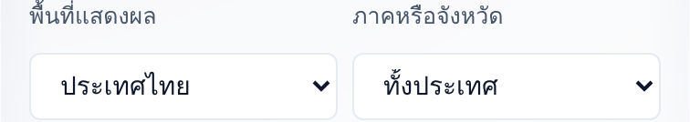{width=55%}

**รูปที่ C.2** ตัวเลือกพื้นที่เหนือแท็บ: พื้นที่แสดงผล (Area shown) และภาคหรือจังหวัด (Region or province)

**แสดงอะไร** เมนูสองช่องเหนือแท็บกำหนด "พื้นที่ที่เลือก" ซึ่งทุกส่วนของหน้าใช้ร่วมกัน

| เมนู | ตัวเลือก |
|---|---|
| **พื้นที่แสดงผล** (Area shown) | **ประเทศไทย** (Thailand) หรือ **เอเชียตะวันออกเฉียงใต้ภาคพื้นทวีป** (Mainland Southeast Asia) |
| **ภาคหรือจังหวัด** (Region or province) | **ทั้งประเทศ**, ภาค 5 ภาค (เหนือ ตะวันออกเฉียงเหนือ กลาง ตะวันออก ใต้) หรือจังหวัดใดก็ได้ 77 จังหวัด |

**ใช้อย่างไร** เลือกจากเมนูได้เลย ทางเลือกถูกจำไว้ในเครื่อง ผลของการเลือกมีดังนี้

- แผนที่ซูมและล็อกขอบเขตไว้ที่พื้นที่นั้น นอกพื้นที่จะถูกพรางไว้ (เลื่อนออกนอกขอบไม่ได้)
- รายการคำเตือน กราฟแนวโน้ม การ์ดความแม่นยำ ตัวเลขสรุป สรุปพยากรณ์ และภาพที่บันทึก ใช้พื้นที่นี้ทั้งหมด
- เมื่อเลือก**จังหวัด** รายการพยากรณ์ในแท็บคำเตือนเปลี่ยนเป็น **รายอำเภอ** โดยอัตโนมัติ และแผนที่แสดงเขตและชื่ออำเภอ/ตำบล
- ถ้าแตะตำแหน่งหรือค้นหาสถานที่ที่อยู่นอกพื้นที่ที่เลือก หน้าเว็บจะขยายพื้นที่ให้เองและแจ้งเป็นข้อความ

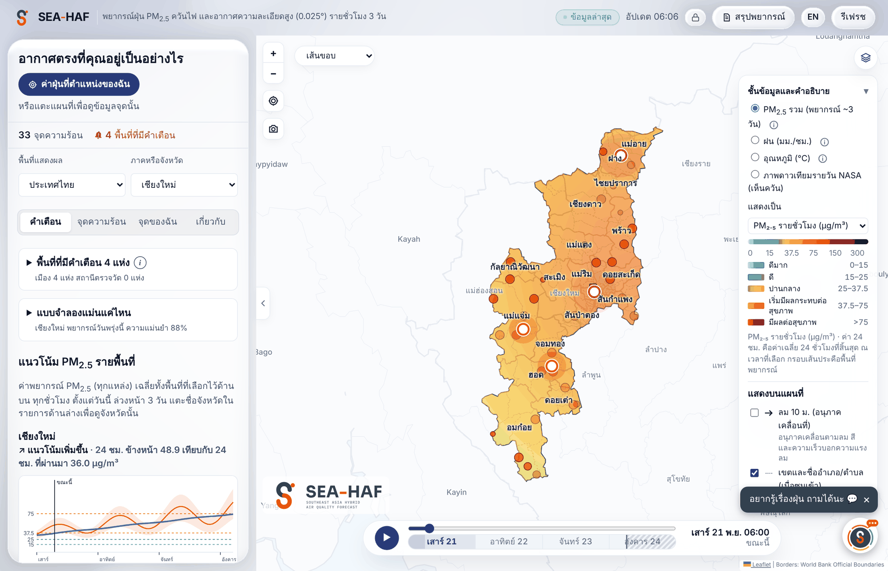{width=95%}

**รูปที่ C.3** เลือกจังหวัดเชียงใหม่: แผนที่ซูมเข้าจังหวัด พื้นที่รอบนอกถูกพราง ชื่ออำเภอขึ้นบนแผนที่ และกราฟแนวโน้มเป็นค่าเฉลี่ยของจังหวัด (Province selected)

**ข้อมูลเบื้องหลัง** เขตจังหวัดและประเทศจาก World Bank Official Boundaries (ฝังอยู่ในหน้า) เขตอำเภอและตำบลจาก
OCHA COD-AB (กรมแผนที่ทหาร 2562, `data/static/th-adm2.json`, `th-adm3.json`) โหลดเมื่อใช้ครั้งแรก

---

## 5.3 แถบเวลาและการเลือกชั่วโมง

{width=75%}

**รูปที่ C.4** แถบเวลาใต้แผนที่: ปุ่มเล่น แถบเลื่อนชั่วโมง แถบวัน (ส่วนที่แรเงาคือช่วงที่ไม่มีข้อมูล) และเวลาที่แสดงอยู่ (Time bar)

**แสดงอะไร** เวลาที่แผนที่ ป้ายสถานี และการ์ดต่าง ๆ กำลังแสดง ช่วงเวลาครอบคลุมตั้งแต่ชั่วโมงที่ผ่านมาของวันนี้ถึงปลายพยากรณ์
(CAMS ประมาณ 3–4 วัน)

**ใช้อย่างไร**

- **ลากแถบเลื่อน** ทีละชั่วโมง
- **▶ / ❚❚** เล่นหรือหยุดภาพเคลื่อนไหว เดินชั่วโมงละ 0.45 วินาที วนกลับเมื่อถึงปลาย
- **แตะชื่อวัน** บนแถบวัน (เช่น "อาทิตย์ 22") เพื่อกระโดดไปวันนั้นที่ชั่วโมงเดียวกันของวัน
- กล่องด้านขวาบอกวันและเวลาที่แสดง และคำว่า "ขณะนี้" เมื่ออยู่ที่ชั่วโมงปัจจุบัน

**อ่านอย่างไร** บนแถบวัน แต่ละช่องคือหนึ่งวันตามเวลาไทย ช่องของวันที่กำลังแสดงถูกเน้น ส่วนที่เป็นสีทึบด้านซ้ายคือชั่วโมงที่ผ่านไปแล้ว
ลายเส้นทแยงคือส่วนของวันที่ไม่มีข้อมูล (เช่น พยากรณ์สิ้นสุดกลางวัน) โดยมีเส้นตั้งตรงจุดที่ข้อมูลจบ ชี้ค้างไว้เพื่อดูเวลาที่พยากรณ์สิ้นสุด

ทุกครั้งที่เปิดหน้าหรือกดรีเฟรช แถบเวลากลับไปที่ชั่วโมงปัจจุบัน การรีเฟรชอัตโนมัติจะคงชั่วโมงที่ผู้ใช้เลือกไว้

---

## 5.4 การเลือกแบบจำลอง CAMS หรือ SILAM

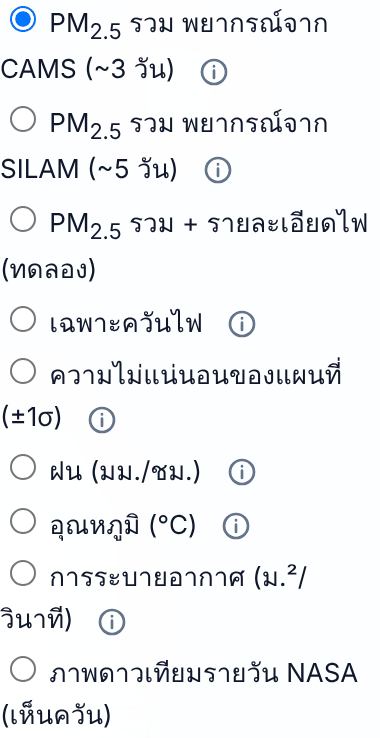{width=40%}

**รูปที่ C.5** ตัวเลือกชั้นข้อมูลในหน้า developer: "PM~2.5~ รวม พยากรณ์จาก CAMS (~3 วัน)" และ "PM~2.5~ รวม พยากรณ์จาก SILAM (~5 วัน)" (Model choice; developer page)

**แสดงอะไร** SEA-HAF ทำพยากรณ์ PM~2.5~ สองชุดด้วยโปรแกรมเดียวกัน ชุดหนึ่งตั้งต้นจาก Copernicus CAMS อีกชุดตั้งต้นจาก SILAM ของ FMI
(รายละเอียดวิธีอยู่ในภาค A)

**สถานะปัจจุบัน** หน้าสำหรับประชาชน (`/` และ `/classic.html`) **แสดงเฉพาะชุด CAMS** ตัวเลือก SILAM ถูกซ่อนไว้ (`syncSilamUI`:
`el.closest('label').hidden = !SILINFO || PUBLIC`) ตัวเลือก SILAM จึงมีเฉพาะในหน้า developer และแสดงเมื่อรอบนั้น pipeline
เผยแพร่ชุด SILAM (`latest.json` มีช่อง `silam`) ชุดหลัก คำเตือนที่แสดงก่อน และการ์ดความแม่นยำยังเป็น CAMS จนกว่าผลเทียบใน log
จะแสดงว่า SILAM ดีอย่างน้อยเท่ากัน **SILAM จึงยังไม่ใช่ค่าเริ่มต้น**

**ใช้อย่างไร (หน้า developer)** เลือกปุ่มวิทยุ SILAM ในกล่องชั้นข้อมูล หน้าเว็บโหลด `data/silam/latest.json` แทน และจำนวนการ์ดรายวันเพิ่มได้ถึง 6 วัน
ถ้าโหลดไม่สำเร็จ หน้าจะกลับไปใช้ CAMS และแจ้งข้อความ เมื่อแสดง SILAM การ์ดความแม่นยำจะขึ้นหมายเหตุว่า "ตัวเลขนี้เป็นของพยากรณ์ชุด CAMS
พยากรณ์ชุด SILAM ยังไม่มีผลตรวจ"

---

## 5.5 แผนที่และชั้นข้อมูล

### 5.5.1 กล่องชั้นข้อมูลและคำอธิบาย (Layers and legend)

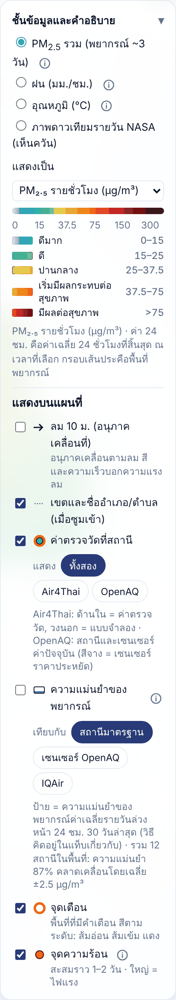{width=40%}

**รูปที่ C.6** กล่องชั้นข้อมูลและคำอธิบายทั้งกล่อง: ชั้นข้อมูลหลัก ตัวเลือก "แสดงเป็น" แถบสี และรายการ "แสดงบนแผนที่" (Layers and legend panel)

กล่องนี้มีสามส่วน

1. **ชั้นข้อมูลหลัก** (เลือกได้ครั้งละหนึ่งชั้น) ปุ่ม (i) ข้างชื่อชั้นเปิดคำอธิบายยาวของชั้นนั้น
2. **แสดงเป็น** (Show as) และแถบสีพร้อมชื่อระดับ
3. **แสดงบนแผนที่** (Show on map) สวิตช์ของชั้นที่วางทับได้หลายชั้นพร้อมกัน

ลูกศร ▾ มุมขวาบนของกล่องพับกล่องเก็บ ในหน้าใหม่ยังมีปุ่มรูปชั้นซ้อน (มุมขวาบนของแผนที่) สำหรับซ่อนหรือแสดงทั้งกล่อง และปุ่ม ‹
ที่ขอบแผงซ้ายสำหรับซ่อนแผงด้านข้างเพื่อให้แผนที่กว้างขึ้น ทั้งสองอย่างถูกจำไว้ในเครื่อง

#### ชั้นข้อมูลหลัก

| ชั้น (ไทย / English) | แสดงอะไร | ข้อมูลเบื้องหลัง | หน้า |
|---|---|---|---|
| **PM~2.5~ รวม (พยากรณ์ ~3 วัน)** / Total PM~2.5~ forecast | PM~2.5~ จากทุกแหล่ง รายชั่วโมง ที่ 0.025° | CAMS ปรับแก้ด้วยค่าตรวจวัด (regression kriging, Kalman filter, การปรับแก้ที่เรียนรู้เอง) จาก pipeline | ทุกหน้า |
| **ฝน (มม./ชม.)** / Rain, mm/h | ฝนรายชั่วโมง | ชั่วโมงที่ผ่านมา: เรดาร์ตรวจอากาศ (กรมอุตุนิยมวิทยาผ่าน RainViewer ปรับด้วยเครื่องวัดฝน ThaiWater) ในพื้นที่ที่เรดาร์เห็น ที่อื่นเป็นฝนจากดาวเทียม Google DeepMind PARDIG (ชั่วโมงล่าสุดใช้ JAXA GSMaP) ชั่วโมงข้างหน้า: ECMWF | ทุกหน้า |
| **อุณหภูมิ (°C)** / Temperature | อุณหภูมิอากาศที่ 2 ม. | ECMWF ย่อส่วนเป็น 0.025° ด้วยความสูงภูมิประเทศ (6.5 °C/กม.) ปรับด้วยค่าตรวจวัด Air4Thai เมื่อผ่านการทดสอบแบบตัดทีละสถานี | ทุกหน้า |
| **ภาพดาวเทียมรายวัน NASA (เห็นควัน)** / NASA daily satellite image | ภาพสีจริงรายวันจาก NASA GIBS ชี้หรือแตะภาพเพื่อดูการประเมินว่าเป็นท้องฟ้าโปร่ง เมฆ หรือควัน/หมอกควัน ปุ่ม **▭ เลือกพื้นที่ (ลากกรอบ)** ประเมินทั้งกรอบ | NASA GIBS (การประเมินเป็นกฎที่อธิบายได้ ไม่ใช่แบบจำลอง ML) | ทุกหน้า |
| PM~2.5~ รวม พยากรณ์จาก SILAM (~5 วัน) | ชุด SILAM (หัวข้อ 5.4) | FMI SILAM | developer |
| PM~2.5~ รวม + รายละเอียดไฟ (ทดลอง) | สนามรวมบวกรายละเอียดจากแบบจำลองควันไฟ (น้ำหนัก α) | แบบจำลอง puff ของหน้าเว็บ | developer |
| เฉพาะควันไฟ / Fire smoke only | PM~2.5~ ที่เพิ่มจากไฟ | แบบจำลอง puff | developer |
| ความไม่แน่นอนของแผนที่ (±1σ) | ครึ่งความกว้างของช่วง 68% เป็น % ของ (PM~2.5~+1) | ความแปรปรวนของ regression kriging | developer |
| การระบายอากาศ (ม.²/วินาที) / Ventilation | ความสูงชั้นผสม × ความเร็วลม | ECMWF | developer |

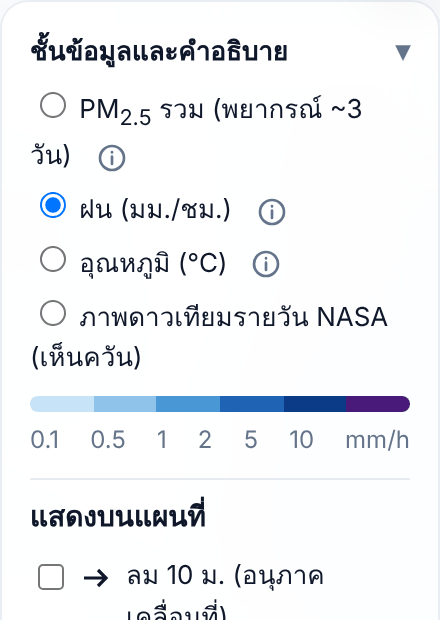{width=40%}

**รูปที่ C.7** เลือกชั้นฝน: แถบสีเปลี่ยนเป็นมาตราฝน 0.1, 0.5, 1, 2, 5, 10 มม./ชม. (Rain layer legend)

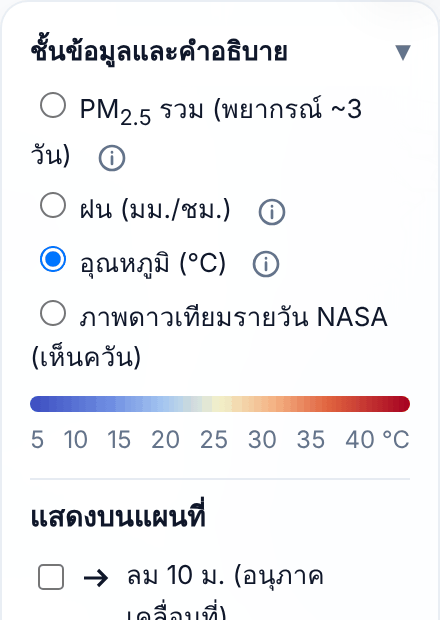{width=40%}

**รูปที่ C.8** เลือกชั้นอุณหภูมิ: แถบสี 5–40 °C (Temperature layer legend)

ในสำเนาทดสอบไม่มีไฟล์อุตุนิยมวิทยา สนามฝนและอุณหภูมิจึงว่างในภาพ รูปที่ C.7 และ C.8 จึงแสดงเฉพาะกล่องคำอธิบาย

#### แสดงเป็น (Show as)

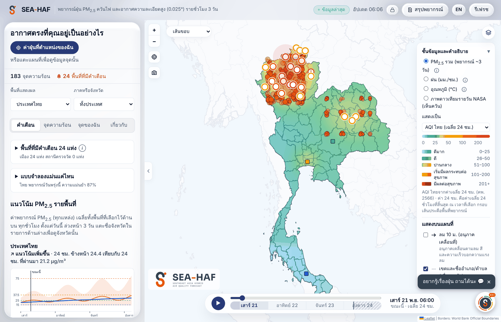{width=95%}

**รูปที่ C.9** ตั้ง "แสดงเป็น" เป็น AQI ไทย (เฉลี่ย 24 ชม.): แถบสีและชื่อระดับเปลี่ยนเป็นช่วง AQI 0–25, 26–50, 51–100, 101–200, 201+ (Show as: Thai AQI)

| ตัวเลือก | ความหมาย |
|---|---|
| PM~2.5~ รายชั่วโมง (µg/m³) | ค่าตามชั่วโมงที่เลือก (ค่าเริ่มต้น) |
| PM~2.5~ เฉลี่ย 24 ชม. (µg/m³) | ค่าเฉลี่ย 24 ชั่วโมงที่สิ้นสุด ณ เวลาที่เลือก |
| AQI ไทย (เฉลี่ย 24 ชม.) / (รายชั่วโมง) | ดัชนีตามเกณฑ์ คพ. ตั้งแต่ 1 มิ.ย. 2566 (เกณฑ์กำหนดไว้สำหรับค่าเฉลี่ย 24 ชม. แบบรายชั่วโมงเป็นค่าประกอบ) |
| AQI สหรัฐฯ (เฉลี่ย 24 ชม.) / (รายชั่วโมง) | ดัชนี US EPA (เกณฑ์ PM~2.5~ ปรับปรุง 6 พ.ค. 2567) |

ตัวเลือกนี้มีผลทั้งแผนที่ ป้ายสถานี และตัวเลขในการ์ด ตารางสีอยู่ในหัวข้อ 5.20

#### แสดงบนแผนที่ (Show on map)

| สวิตช์ (ไทย / English) | ค่าเริ่มต้น | แสดงอะไร | อ่านอย่างไร | หน้า |
|---|---|---|---|---|
| **ลม 10 ม. (อนุภาคเคลื่อนที่)** / Wind, 10 m | ปิด | อนุภาคเคลื่อนตามลมที่ 10 ม. จาก ECMWF | สีและความเร็วของอนุภาคบอกความแรงลมตามมาตราโบฟอร์ต (0, 1.6, 3.4, 5.5, 8, 10.8 ม./วินาที) | ทุกหน้า |
| **เขตและชื่ออำเภอ/ตำบล (เมื่อซูมเข้า)** / District and sub-district borders | เปิด | เส้นเขตและชื่อ ขึ้นเมื่อซูมเข้า | เส้นประบาง | ทุกหน้า |
| **ค่าตรวจวัดที่สถานี** / Measured at stations | เปิด | สถานีตรวจวัด ปุ่ม **ทั้งสอง / Air4Thai / OpenAQ** เลือกแหล่ง | Air4Thai: วงกลม สีด้านใน = ค่าตรวจวัด วงนอก = ค่าแบบจำลอง; OpenAQ: สี่เหลี่ยม สี = ค่าปัจจุบัน (สีจาง = เซนเซอร์ราคาประหยัด) | ทุกหน้า |
| **ความแม่นยำของพยากรณ์** / Forecast accuracy | ปิด | ป้ายเปอร์เซ็นต์เหนือสถานี ปุ่ม **สถานีมาตรฐาน / เซนเซอร์ OpenAQ / IQAir** เลือกว่าเทียบกับอะไร | หัวข้อ 5.5.2 | ทุกหน้า |
| **จุดเตือน** / Warning marks | เปิด | ทุกพื้นที่ที่มีคำเตือน สีตามระดับ | หัวข้อ 5.6 | ทุกหน้า |
| **จุดความร้อน** / Hotspots | เปิด | จุดความร้อนจากดาวเทียมสะสมราว 1–2 วัน | วงใหญ่ = ไฟแรง (FRP สูง) วงจาง = ตรวจพบนานกว่า 12 ชม. ชี้ดูจังหวัด FRP ดาวเทียม และเวลา | ทุกหน้า |
| เส้นแบ่งระดับ / Contour lines | เปิด | เส้นขอบระดับสีของสนาม | | developer |
| เรดาร์ตรวจอากาศ (ฝน 2 ชม. ล่าสุด) | ปิด | ภาพเรดาร์ทุก 10 นาที ย้อนหลัง 2 ชม. (dBZ) มีปุ่มเล่นและแถบเลื่อนของตัวเอง | ไม่ใช่เวลาตามแถบเวลาหลัก | developer |
| ลูกศรลมพร้อมค่า (ชี้ดู) | ปิด | ลูกศรลมที่ชี้ดูค่าได้ | | developer |
| เขตและชื่อจังหวัด | ปิด | | | developer |
| เมือง / Towns | เปิด | วงกลมขอบดำ = เมือง/จุดรับ | | developer |

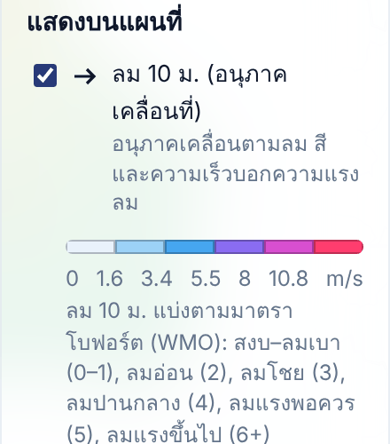{width=40%}

**รูปที่ C.10** สวิตช์ลม 10 ม. เมื่อเปิด: แถบสีความเร็วลมตามมาตราโบฟอร์ตปรากฏใต้สวิตช์ (Wind legend)

### 5.5.2 ชั้นความแม่นยำของพยากรณ์ (Forecast accuracy)

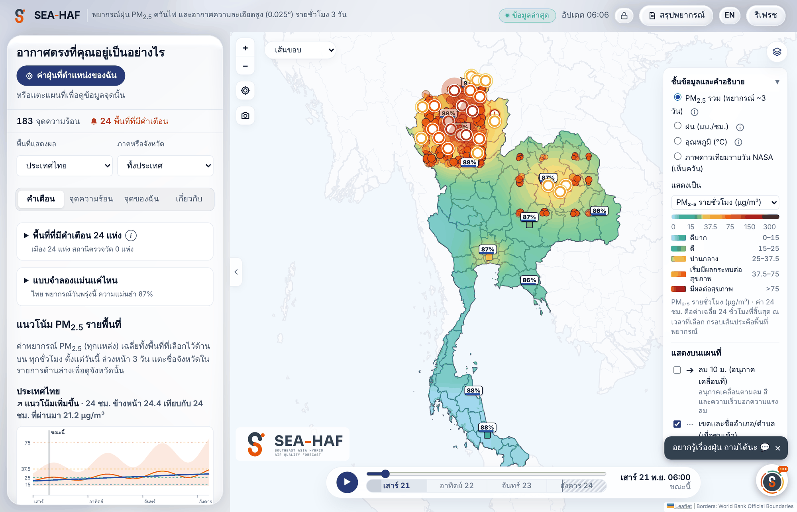{width=95%}

**รูปที่ C.11** เปิด "ความแม่นยำของพยากรณ์": ป้ายตัวเลขเหนือสถานีบอกความแม่นยำของพยากรณ์ค่าเฉลี่ยรายวันล่วงหน้า 24 ชม. ที่สถานีนั้น (Forecast accuracy badges)

**แสดงอะไร** ป้ายเล็กเหนือสถานีตรวจวัด ตัวเลขคือ **ความแม่นยำ = 100 − NRMSE (%)** โดย NRMSE = RMSE หารด้วยค่าเฉลี่ยที่วัดได้
ของพยากรณ์**ค่าเฉลี่ยรายวัน** (00–24 น. เวลาไทย ฐานเดียวกับ AQI ไทย) ที่ออกล่วงหน้า 24 ชม. ใน 30 วันล่าสุด สถานีต้องมีอย่างน้อย 15 วัน
จึงได้ป้าย แถบใต้ตัวเลขยาวตามค่าเดียวกัน

**ใช้อย่างไร** ชี้ที่ป้ายเพื่อดูความแม่นยำ ความคลาดเคลื่อนโดยเฉลี่ย (µg/m³) และแนวโน้ม (สูงหรือต่ำกว่าจริง) ของวันพรุ่งนี้และล่วงหน้า 2 วัน
แตะป้ายเพื่อเปิดการ์ดความแม่นยำของสถานีนั้น (หัวข้อ 5.9.2) ป้ายที่ซ้อนกันบนจอจะเหลือเฉพาะสถานีที่มีชั่วโมงตรวจมากกว่า ซูมเข้าเพื่อดูครบ
บรรทัดใต้สวิตช์สรุปทุกสถานีในพื้นที่ที่เลือกรวมกัน ปุ่ม **เซนเซอร์ OpenAQ** และ **IQAir** แสดงความใกล้กับเซนเซอร์ ซึ่งคิดแยกและไม่รวมในตัวเลขของสถานีมาตรฐาน
(เซนเซอร์อ่านค่าสูงเกินในอากาศชื้น)

**ข้อมูลเบื้องหลัง** `data/accuracy.json` ที่ pipeline คำนวณจากบันทึกพยากรณ์และค่าตรวจวัดของสถานีในประเทศไทย

### 5.5.3 แผนที่ฐานและปุ่มบนแผนที่

- **แผนที่ฐาน** (เมนูมุมซ้ายบนของแผนที่): แผนที่สีอ่อน, แผนที่ถนน, ภูมิประเทศ, ภาพดาวเทียม, เส้นขอบอย่างเดียว (ออฟไลน์) แบบสุดท้ายไม่โหลดภาพจากภายนอก
- **+ / −**: ซูม
- **◎**: ตำแหน่งของฉัน (เหมือนปุ่มในแผงซ้าย)
- **กล้อง**: บันทึกแผนที่เป็นภาพ (หัวข้อ 5.15)
- โลโก้ SEA-HAF บนแผนที่ติดไปกับภาพหน้าจอเสมอ หน้า public ปิดเมนูคลิกขวาและการลากภาพแผนที่ของเบราว์เซอร์

### 5.5.4 แตะแผนที่: การ์ดสรุปของจุดนั้น

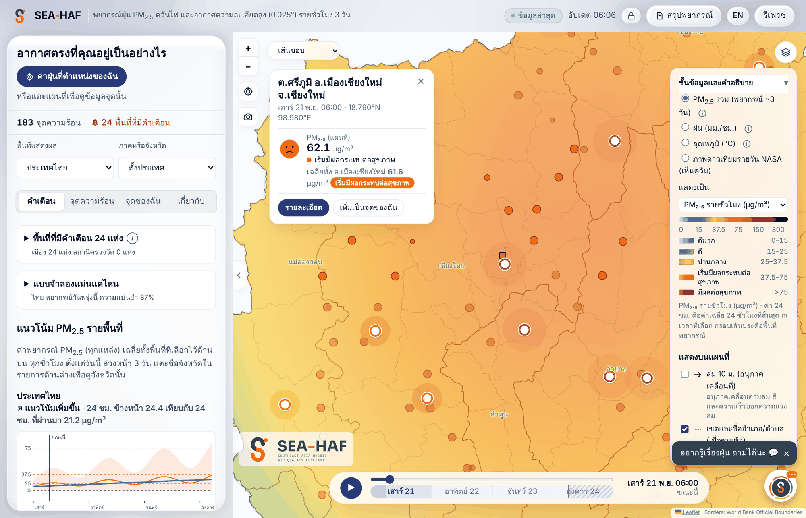{width=95%}

**รูปที่ C.12** แตะแผนที่ในหน้าใหม่: การ์ดบอกชื่อตำบล อำเภอ จังหวัด พิกัด เวลา ค่า PM~2.5~ ระดับ ค่าเฉลี่ยของอำเภอ และปุ่ม **รายละเอียด** กับ **เพิ่มเป็นจุดของฉัน** (Place card)

**แสดงอะไร** ในหน้าใหม่ (`<body data-click="info">`) การแตะแผนที่เปิดการ์ดสั้นของจุดนั้นที่เวลาบนแถบเวลา: ชื่อสถานที่ PM~2.5~ (จากแผนที่)
ระดับสี ค่าเฉลี่ยของอำเภอ และอากาศ (อุณหภูมิ ฝน) ถ้ามีข้อมูล

**ใช้อย่างไร**

- **รายละเอียด** เปิดหน้าต่างเต็มของจุดนั้น (เหมือนรูปที่ C.13) ซึ่งมีปุ่ม **อากาศมาจากไหน?** (Where is the air from?) เมื่อรอบนั้นมีลมสำหรับ trajectory
- **เพิ่มเป็นจุดของฉัน** บันทึกจุดนั้นไว้ในแท็บจุดของฉัน
- **×** ปิดการ์ด
- ในหน้าเดิม (classic) การแตะแผนที่ **เพิ่มจุดของฉันทันที** ไม่มีการ์ด (หัวข้อ 5.18)

**อากาศมาจากไหน? (backward trajectories)** หน้าเว็บคำนวณย้อนเส้นทางอากาศ 27 เส้น (9 เส้นต่อความสูง × 3 ความสูง 100, 500 และ 1,500 ม.
เหนือพื้นดิน) ย้อนหลัง 24 หรือ 48 ชม. (เลือกได้) ด้วยลม ECMWF ตารางผลบอกว่าอากาศแต่ละความสูงเคยอยู่เหนือประเทศใด และผ่านไฟกี่จุด
(จุดความร้อนภายใน 20 กม. จากเส้นทาง ที่ตรวจพบภายใน 12 ชม. ของเวลาที่อากาศผ่าน) เส้นบนแผนที่ใช้สีตามความสูง เส้นหนามีจุดทุก 6 ชม.
ปุ่ม **คำนวณใหม่สำหรับชั่วโมงนี้** ขึ้นเมื่อเลื่อนเวลาไปแล้ว และปุ่ม **ล้าง** ลบเส้น
ความสูงถูกคงที่ (ไม่มีการเคลื่อนที่แนวตั้ง) จึงใช้เป็นแนวทางเท่านั้น ที่เส้นกระจายออกจากกันมาก แหล่งที่มาไม่แน่นอน

### 5.5.5 หน้าต่างเมื่อเปิดหน้า และกล่องตำแหน่งของฉัน

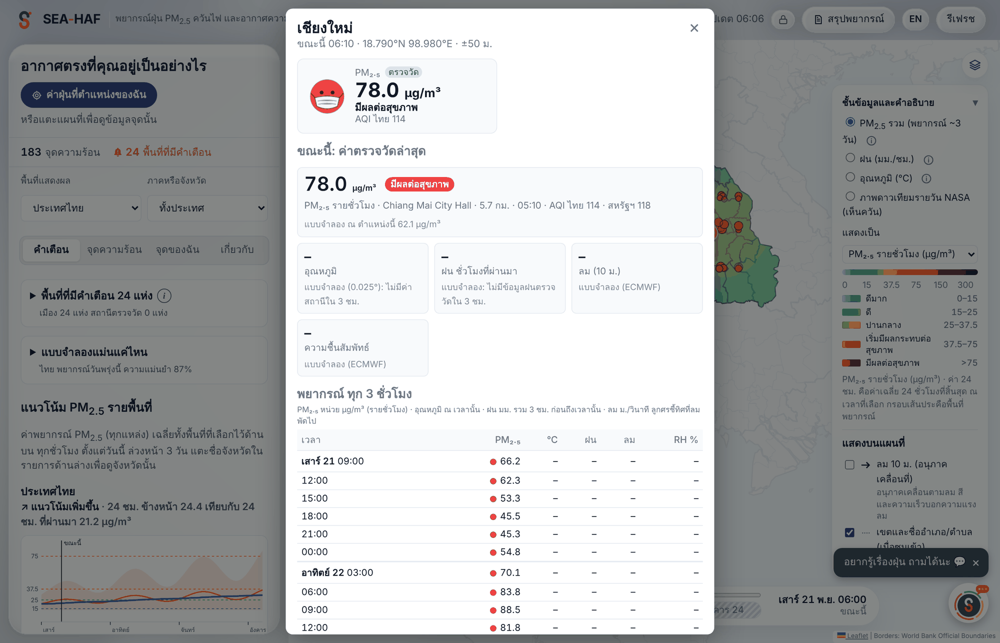{width=95%}

**รูปที่ C.13** หน้าต่างที่ขึ้นเมื่อเปิดหน้า (ถ้าเบราว์เซอร์อนุญาตตำแหน่ง): ค่า PM~2.5~ ที่ตำแหน่งนั้น ค่าตรวจวัดล่าสุดของสถานีใกล้ที่สุด อุณหภูมิ ฝน ลม ความชื้น และตารางพยากรณ์ทุก 3 ชั่วโมง (Location pop-up)

เมื่อเปิดหน้าและเบราว์เซอร์เคยอนุญาตตำแหน่ง หน้าเว็บแสดงหน้าต่างนี้ ช่องบนสุดเป็นค่าตรวจวัดของสถานีที่ใกล้ที่สุด (มีป้าย "ตรวจวัด") หรือค่าจากแผนที่
ถัดมาคือ "ขณะนี้: ค่าตรวจวัดล่าสุด" พร้อมชื่อสถานี ระยะทาง เวลา AQI ไทยและสหรัฐฯ และค่าจากแบบจำลองที่ตำแหน่ง แล้วเป็นช่องอากาศ
(อุณหภูมิ 0.025°, ฝนชั่วโมงที่ผ่านมา, ลม 10 ม., ความชื้นสัมพัทธ์ จาก ECMWF) และตาราง **พยากรณ์ทุก 3 ชั่วโมง**
ช่องท้ายหน้าต่าง **แสดงหน้าต่างนี้เมื่อเปิดหน้า** ปิดการแสดงอัตโนมัติได้ (จำไว้ในเครื่อง คีย์ `hsw.locPop`)

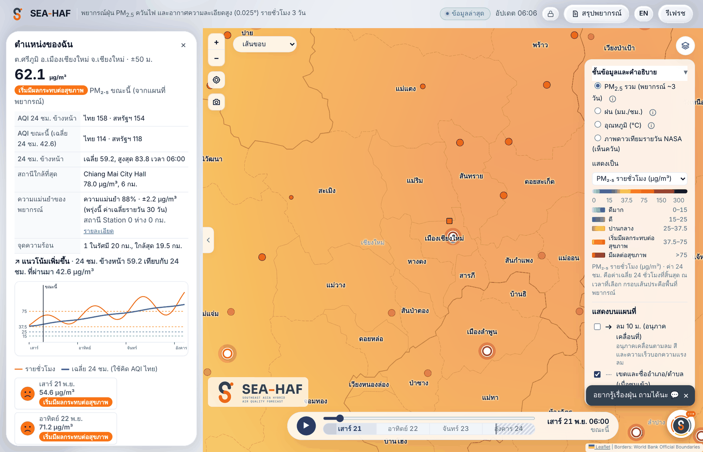{width=95%}

**รูปที่ C.14** กล่องตำแหน่งของฉันในแผงซ้ายหลังกดปุ่มตำแหน่ง: ค่าขณะนี้ AQI 24 ชม. ข้างหน้า สถานีใกล้ที่สุด ความแม่นยำของพยากรณ์ จุดความร้อนใกล้ และกราฟแนวโน้มของจุดนั้น (My location box)

---

## 5.6 เครื่องหมายเตือนบนแผนที่ (Warning marks)

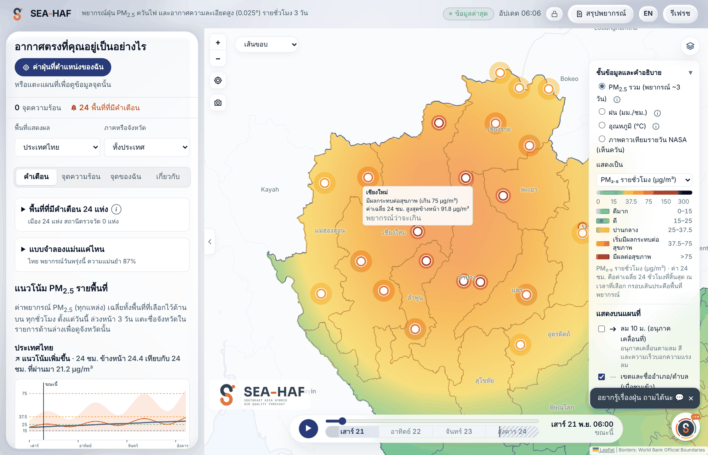{width=95%}

**รูปที่ C.15** เครื่องหมายเตือนบนแผนที่ภาคเหนือ: สีส้มอ่อน ส้มเข้ม และแดงตามระดับ วงแหวน = พยากรณ์ว่าจะเกิน ชี้ที่เครื่องหมายเพื่อดูชื่อ ระดับ และค่า (Warning marks, `#shWarn`)

**แสดงอะไร** ทุกพื้นที่ที่มีคำเตือน (เมืองและสถานีตรวจวัด หัวข้อ 5.9.1) ถูกทำเครื่องหมายพร้อมกันเป็นวงกลมกะพริบ สีตามระดับความเสี่ยง

| สี | ระดับ (ไทย / English) | ค่าที่ใช้ตัดสิน |
|---|---|---|
| ส้มอ่อน (wl1) | เริ่มมีผลต่อกลุ่มเสี่ยง (unhealthy for sensitive groups) | 37.5–55 µg/m³ |
| ส้มเข้ม (wl2) | ไม่ดีต่อสุขภาพ (unhealthy) | 55–75 µg/m³ (55 คือขั้น "unhealthy" ของ US EPA) |
| แดง (wl3) | มีผลกระทบต่อสุขภาพ (affects health) | เกิน 75 µg/m³ (ระดับ "มีผลกระทบต่อสุขภาพ" ของ คพ.) |

ค่าที่ใช้เลือกสี: ของ**สถานี**ใช้ค่าเฉลี่ย 24 ชม. ที่วัดได้ ถ้าไม่เข้าเกณฑ์จากค่าวัดจึงใช้ค่าเฉลี่ย 24 ชม. พยากรณ์สูงสุดข้างหน้า
ของ**เมือง**ใช้ค่าเฉลี่ย 24 ชม. พยากรณ์สูงสุดข้างหน้า เมืองที่เข้าเกณฑ์เพราะ**ชั่วโมงเดียว**เกิน 75 แต่ค่าเฉลี่ย 24 ชม. ไม่เกิน 37.5 จะเป็น**สีส้มอ่อน**

**อ่านอย่างไร** **จุดทึบ** = วัดได้เกินมาตรฐานแล้ว **วงแหวน** = พยากรณ์ว่าจะเกิน ชี้ที่เครื่องหมายเพื่อดูชื่อ ระดับ ค่า และว่าเป็นค่าวัดหรือค่าพยากรณ์
แตะเพื่อเปิดพยากรณ์ของเมืองหรือสถานีนั้น เครื่องหมายตามพื้นที่ที่เลือกไว้เหนือแท็บ ปิดได้ที่สวิตช์ **จุดเตือน** (`#shWarn`)
ในภาพที่บันทึก เครื่องหมายที่อยู่ใกล้กันจะรวมกลุ่ม (หัวข้อ 5.15)

---

## 5.7 แท็บต่าง ๆ ในแผงด้านข้าง

หน้า public มีสี่แท็บ: **คำเตือน** (Warnings), **จุดความร้อน** (Hotspots), **จุดของฉัน** (My places) และ **เกี่ยวกับ** (About)
หน้า developer มีแท็บ **ตั้งค่า** (Settings) แทนจุดของฉัน และมีแท็บ **วิธีการ** (Method) แทนเกี่ยวกับ

---

## 5.8 ลำดับเนื้อหาในแท็บคำเตือน

จากบนลงล่าง แท็บคำเตือนมี

1. กล่อง **พื้นที่ที่มีคำเตือน** (เมื่อมีอย่างน้อยหนึ่งแห่ง) หัวข้อ 5.9.1
2. การ์ด **แบบจำลองแม่นแค่ไหน** หัวข้อ 5.9.2
3. **แนวโน้ม PM~2.5~ รายพื้นที่** หัวข้อ 5.9.3
4. เมนู **แสดงพยากรณ์** และรายการการ์ดรายวัน หัวข้อ 5.9.4

## 5.9 แท็บคำเตือน (Warnings)

### 5.9.1 พื้นที่ที่มีคำเตือน และปุ่ม (i)

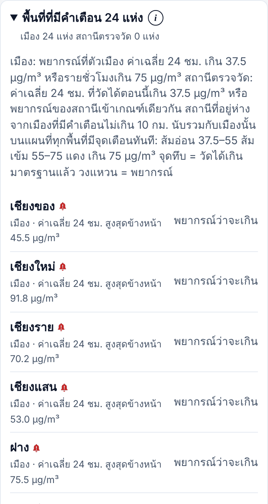{width=50%}

**รูปที่ C.16** กล่อง "พื้นที่ที่มีคำเตือน 24 แห่ง" เปิดอยู่ และกดปุ่ม (i) แล้ว: ข้อความเกณฑ์การนับอยู่บนสุด ตามด้วยรายชื่อเมืองพร้อมกระดิ่ง ค่าเฉลี่ย 24 ชม. สูงสุดข้างหน้า และป้าย "พยากรณ์ว่าจะเกิน" (Places with a warning, with the (i) rule)

**แสดงอะไร** รายชื่อทุกพื้นที่ในพื้นที่ที่เลือกซึ่งเข้าเกณฑ์เตือน หัวกล่องบอกจำนวนรวม และแยก "เมือง n แห่ง สถานีตรวจวัด n แห่ง"

**เกณฑ์เตือน (ข้อความของปุ่ม i)**

- **เมือง**: พยากรณ์ที่ตัวเมือง **ค่าเฉลี่ย 24 ชม. เกิน 37.5 µg/m³ หรือรายชั่วโมงเกิน 75 µg/m³**
- **สถานีตรวจวัด** (เฉพาะสถานีมาตรฐาน ไม่รวมเซนเซอร์ราคาประหยัด): ค่าเฉลี่ย 24 ชม. ที่**วัดได้ตอนนี้**เกิน 37.5 µg/m³
  หรือพยากรณ์ที่ปรับให้สถานีนั้นเข้าเกณฑ์เดียวกับเมือง
- สถานีที่อยู่ห่างจากเมืองที่มีคำเตือน**ไม่เกิน 10 กม.** นับรวมกับเมืองนั้น (เมืองนั้นได้ป้าย "วัดได้เกินมาตรฐานแล้ว" ถ้าสถานีวัดได้เกิน)

**ใช้อย่างไร** แตะหัวกล่องเพื่อเปิด/ปิดรายการ แตะ (i) เพื่อแสดง/ซ่อนเกณฑ์ (การกด i ไม่พับกล่อง) แตะชื่อเพื่อเปิดพยากรณ์ของพื้นที่นั้นบนแผนที่
ลำดับในรายการ: สถานีที่วัดได้เกินแล้วขึ้นก่อน ตามด้วยเมือง แล้วสถานีที่พยากรณ์ว่าจะเกิน

**อ่านอย่างไร** ป้ายท้ายแถว **วัดได้เกินมาตรฐานแล้ว** (ตัวหนาสีแดง) หรือ **พยากรณ์ว่าจะเกิน** ตัวเลขในแถวคือ "ค่าเฉลี่ย 24 ชม. สูงสุดข้างหน้า"
หรือ "เฉลี่ย 24 ชม. ตอนนี้" ของสถานี

### 5.9.2 การ์ดความแม่นยำ "แบบจำลองแม่นแค่ไหน"

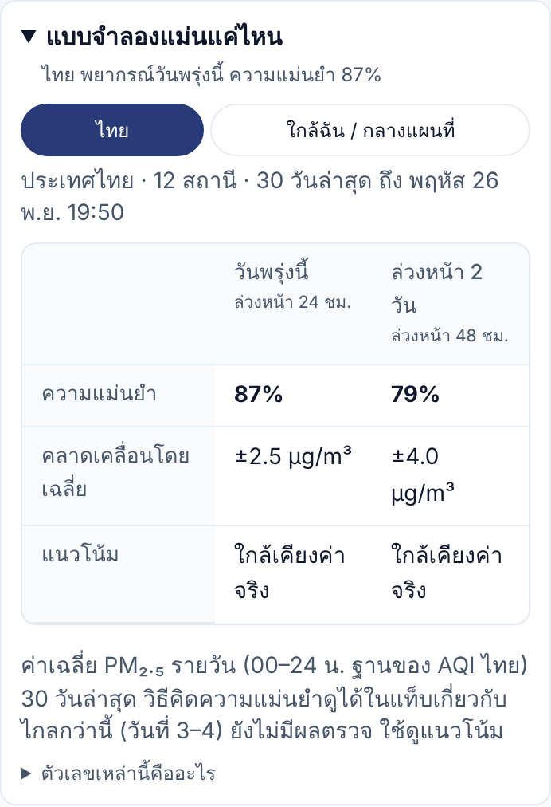{width=50%}

**รูปที่ C.17** การ์ดความแม่นยำเมื่อเปิด: ปุ่มเลือกพื้นที่ ตารางความแม่นยำ ความคลาดเคลื่อนโดยเฉลี่ย และแนวโน้มของพยากรณ์วันพรุ่งนี้และล่วงหน้า 2 วัน (How right has the forecast been?)

**แสดงอะไร** หัวการ์ดตอนพับบอกความแม่นยำของ "วันพรุ่งนี้" ของพื้นที่ที่เลือก (เช่น "ไทย พยากรณ์วันพรุ่งนี้ ความแม่นยำ 87%") เมื่อเปิดจะเห็นตาราง

| แถว | ความหมาย |
|---|---|
| **ความแม่นยำ** | 100 − NRMSE ของค่าเฉลี่ยรายวัน (หัวข้อ 5.5.2) |
| **คลาดเคลื่อนโดยเฉลี่ย** | ค่าเฉลี่ยของ \|พยากรณ์ − ค่าวัด\| เป็น µg/m³ (±) |
| **แนวโน้ม** | "ใกล้เคียงค่าจริง" ถ้าความเอนเอียงไม่เกิน max(1.5 µg/m³, 10% ของค่าเฉลี่ยที่วัด) มิฉะนั้น "มักต่ำกว่าจริง" หรือ "มักสูงกว่าจริง" พร้อมขนาด |

คอลัมน์ **วันพรุ่งนี้** (ล่วงหน้า 24 ชม.) และ **ล่วงหน้า 2 วัน** (48 ชม.) ใต้ตารางบอกว่าวันที่ 3–4 ยังไม่ได้ประเมิน ให้ใช้ดูแนวโน้ม
หน้า developer มีอีกสองแถว: "วันที่ฝุ่นเกิน 37.5 ที่เตือนทัน" และ "เตือนแล้วไม่เกินจริง" และบรรทัดคะแนนของเซนเซอร์ราคาประหยัด

**ใช้อย่างไร** ปุ่มแรกคือพื้นที่ที่เลือกไว้เหนือแท็บ (ชื่อเปลี่ยนตาม เช่น "ไทย" หรือ "เชียงใหม่") ปุ่ม **ใกล้ฉัน / กลางแผนที่** ใช้สถานีที่ใกล้
ตำแหน่งของคุณที่สุด (หรือกลางแผนที่ถ้ายังไม่ได้ให้ตำแหน่ง หรือสถานีที่แตะจากป้ายบนแผนที่) ภายใน 25 กม. ถ้าไม่มีสถานีในรัศมี
จะใช้ค่าของภาคและบอกไว้ จังหวัดที่ไม่มีสถานีที่มีวันตรวจวัดพอ (อย่างน้อย 15 วันใน 30 วัน) ใช้ค่าของภาค ตำแหน่งนอกประเทศไทยไม่มีคะแนน
"ตัวเลขเหล่านี้คืออะไร" ท้ายการ์ดอธิบายวิธีคิด

### 5.9.3 แนวโน้ม PM~2.5~ รายพื้นที่ คู่กับกราฟฝนและอุณหภูมิ

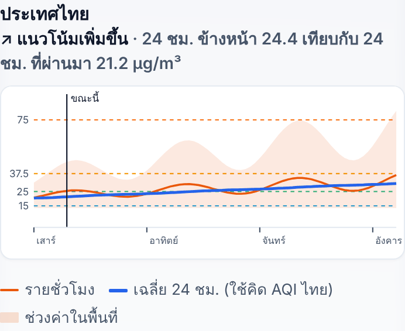{width=50%}

**รูปที่ C.18** กราฟแนวโน้มของพื้นที่ที่เลือก: เส้นส้ม = รายชั่วโมง เส้นน้ำเงิน = เฉลี่ย 24 ชม. แถบจาง = ช่วงค่าในพื้นที่ เส้นประแนวนอน = 15 / 25 / 37.5 / 75 µg/m³ เส้นตั้ง = ขณะนี้ (Area PM~2.5~ trend)

**แสดงอะไร** ค่าพยากรณ์ PM~2.5~ (ทุกแหล่ง) เฉลี่ยทั้งพื้นที่ที่เลือกไว้ ทุกชั่วโมง ตั้งแต่วันนี้ถึงปลายพยากรณ์ บรรทัดหัวกราฟบอกทิศทาง เช่น
"↗ แนวโน้มเพิ่มขึ้น · 24 ชม. ข้างหน้า 24.4 เทียบกับ 24 ชม. ที่ผ่านมา 21.2 µg/m³" (ทรงตัว / เพิ่มขึ้น / ลดลง)

**อ่านอย่างไร**

- **กราฟ PM~2.5~**: ส้ม = ค่ารายชั่วโมง, น้ำเงิน = ค่าเฉลี่ย 24 ชม. (ฐานของ AQI ไทย), แถบสีจาง = ช่วงค่าในพื้นที่ (พื้นที่ส่วนใหญ่อยู่ในแถบนี้),
  เส้นประเข้ม = ควันไฟจากแบบจำลองของหน้าเว็บ (เมื่อมี), เส้นประแนวนอน = เกณฑ์ 15 / 25 / 37.5 / 75 µg/m³, เส้นตั้ง "ขณะนี้"
- **กราฟอุณหภูมิและฝน** (ใต้กราฟ PM~2.5~ เมื่อมีข้อมูลอุตุนิยมวิทยา): เส้นแดง = อุณหภูมิ 2 ม. (ECMWF ย่อส่วน 0.025° และการปรับแก้ที่เรียนรู้เองเมื่อได้น้ำหนักแล้ว),
  แท่งน้ำเงิน = ฝนรายชั่วโมงอ่านที่แกนขวา (มม./ชม.) แท่ง**เข้ม** = ฝนที่ตรวจวัดแล้ว (เรดาร์หรือดาวเทียม PARDIG/GSMaP) แท่ง**จาง** = ฝนพยากรณ์ ECMWF
  แตะกราฟเพื่ออ่านค่าชั่วโมงนั้น
- กล่องรายวันใต้กราฟ: ค่าเฉลี่ยรายวัน (เที่ยงคืนถึงเที่ยงคืน) ไอคอนหน้า และป้ายระดับ (ในหน้า developer)

**ใช้อย่างไร** เปลี่ยนพื้นที่ด้วยเมนูเหนือแท็บ หรือแตะการ์ดจังหวัดในรายการด้านล่าง (หน้าจะเลือกจังหวัดนั้นและเลื่อนขึ้นมาที่กราฟ)

**ข้อมูลเบื้องหลัง** ค่าเฉลี่ยของจุดตาราง 0.1° ในพื้นที่ (ทั้งแผนที่ภูมิภาคใช้ตาราง 0.25°) จากแผนที่ PM~2.5~ ที่ปรับแก้แล้ว (`areaSeries`)

### 5.9.4 การ์ดพยากรณ์รายวัน และเมนู "แสดงพยากรณ์"

เมนู **แสดงพยากรณ์** (Show forecast) เลือกรายการได้สี่แบบ

| ตัวเลือก | ค่าที่ใช้ | หมายเหตุ |
|---|---|---|
| **รายจังหวัด (เฉลี่ยทั้งจังหวัด)** | ค่าเฉลี่ยของทุกจุด 0.1° ในจังหวัด | ค่าเริ่มต้น จังหวัดที่มีเมืองหรือสถานีที่มีคำเตือนขึ้นก่อนพร้อมกระดิ่ง แล้วเรียงจากค่าสูงสุด แตะเพื่อเลือกจังหวัดนั้น |
| **รายอำเภอ (เฉลี่ยทั้งอำเภอ)** | ค่าเฉลี่ยของจุด 0.1° ในอำเภอ (อำเภอเล็กใช้ค่ากลางอำเภอ) | สูงสุด 40 อำเภอ แตะเพื่อซูมไปอำเภอนั้น ใช้อัตโนมัติเมื่อเลือกจังหวัด |
| **รายเมือง (ที่ตัวเมือง)** | ค่าที่ตำแหน่งตัวเมือง และส่วนที่มาจากควันไฟ | สูงสุด 25 เมือง จุดของฉันอยู่ในรายการนี้ด้วย |
| **สถานีตรวจวัด** | ค่าวัดขณะนี้ และพยากรณ์ที่ปรับให้ตรงกับสถานีนั้น | หัวข้อ 5.10 |

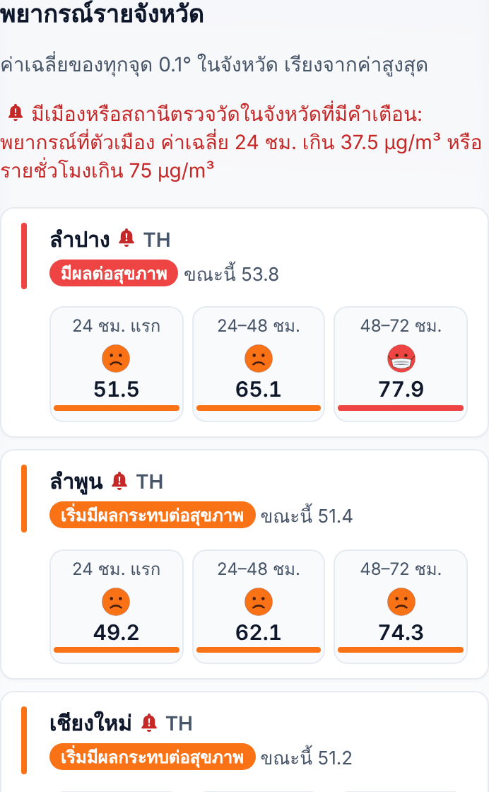{width=50%}

**รูปที่ C.19** การ์ดพยากรณ์รายจังหวัด: แถบสีซ้ายตามระดับที่แย่ที่สุด กระดิ่ง = มีเมืองหรือสถานีในจังหวัดที่มีคำเตือน ป้ายระดับ ค่าขณะนี้ และกล่องรายวัน "24 ชม. แรก / 24–48 ชม. / 48–72 ชม." (Daily forecast cards, by province)

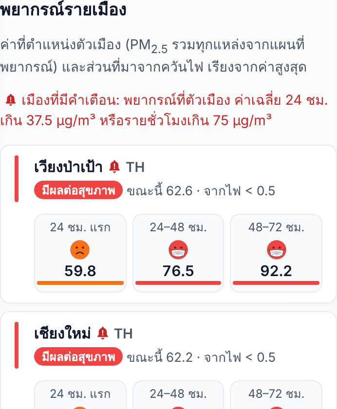{width=50%}

**รูปที่ C.20** การ์ดรายเมือง: เหมือนรายจังหวัด และมีค่า "จากไฟ" (ส่วนที่มาจากควันไฟ) ต่อท้ายค่าขณะนี้ (Forecast by town)

**อ่านการ์ดอย่างไร**

- **ชื่อ** และรหัสประเทศ (TH, LA, MM, KH, VN …) กระดิ่งสีแดงข้างชื่อ = มีคำเตือน ชี้ที่กระดิ่งเพื่อดูชื่อเมืองหรือสถานีที่ทำให้เตือน
- **ป้ายระดับ** สีตามระดับที่แย่ที่สุดของการ์ด และ "ขณะนี้" = ค่าชั่วโมงปัจจุบัน
- **กล่องรายวัน** หนึ่งกล่องต่อวันจนสุดพยากรณ์ (CAMS สูงสุด 3 กล่อง SILAM สูงสุด 6 กล่อง วันหนึ่งต้องมีพยากรณ์อย่างน้อย 18 ชม. จึงนับ)
  ตัวเลขในกล่องคือ **ค่าเฉลี่ย 24 ชม. สูงสุด**ที่สิ้นสุดในช่วงนั้น (ไม่ใช่ค่ารายชั่วโมงสูงสุด) ไอคอนหน้าและแถบสีตามระดับ
  เมื่อมีข้อมูลอากาศ กล่องแสดงอุณหภูมิต่ำสุด–สูงสุด ฝนรวมของช่วง ("ไม่มีฝน" ถ้าต่ำกว่า 0.1 มม.) และไอคอนเมฆจากเมฆปกคลุมช่วง 07–18 น.
  เมื่อมีมากกว่า 3 กล่องบนจอแคบ หัวกล่องเป็น "วันที่ 1, 2, …"
- **แตะการ์ด** เปิดกราฟรายชั่วโมงของพื้นที่นั้นใต้รายการ (`#townDetail`) และชี้ตำแหน่งบนแผนที่

---

## 5.10 สถานีตรวจวัด และค่า "รอยืนยัน" (Unconfirmed reading)

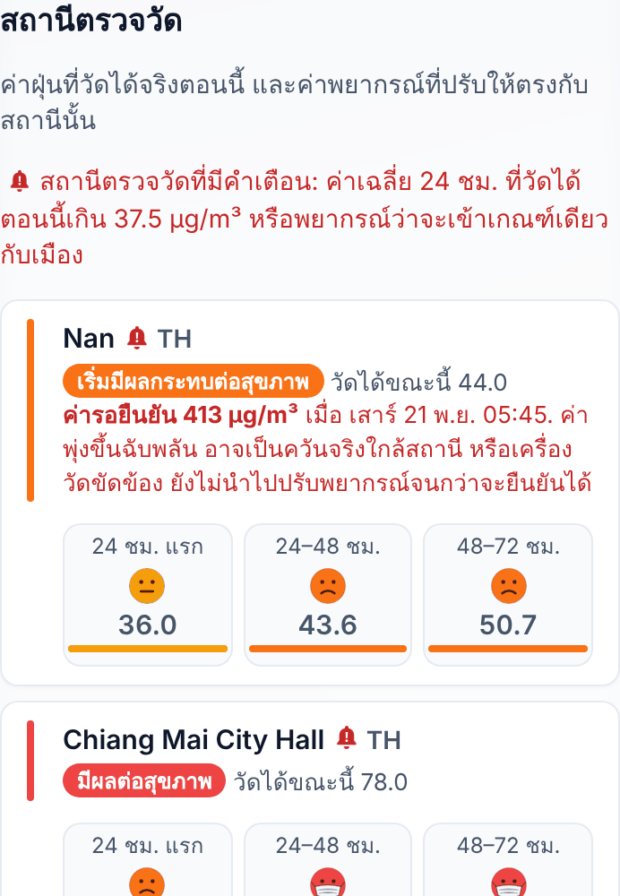{width=50%}

**รูปที่ C.21** รายการสถานีตรวจวัด: สถานีน่านมีค่ารอยืนยัน 413 µg/m³ เป็นข้อความสีแดงใต้ชื่อ ส่วนกล่องรายวันยังเป็นพยากรณ์ที่ไม่ได้ใช้ค่านั้น (Monitoring stations with an unconfirmed reading)

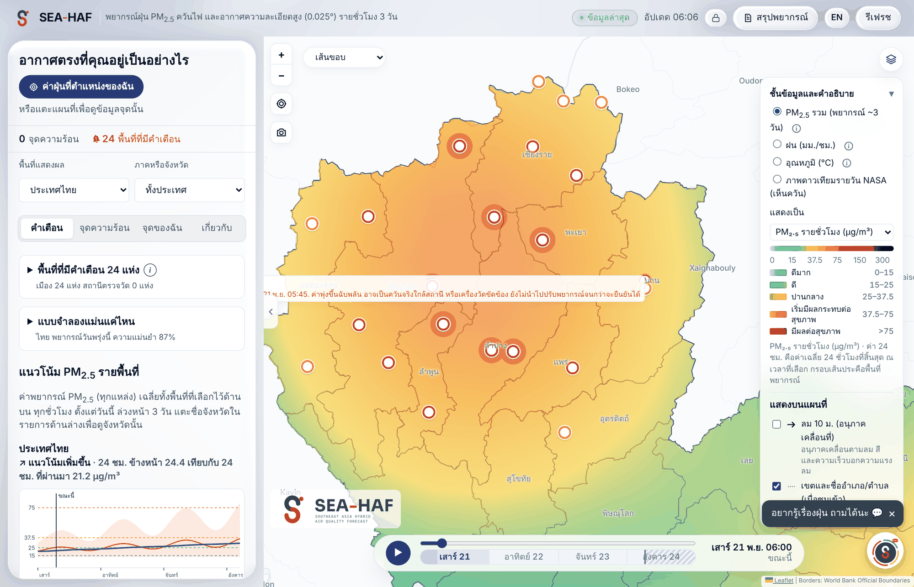{width=95%}

**รูปที่ C.22** เครื่องหมาย "!" สีแดงเหนือสถานีที่มีค่ารอยืนยันบนแผนที่ และข้อความเมื่อชี้ (Unconfirmed-reading mark)

**รายการสถานี** (เลือก "สถานีตรวจวัด" ในเมนูแสดงพยากรณ์) แสดงสถานีมาตรฐานพร้อมค่าวัดขณะนี้ ป้ายระดับ และกล่องรายวันของพยากรณ์ที่ปรับให้สถานีนั้น
(Kalman filter ต่อสถานี) สถานีที่มีคำเตือนมีกระดิ่ง หมายเหตุสีแดงด้านบนอธิบายเกณฑ์เตือนของสถานี

**ค่ารอยืนยัน** คือค่าล่าสุดของสถานีที่การตรวจค่าพุ่ง (spike check, `scripts/obsqc.mjs`) กันไว้ เงื่อนไขคือ
ค่าเกิน **300 µg/m³** และเกิน **5 เท่า**ของค่าสูงสุดใน **3 ชั่วโมง**ก่อนหน้า (`SPIKE = {min: 300, ratio: 5, backH: 3}`)
ค่าแบบนี้อาจเป็นควันจริงที่อยู่ติดสถานี หรือเครื่องวัดขัดข้อง หน้าเว็บจึงแสดงทันทีแต่ติดป้ายว่ายังไม่ยืนยัน และ**ไม่นำไปปรับพยากรณ์**จนกว่าจะยืนยัน

**อ่านอย่างไร** ในรายการเป็นข้อความสีแดง "**ค่ารอยืนยัน** 413 µg/m³ เมื่อ … ค่าพุ่งขึ้นฉับพลัน อาจเป็นควันจริงใกล้สถานี หรือเครื่องวัดขัดข้อง…"
บนแผนที่เป็นวงกลมขาวขอบแดงมี "!" ซึ่งขึ้นเฉพาะเมื่อแถบเวลาอยู่ที่ "ขณะนี้" (ภายใน 1 ชม.) และค่านั้นมีอายุไม่เกิน 6 ชม.
แตะเครื่องหมายเพื่อเปิดพยากรณ์ของสถานี ให้ตรวจกับ Air4Thai หรือสถานีข้างเคียงก่อนเชื่อค่านี้

---

## 5.11 แท็บจุดความร้อน (Hotspots)

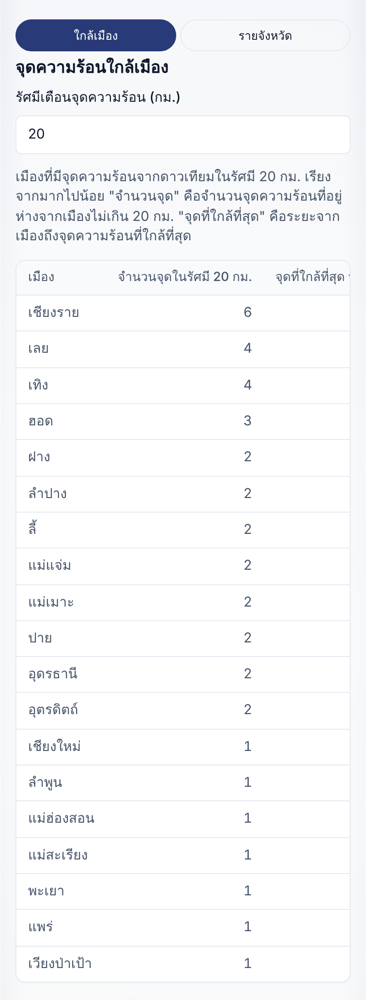{width=50%}

**รูปที่ C.23** มุมมอง "ใกล้เมือง": รัศมีเตือนจุดความร้อน (กม.) และตารางเมืองที่มีจุดความร้อนในรัศมี เรียงจากมากไปน้อย (Hotspots close to towns)

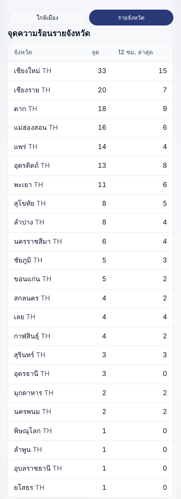{width=50%}

**รูปที่ C.24** มุมมอง "รายจังหวัด": จำนวนจุดความร้อนรายจังหวัด และจำนวนใน 12 ชม. ล่าสุด (Hotspots by province)

**แสดงอะไร** จุดความร้อนจากดาวเทียม VIIRS (S-NPP, NOAA-20, NOAA-21) ของ NASA FIRMS ช่วง 1–2 วันล่าสุด ในพื้นที่ที่เลือก
ปุ่มสลับด้านบน **ใกล้เมือง / รายจังหวัด** จำค่าไว้ในเครื่อง

- **ใกล้เมือง** (Near towns): ช่อง **รัศมีเตือนจุดความร้อน (กม.)** ค่าเริ่มต้น 20 กม. ตั้งได้ 2–100 กม.
  ตารางมีคอลัมน์ **เมือง**, **จำนวนจุดในรัศมี** และ **จุดที่ใกล้ที่สุด** (ระยะจากเมืองถึงจุดที่ใกล้ที่สุด กม.)
  ถ้าไม่มีจุดความร้อนเลย หน้าจะบอกว่านอกฤดูเผา (ภาคเหนือประมาณมกราคม–เมษายน) ถือเป็นเรื่องปกติ
- **รายจังหวัด** (By province): สูงสุด 40 จังหวัด คอลัมน์ **จังหวัด**, **จุด**, **12 ชม. ล่าสุด** (หน้า developer เพิ่ม FRP MW
  และตาราง "กลุ่มไฟขนาดใหญ่ที่สุด" ที่รวมจุดตามช่อง 0.1° และวัน)

**อ่านอย่างไร** ดาวเทียมเห็นไฟเพียงวันละประมาณ 2 ครั้ง (ราว 13:30 และ 01:30 น.) ไฟระหว่างนั้นหรือใต้เมฆอาจไม่ถูกนับ
จำนวนจุดไม่ใช่ปริมาณควันโดยตรง ใช้ร่วมกับแผนที่ PM~2.5~ และลม

---

## 5.12 แท็บจุดของฉัน (My places)

แท็บนี้เก็บสถานที่ของผู้ใช้ เช่น บ้าน ที่ทำงาน โรงเรียน จุดของฉันจะเข้าไปอยู่ในรายการพยากรณ์รายเมือง (รูปที่ C.20)
ใช้ในการนับคำเตือน และเก็บไว้**ในเบราว์เซอร์นี้เท่านั้น** (`localStorage` คีย์ `hsw.points`) ไม่ถูกส่งไปที่ใด

### 5.12.1 เพิ่มตำแหน่งปัจจุบันพร้อมตั้งชื่อ

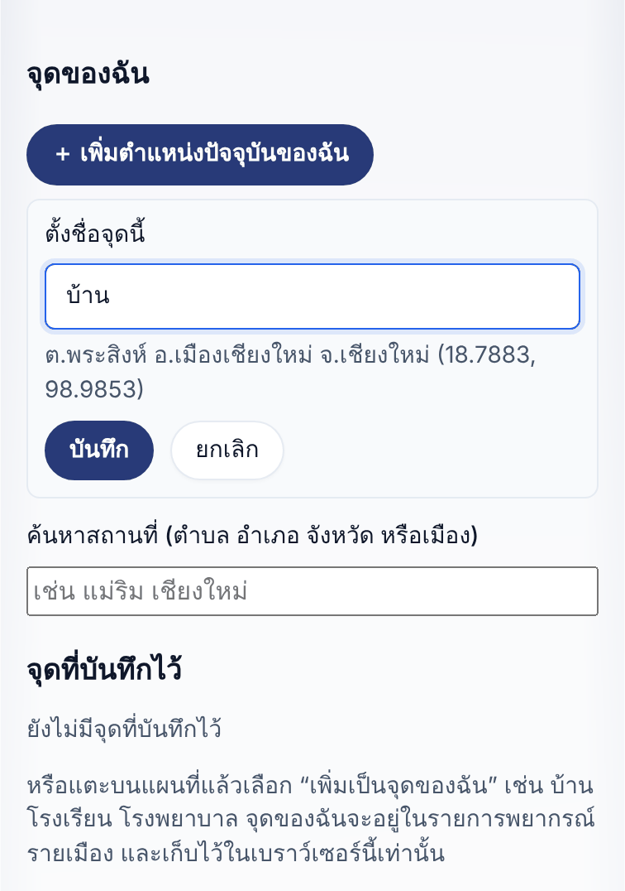{width=50%}

**รูปที่ C.25** กด "＋ เพิ่มตำแหน่งปัจจุบันของฉัน" แล้ว: ฟอร์ม "ตั้งชื่อจุดนี้" พร้อมชื่อตำบล อำเภอ จังหวัด และพิกัด ปุ่มบันทึกและยกเลิก (Add my current location)

1. กด **＋ เพิ่มตำแหน่งปัจจุบันของฉัน** (＋ Add my current location) เบราว์เซอร์จะขออนุญาตใช้ตำแหน่ง
2. ฟอร์ม **ตั้งชื่อจุดนี้** ขึ้นพร้อมชื่อตำบล อำเภอ จังหวัด และพิกัด 4 ตำแหน่ง แผนที่เลื่อนไปที่จุดนั้น
3. พิมพ์ชื่อ (สูงสุด 40 ตัวอักษร เช่น บ้าน ที่ทำงาน โรงเรียนลูก) แล้วกด **บันทึก** หรือ Enter กด **ยกเลิก** หรือ Esc เพื่อยกเลิก
   ถ้าไม่ตั้งชื่อ จะใช้ชื่อ "จุดของฉัน"

ถ้าเบราว์เซอร์ไม่อนุญาต หรือหาตำแหน่งไม่ได้ภายใน 15 วินาที จะมีข้อความบอก และแนะนำให้แตะแผนที่แทน ตำแหน่งที่อยู่นอกแผนที่ของหน้านี้จะไม่ถูกบันทึก

### 5.12.2 ค้นหาสถานที่

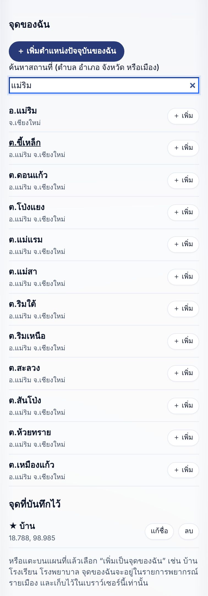{width=50%}

**รูปที่ C.26** พิมพ์ "แม่ริม" ในช่องค้นหา: ผลลัพธ์เป็นอำเภอและตำบลพร้อมชื่ออำเภอ/จังหวัด และปุ่ม "＋ เพิ่ม" ด้านล่างคือจุดที่บันทึกไว้ (Find a place)

ช่อง **ค้นหาสถานที่ (ตำบล อำเภอ จังหวัด หรือเมือง)** ค้นจากชื่อที่หน้าเว็บมีอยู่แล้ว (จังหวัด เมือง อำเภอ ตำบลของไทย) **ไม่ส่งคำค้นไปบริการภายนอก**

- พิมพ์อย่างน้อย 2 ตัวอักษร หลายคำได้ (เช่น "แม่ริม เชียงใหม่") ทุกคำต้องพบในชื่อของสถานที่หรือชื่ออำเภอ/จังหวัดของมัน
  คำนำหน้า ต. อ. จ. ตำบล อำเภอ จังหวัด แขวง เขต ถูกตัดออกก่อนค้น ชื่อที่ตรงหรือขึ้นต้นด้วยคำที่พิมพ์ขึ้นก่อน แสดงสูงสุด 12 รายการ
- **แตะชื่อ** เพื่อซูมไปที่สถานที่นั้น (ขอบเขตของอำเภอหรือตำบลถูกเน้น)
- **＋ เพิ่ม** บันทึกเป็นจุดของฉันที่กลางพื้นที่นั้นด้วยชื่อของสถานที่ ถ้ามีอยู่แล้วจะบอกว่า "มีอยู่ในจุดของฉันแล้ว"

### 5.12.3 จุดที่บันทึกไว้และหมุดบนแผนที่

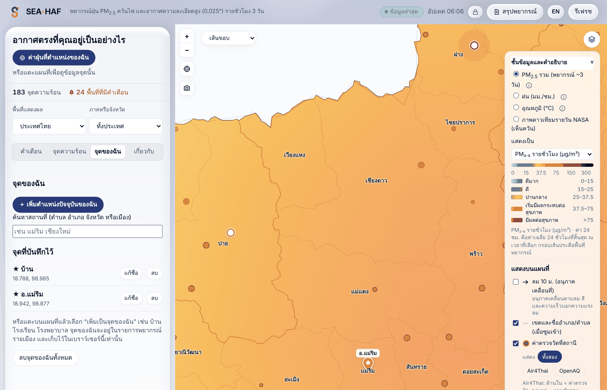{width=95%}

**รูปที่ C.27** จุดที่บันทึกไว้สองจุด (★ บ้าน, ★ อ.แม่ริม) พร้อมปุ่ม แก้ชื่อ และ ลบ และหมุดรูปดาวบนแผนที่ (Saved places and pins)

- รายการ **จุดที่บันทึกไว้** แต่ละแถวมี ★ ชื่อ พิกัด ปุ่ม **แก้ชื่อ** (เปลี่ยนเป็นช่องพิมพ์ บันทึกด้วย Enter ยกเลิกด้วย Esc) และ **ลบ**
- แตะชื่อเพื่อไปที่จุดนั้น
- **ลบจุดของฉันทั้งหมด** ขึ้นเมื่อมีตั้งแต่ 2 จุด
- บนแผนที่แต่ละจุดเป็นหมุดดาวพร้อมชื่อ
- อีกทางหนึ่งคือแตะแผนที่แล้วกด **เพิ่มเป็นจุดของฉัน** ในการ์ด (รูปที่ C.12)

---

## 5.13 แท็บเกี่ยวกับ (About)

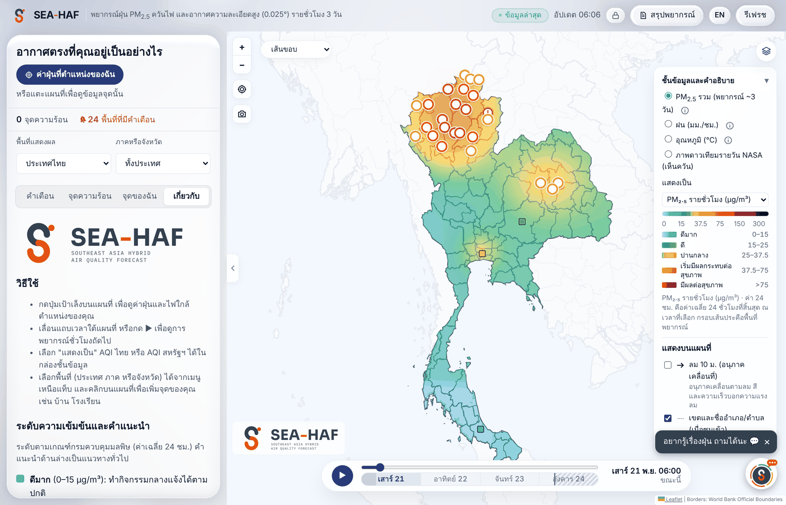{width=95%}

**รูปที่ C.28** แท็บเกี่ยวกับ: วิธีใช้ ระดับความเข้มข้นและคำแนะนำ วิธีคิดความแม่นยำ ข้อควรรู้ และแหล่งข้อมูลนำเข้า (About tab)

แท็บนี้มีในหน้า public เท่านั้น ประกอบด้วย **วิธีใช้**, **ระดับความเข้มข้นและคำแนะนำ** (ห้าระดับของ คพ. พร้อมคำแนะนำ หัวข้อ 5.20),
**ความแม่นยำของพยากรณ์คิดอย่างไร**, **ข้อควรรู้** (เป็นการพยากรณ์ ไม่ใช่ประกาศทางการ ดาวเทียมเห็นไฟวันละ ~2 ครั้ง ค่าทางการดูที่ Air4Thai)
และ **ข้อมูลนำเข้าจาก** (NASA FIRMS, Copernicus CAMS, ECMWF, สถานีตรวจวัด ฯลฯ)

---

## 5.14 สรุปพยากรณ์ (Forecast summary)

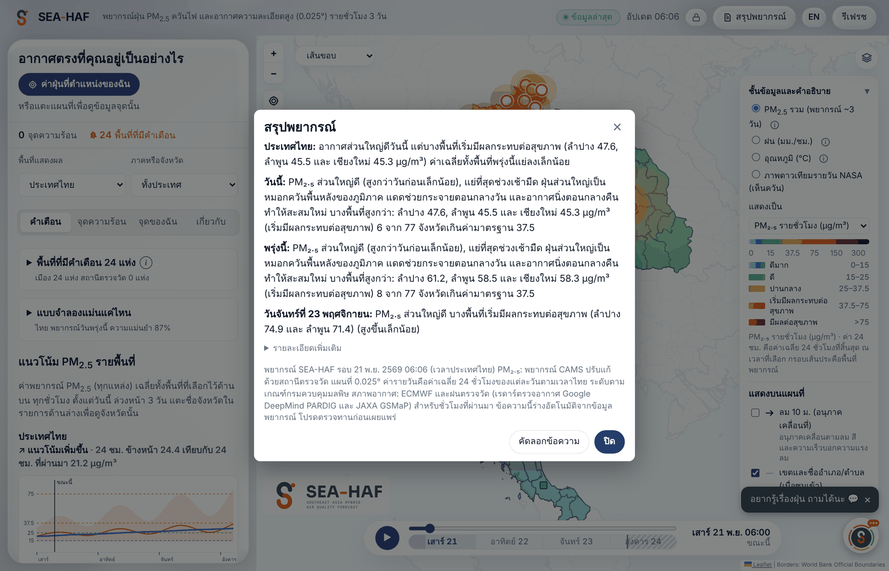{width=95%}

**รูปที่ C.29** หน้าต่างสรุปพยากรณ์: ย่อหน้าภาพรวมของพื้นที่ ตามด้วยวันนี้ พรุ่งนี้ และอีก 2 วัน และหมายเหตุแหล่งข้อมูล ปุ่มคัดลอกข้อความและปิด (Forecast summary)

**แสดงอะไร** ข้อความที่หน้าเว็บร่างเองจากข้อมูลพยากรณ์ของพื้นที่ที่เลือกเหนือแท็บ แบ่งเป็นภาพรวม แล้ว**วันนี้ พรุ่งนี้ และอีก 2 วัน**
แต่ละวันบอกระดับของพื้นที่ส่วนใหญ่ ช่วงเวลาที่ฝุ่นสูง พื้นที่ที่สูงสุด (เช่น "ลำปาง 47.6, ลำพูน 45.5 และเชียงใหม่ 45.3 µg/m³")
จำนวนจังหวัดที่เกินค่ามาตรฐาน 37.5 และสภาพอากาศ (อุณหภูมิ ฝน ลม การระบายอากาศ) เมื่อมีข้อมูล
"รายละเอียดเพิ่มเติม" แสดงตัวเลขรายวัน ท้ายหน้าต่างบอกรอบพยากรณ์และแหล่งข้อมูล

**ใช้อย่างไร** กดปุ่ม **สรุปพยากรณ์** ที่ส่วนหัว (บนมือถือคือ **สรุป**) **คัดลอกข้อความ** เพื่อนำไปวาง **ปิด** หรือ Esc เพื่อปิด

**ข้อมูลเบื้องหลัง** ตัวเลขเดียวกับกราฟแนวโน้มรายพื้นที่ (`areaSeries`): ค่าเฉลี่ยของแผนที่ PM~2.5~ ที่ปรับแก้แล้ว วันตามเวลาไทย
ค่าเฉลี่ย 24 ชม. ต้องมีอย่างน้อย 18 ชั่วโมง ระดับใช้เกณฑ์ 24 ชม. ของ คพ. ลมจาก ECMWF ที่กลางพื้นที่

---

## 5.15 บันทึกภาพแผนที่ (Save the map as an image)

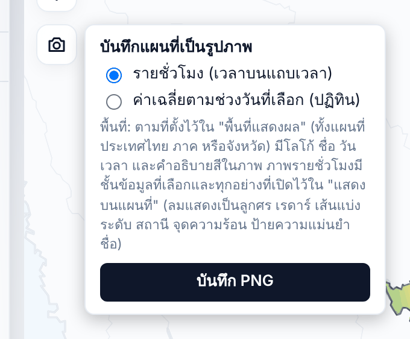{width=50%}

**รูปที่ C.30** แผงบันทึกภาพจากปุ่มกล้องบนแผนที่: เลือกรายชั่วโมงหรือค่าเฉลี่ยตามช่วงวันที่เลือก และปุ่ม "บันทึก PNG" (Save panel)

**ใช้อย่างไร**

1. กดปุ่ม**กล้อง**ใต้ปุ่มตำแหน่งบนแผนที่
2. เลือก **รายชั่วโมง (เวลาบนแถบเวลา)** หรือ **ค่าเฉลี่ยตามช่วงวันที่เลือก (ปฏิทิน)** แบบหลังมีช่อง **ตั้งแต่วันที่ / ถึงวันที่**
   เลือกได้เฉพาะวันที่มีข้อมูลเก็บไว้ (`data/pm-days`) ค่าเริ่มต้นคือ 7 วันล่าสุด และบอกว่าช่วงที่เลือกมีข้อมูลกี่วัน
3. กด **บันทึก PNG** ปุ่มเปลี่ยนเป็น "กำลังสร้างภาพ…" แล้วเบราว์เซอร์ดาวน์โหลดไฟล์ เช่น `SEA-HAF_PM25_hourly_<พื้นที่>_<เวลา>.png`

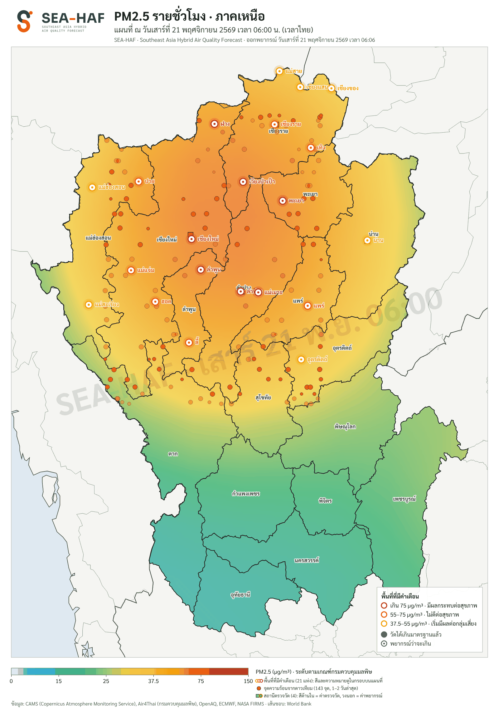{width=70%}

**รูปที่ C.31** ภาพที่บันทึกของภาคเหนือ (รายชั่วโมง): หัวภาพมีโลโก้ ชื่อชั้นข้อมูล พื้นที่ และเวลา แผนที่มีชื่อจังหวัด เครื่องหมายเตือนพร้อมชื่อ จุดความร้อน และสถานี กรอบคำอธิบายรวมมุมขวาล่าง และแถบสีกับรายการสัญลักษณ์ด้านล่าง (Saved map image)

**ภาพมีอะไร**

- **พื้นที่** ตาม "พื้นที่แสดงผล" (ทั้งแผนที่ ประเทศไทย ภาค หรือจังหวัด) สนามข้อมูลถูกตัดตามขอบพื้นที่เหมือนบนจอ พื้นที่ทรงสูงถูกขยายด้านข้างเพื่อให้รูปทรงถูกต้อง
- **หัวภาพ**: โลโก้ ชื่อชั้นและพื้นที่ เวลาของแผนที่ และเวลาออกพยากรณ์ ลายน้ำจาง "SEA-HAF · เวลา"
- **ชั้นข้อมูล**: ชั้นที่เลือก (PM~2.5~, ฝน, อุณหภูมิ ฯลฯ) วาดจากข้อมูลบนแคนวาส ไม่ใช่การจับภาพหน้าจอ
- **สิ่งที่เปิดใน "แสดงบนแผนที่"** (เฉพาะภาพรายชั่วโมง): ลม (เป็นลูกศร) เรดาร์ เส้นแบ่งระดับ สถานี จุดความร้อน ป้ายความแม่นยำ ชื่อสถานที่ และเครื่องหมายเตือน
- **ชื่อสถานที่**: เลือกจังหวัด จะมีเขตและชื่ออำเภอ/ตำบล พื้นที่อื่นมีชื่อจังหวัด ชื่อไม่ทับกัน
- **กรอบคำอธิบายรวม** (combined legend) มุมขวาล่าง มีหัวข้อแยกตามชั้นที่ปรากฏในภาพ ได้แก่ **พื้นที่ที่มีคำเตือน** (แดง เกิน 75, ส้มเข้ม 55–75,
  ส้มอ่อน 37.5–55 เฉพาะระดับที่มีในภาพ จุดทึบ = วัดได้เกินมาตรฐานแล้ว วงแหวน = พยากรณ์ว่าจะเกิน และ "+n = มีพื้นที่ใกล้กันอีก n แห่ง"),
  **สถานีตรวจวัด** และ **จุดความร้อนจากดาวเทียม 1–2 วันล่าสุด**
- **แถบสีและรายการสัญลักษณ์** ด้านล่าง และบรรทัดแหล่งข้อมูล (CAMS, Air4Thai, OpenAQ, ECMWF, NASA FIRMS, เส้นขอบ World Bank)

**การจับกลุ่มเครื่องหมายเตือน** เครื่องหมายที่อยู่ห่างกันในภาพไม่ถึง 28 จุดภาพ (คูณตามสเกลภาพ) รวมเป็นหนึ่งเครื่องหมาย เครื่องหมายที่แสดงคือระดับสูงสุด
ของกลุ่ม (เรียงระดับก่อน แล้วค่าวัดก่อนค่าพยากรณ์) ชื่อเขียนว่า "ชื่อ และอีก n แห่ง" และมีป้าย "+n" สีเดียวกับระดับ ชื่อเตือนวาดทับชื่ออื่น
แต่ไม่ทับกันเอง

---

## 5.16 แชต "ถาม SEA-HAF" (Ask SEA-HAF)

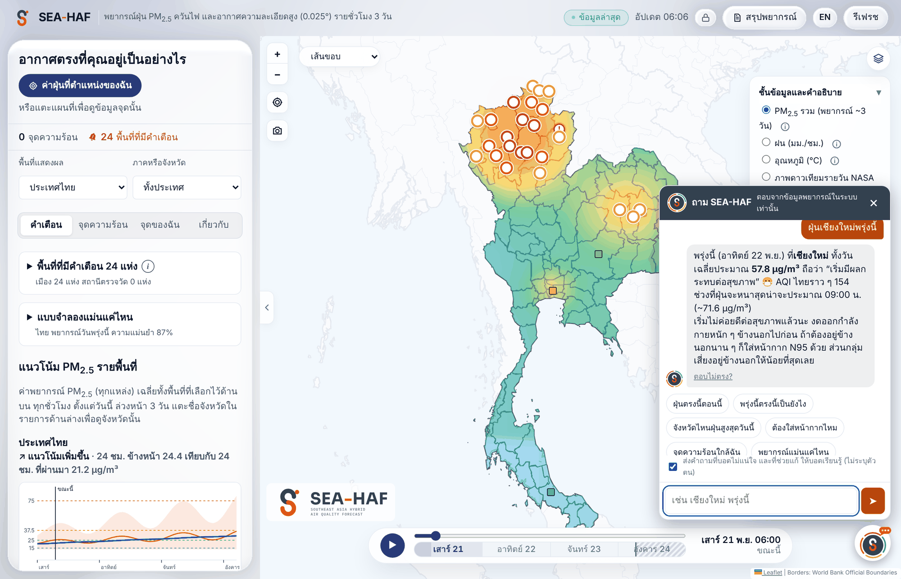{width=95%}

**รูปที่ C.32** หน้าต่างแชต: คำถาม "ฝุ่นเชียงใหม่พรุ่งนี้" และคำตอบที่บอกค่าเฉลี่ย ระดับ AQI ช่วงที่ฝุ่นหนาที่สุด และคำแนะนำ ด้านล่างคือปุ่มคำถามสำเร็จรูปและช่องพิมพ์ (Ask SEA-HAF chat)

**ใช้อย่างไร** กดปุ่มหุ่นยนต์มุมขวาล่าง (ครั้งแรกจะมีข้อความชวน "อยากรู้เรื่องฝุ่น ถามได้นะ 💬" ปิดได้ด้วย ×) พิมพ์คำถาม (สูงสุด 200 ตัวอักษร)
หรือกดปุ่มคำถามสำเร็จรูป: **ฝุ่นตรงนี้ตอนนี้**, **พรุ่งนี้ตรงนี้เป็นยังไง**, **จังหวัดไหนฝุ่นสูงสุดวันนี้**, **ต้องใส่หน้ากากไหม**,
**จุดความร้อนใกล้ฉัน**, **พยากรณ์แม่นแค่ไหน**, **ข้อมูลมาจากไหน** กด Esc หรือ × เพื่อปิด

**ตอบเรื่องอะไรได้** หัวข้อที่ตอบได้: ค่าฝุ่น PM~2.5~ (ตอนนี้ วันไหน ช่วงไหนของวัน ที่ตำแหน่งของคุณหรือจังหวัดใดในไทย), ควรทำตัวยังไง / ใส่หน้ากากไหม,
จังหวัดไหนฝุ่นเยอะสุด, จุดความร้อน / ไฟ, ฝน / อุณหภูมิ, หมอก, พยากรณ์แม่นแค่ไหน, ข้อมูลมาจากไหน, ระบบทำงานยังไง
คำถามที่ต้องรู้สถานที่แต่ไม่ได้บอกจังหวัด จะขอใช้ตำแหน่งจากเบราว์เซอร์ ถ้าไม่ได้ จะถามว่า "อยากรู้ของที่ไหนดี?"

**ขอบเขตของคำตอบ**

- **คำตอบมาจากข้อมูลบนหน้าเว็บเท่านั้น** (แผนที่พยากรณ์ จุดความร้อน อากาศ การ์ดความแม่นยำ) หัวหน้าต่างเขียนว่า "ตอบจากข้อมูลพยากรณ์ในระบบเท่านั้น"
  แชตไม่ได้ใช้แบบจำลองภาษาสร้างคำตอบ และไม่ค้นข้อมูลจากภายนอก
- ส่วนที่เป็น "AI" มีเพียงตัวจำแนกหัวข้อขนาดเล็ก (`scripts/chatml.mjs`) ที่ทายว่าคำถามเป็นหัวข้อใด
  ถ้ามั่นใจตั้งแต่ 0.5 ขึ้นไปจะตอบหัวข้อนั้น ถ้าไม่มั่นใจจะใช้กฎคำสำคัญ ถ้ายังไม่ชัดและมีหัวข้อที่น่าจะเป็นอย่างน้อย 0.2 จะถามกลับพร้อมปุ่มให้เลือกหัวข้อ
- เรื่องนอกขอบเขต แชตตอบว่า "เรื่องนี้ตอบไม่ได้จริง ๆ นะ ตอบได้แค่เรื่องฝุ่น หมอกควัน หมอก อากาศ จุดความร้อน แล้วก็เรื่องของ SEA-HAF เอง"
- ถ้าวันที่ถามเลยปลายพยากรณ์ แชตบอกว่า "พยากรณ์ยังไปไม่ถึงวันนั้น"
- ลิงก์ **ตอบไม่ตรง?** ใต้คำตอบเปิดปุ่มให้เลือกหัวข้อที่ตั้งใจถามใหม่
- ช่องติ๊ก "ส่งคำถามที่บอตไม่แน่ใจ และที่ช่วยแก้ ให้บอตเรียนรู้ (ไม่ระบุตัวตน)" ขึ้นเฉพาะเมื่อตั้งปลายทางรับคำถามไว้ (`chat/config.json`)
  ไม่ติ๊กก็ใช้แชตได้ตามปกติ คำถามที่ส่งไปเป็นข้อมูลให้ผู้ดูแลติดหัวข้อในหน้า developer (รูปที่ C.38)

---

## 5.17 ธีม ภาษา และการใช้งานบนมือถือ

### 5.17.1 ธีมสว่างและมืด

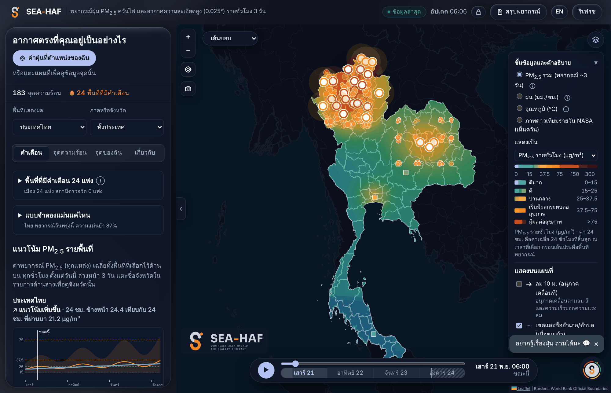{width=95%}

**รูปที่ C.33** หน้าหลักในธีมมืด (Dark theme)

หน้าเว็บเปลี่ยนเป็นธีมมืดตาม**การตั้งค่าของระบบปฏิบัติการหรือเบราว์เซอร์** (`prefers-color-scheme`) โดยอัตโนมัติ หน้าเว็บไม่มีปุ่มสลับธีมของตัวเอง
โลโก้ หุ่นยนต์แชต และแผงกระจกเปลี่ยนเป็นรุ่นสำหรับพื้นมืด ข้อความบนแผงกระจกออกแบบให้มีความต่างสีอย่างน้อย 4.5:1 ทั้งสองธีม
สีของระดับ PM~2.5~ บนแผนที่เหมือนกันทั้งสองธีม

### 5.17.2 ภาษาอังกฤษ

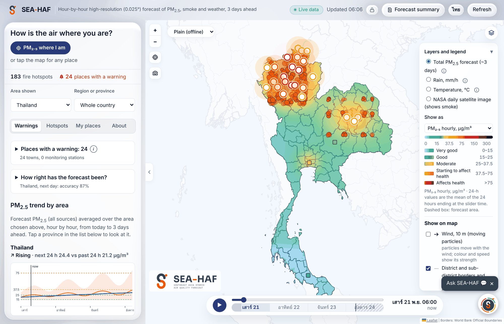{width=95%}

**รูปที่ C.34** หน้าหลักเมื่อกดปุ่ม EN: ข้อความทั้งหน้าเป็นภาษาอังกฤษ (English)

### 5.17.3 การใช้งานบนมือถือ

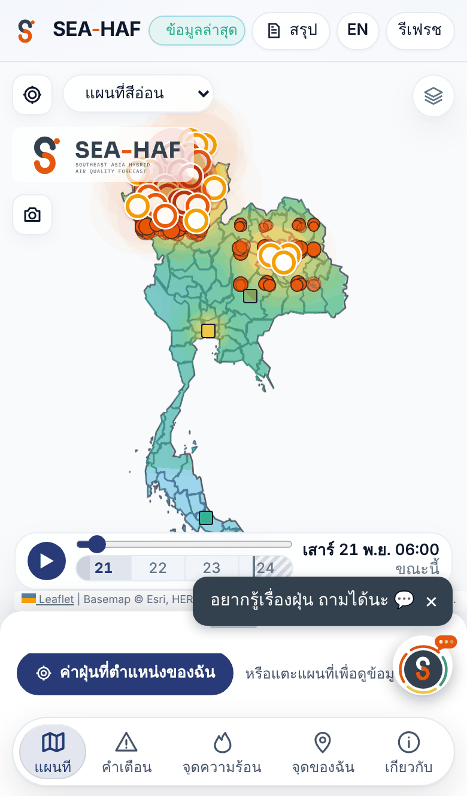{width=30%} 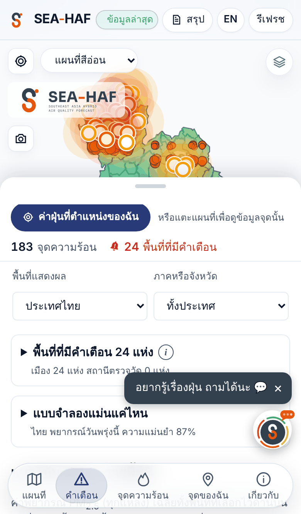{width=30%} 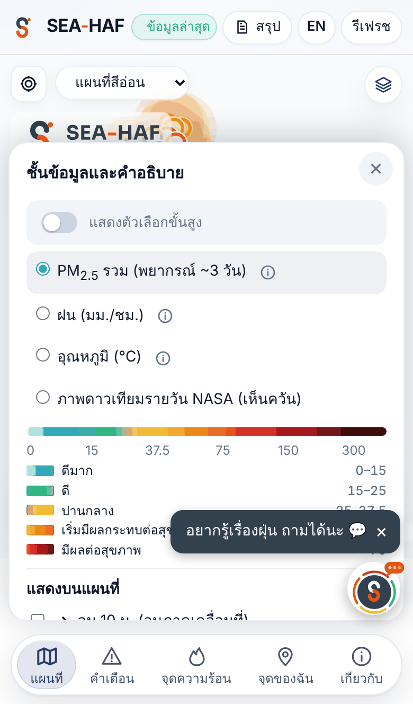{width=30%}

**รูปที่ C.35** หน้าใหม่บน iPhone (จากซ้าย): หน้าแผนที่, แผ่นเลื่อนล่างเมื่อแตะแท็บคำเตือน และกล่องชั้นข้อมูลแบบหน้าต่าง (Mobile layout)

บนจอแคบ (ไม่เกินประมาณ 860 px) หน้าใหม่จัดเป็นแบบแอป

- **แถบแท็บล่าง**: **แผนที่**, **คำเตือน**, **จุดความร้อน**, **จุดของฉัน**, **เกี่ยวกับ**
- **แผ่นเลื่อนล่าง** (bottom sheet) แทนแผงด้านข้าง มีสามระดับ (พับ ครึ่ง เต็ม) ลากที่ขีดด้านบนหรือแตะแท็บเพื่อเปลี่ยน
  เมื่อแตะรายการที่ต้องดูบนแผนที่ แผ่นจะพับลงให้เห็นแผนที่
- **ส่วนหัว** เหลือ ป้ายสถานะ, **สรุป**, ภาษา และ **รีเฟรช** แถบเวลาอยู่ใต้แผนที่ โลโก้ย้ายไปมุมซ้ายบนใต้ปุ่มตำแหน่ง
- **กล่องชั้นข้อมูล** เปิดจากปุ่มรูปชั้นซ้อนเป็นหน้าต่าง โดยปกติแสดงแบบย่อ สวิตช์ **แสดงตัวเลือกขั้นสูง** (Show advanced options)
  เปิดส่วนที่ซ่อนไว้ ได้แก่ เมนู **แสดงเป็น** (AQI) สวิตช์ค่าตรวจวัดที่สถานีและปุ่มเลือกแหล่ง และคำอธิบายยาวของแต่ละชั้น
- แชตเลื่อนขึ้นเหนือแป้นพิมพ์เมื่อพิมพ์

---

## 5.18 หน้าเดิม (`/classic.html`)

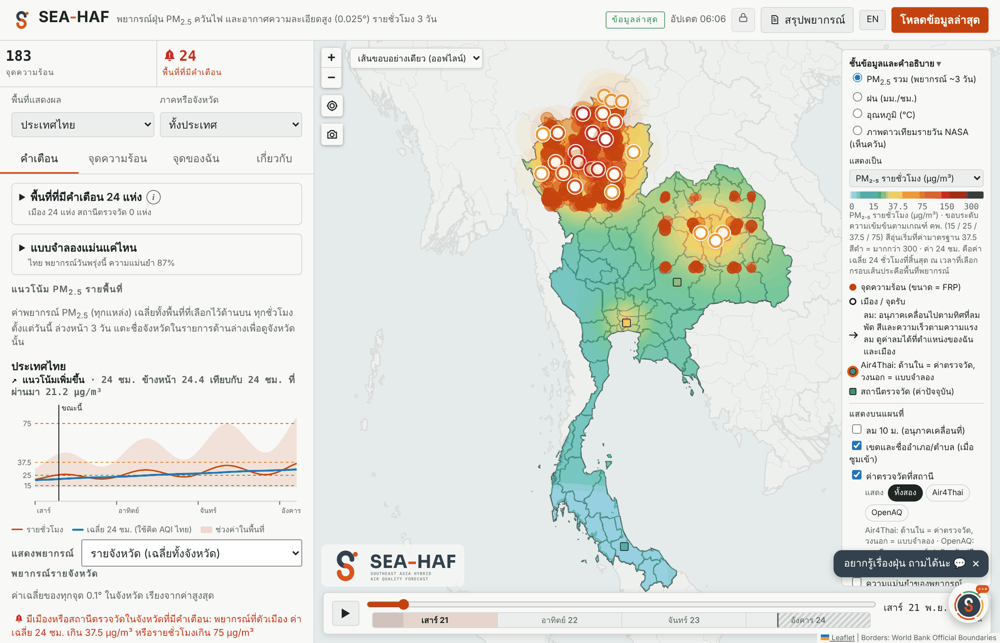{width=95%}

**รูปที่ C.36** หน้าเดิม (classic) ที่ใช้โค้ดชุดเดียวกัน: ตัวเลขสรุปเป็นกล่องด้านบนแผง กราฟและการ์ดเหมือนหน้าใหม่ กล่องชั้นข้อมูลแบบเดิม (Classic page)

หน้าเดิมกับหน้าใหม่ใช้โค้ด ข้อมูล และกฎเตือนชุดเดียวกัน ทุกฟังก์ชันในบทนี้ใช้ได้ทั้งสองหน้า ความต่างอยู่ที่ผังและการโต้ตอบ

| เรื่อง | หน้าใหม่ (`/`) | หน้าเดิม (`/classic.html`) |
|---|---|---|
| แตะแผนที่ | เปิดการ์ดสรุปของจุดนั้น (รูปที่ C.12) | **เพิ่มเป็นจุดของฉันทันที** (ลบได้ในแท็บจุดของฉัน) |
| แผงด้านข้าง | แผงกระจก มีกล่อง "อากาศตรงที่คุณอยู่เป็นอย่างไร" ซ่อนแผงได้ | แผงทึบแบบเดิม ตัวเลขสรุปเป็นกล่อง |
| คำอธิบายสี | ชื่อระดับพร้อมช่วงค่าใต้แถบสี (`#legKey`) และปุ่ม (i) ของแต่ละชั้น | แถบสีและข้อความคำอธิบายใต้แถบ |
| ปุ่มซ่อนกล่องชั้นข้อมูล / แผงด้านข้าง | มี | ไม่มี (พับกล่องด้วย ▾) |
| มือถือ | แถบแท็บล่างและแผ่นเลื่อนล่าง | แผงและแผนที่เรียงต่อกันตามแนวตั้ง |
| ภาพพื้นหลังแบบน้ำ (WebGL) | มีเฉพาะจอกว้าง | ไม่มี |

---

## 5.19 หน้า developer (`/dev.html`)

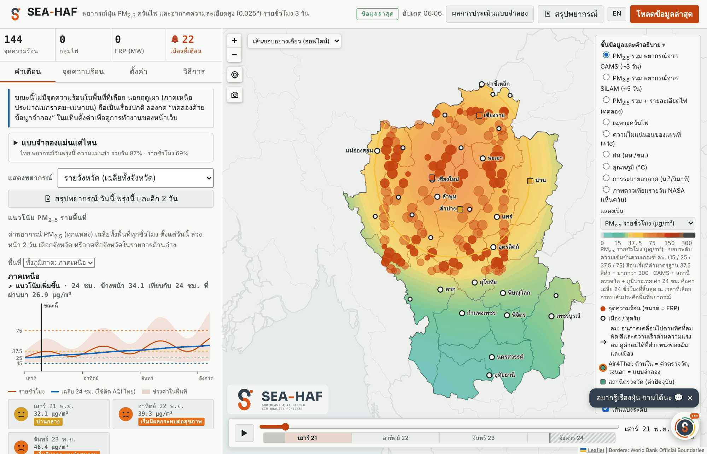{width=95%}

**รูปที่ C.37** หน้า developer หลังเข้าสู่ระบบ (สำเนาทดสอบ): ตัวเลขสรุปสี่ช่อง (จุดความร้อน กลุ่มไฟ FRP เมืองที่เตือน) แท็บตั้งค่าและวิธีการ ชั้นข้อมูลเพิ่มเติม และปุ่ม "ผลการประเมินแบบจำลอง" (Developer page)

**การเข้าถึง** `dev.html` คือ `index.html` แบบ developer ที่ถูกเข้ารหัสตอน build (`scripts/lockpage.mjs`: PBKDF2-SHA256 → AES-256-GCM)
ไฟล์ที่เผยแพร่มีแต่ข้อความเข้ารหัสและฟอร์มเข้าสู่ระบบ ชื่อผู้ใช้และรหัสผ่านมาจาก GitHub Secrets `DEV_USER` และ `DEV_PASS`
(คู่มือนี้ไม่บอกค่า) ช่อง "จำไว้ในเครื่องนี้" เก็บกุญแจที่ได้จากรหัสผ่าน ไม่เก็บรหัสผ่าน หน้า **ผลการประเมินแบบจำลอง** (`perf.html`) ถูกล็อกแบบเดียวกัน

**ส่วนที่มีเพิ่มจากหน้า public**

| ส่วน | อะไร |
|---|---|
| ตัวเลขสรุป | เพิ่ม **กลุ่มไฟ** (จำนวนช่อง 0.1°) และ **FRP (MW)** |
| แท็บ **ตั้งค่า** | NASA FIRMS MAP_KEY (ใช้เฉพาะเมื่อเปิดหน้าโดยไม่มีไฟล์ข้อมูลรายชั่วโมง ช่องเป็นแบบรหัสผ่าน ไม่บันทึกลง repo), ดาวเทียม (VIIRS S-NPP, NOAA-20, NOAA-21, MODIS), จำนวนวันย้อนหลัง, ความเชื่อมั่น, ชนิดเชื้อเพลิง (FINN v2.5), น้ำหนักรายละเอียดไฟ α, รูปแบบเวลาการเผา, ความสูงควันลอยตัว, การปรับการปล่อยด้วยค่าตรวจวัด (ทดสอบ), ปุ่ม **ทดลองด้วยข้อมูลจำลอง** และ **อัปโหลดไฟล์ CSV ของ FIRMS** |
| ชั้นข้อมูลและสวิตช์ | SILAM, รายละเอียดไฟ, เฉพาะควันไฟ, ความไม่แน่นอน, การระบายอากาศ, เส้นแบ่งระดับ, เรดาร์, ลูกศรลม, เขตจังหวัด, เมือง (ตารางในหัวข้อ 5.5.1) |
| แท็บจุดความร้อน | คอลัมน์ FRP และตาราง **กลุ่มไฟขนาดใหญ่ที่สุด** (แตะแถวเพื่อบินไปที่กลุ่มไฟ) |
| การ์ดความแม่นยำ | แถว "วันที่ฝุ่นเกิน 37.5 ที่เตือนทัน" และ "เตือนแล้วไม่เกินจริง" และคะแนนเซนเซอร์ราคาประหยัด |
| แท็บ **วิธีการ** | คำอธิบายวิธีการเต็ม (ภาษาอังกฤษ) และกล่องตรวจสถานะรายรอบ: `rkBox` (ค่าสัมประสิทธิ์ regression kriging), `assimBox` (การปรับการปล่อยจากไฟ, shadow mode), `mlBox` (สถานะการปรับแก้ที่เรียนรู้เอง: active/learning, น้ำหนักของ expert, expert ที่ฝึกแล้ว, ความคลาดเคลื่อนนอกตัวอย่าง, feature สำคัญ) และ `verifyBox` (ตาราง RMSE ตาม lead: raw, corrected, blend) |
| ปุ่ม **ผลการประเมินแบบจำลอง** | เปิด `perf.html`: สรุป, ความคลาดเคลื่อนรายวัน, skill เทียบ reference รายวัน, ความคลาดเคลื่อนและ skill ตาม lead, สิ่งที่แต่ละขั้นเพิ่ม, skill รายสถานี, อนุกรมเวลาสถานี, เหตุการณ์เกินเกณฑ์, การตรวจอิสระ, น้ำหนักของการเรียนรู้เอง (คำนวณใหม่ทุก 3 ชม.) |

**สถานะของประตู (gates)** หน้า developer แสดงสถานะการปรับแก้ที่เรียนรู้เอง (v1) ใน `mlBox` ส่วนประตูอื่นที่ pipeline ตรวจรายวัน
(`pmHighCheck` ของ PM~2.5~ correction v2, `obsRainCheck` ของ PARDIG/GSMaP, `rainDetectCheck` ของ weather-ML) **ยังไม่มีตารางในหน้า developer**
ผลอยู่ใน log ของ workflow และ `state.json` (ดูบทที่ 6–7) ข้อนี้จดไว้ใน `ISSUES_C1.md` ตามสถานะในโค้ด ณ วันที่เขียน
PM~2.5~ correction v2 และ climatology blend **ยังไม่ได้ใช้งาน** (ประตูยังปิด) และ SILAM ยังไม่เป็นค่าเริ่มต้น

### 5.19.1 การติดหัวข้อคำถามแชต (chat labelling)

{width=60%}

**รูปที่ C.38** กล่อง "คำถามแชทที่รอติดหัวข้อ" บนสุดของแท็บวิธีการ: ช่องรหัส (EXPORT_TOKEN) และปุ่มโหลด (Chat questions to label)

1. ใส่รหัสในช่อง **รหัส (EXPORT_TOKEN)** (ค่าของ Pages secret ที่ตั้งจาก `CHAT_EXPORT_TOKEN`) รหัสอยู่เฉพาะในแท็บเบราว์เซอร์นี้ (`sessionStorage`)
   ไม่อยู่ในหน้าเว็บหรือ repo แล้วกด **โหลด** หรือ Enter รหัสผิดจะขึ้น "รหัสไม่ถูกต้อง"
2. รายการแสดงคำถามที่บอตไม่แน่ใจ และคำถามจากโหมดเก็บคำถาม (ลิงก์ที่มี `?chatlab=1`) แต่ละข้อบอกจำนวนครั้งที่ส่งมา หัวข้อที่ผู้ใช้เลือก
   และหัวข้อที่บอตทาย บรรทัดสถานะบอก "รอติดหัวข้อ n ข้อ ติดแล้ว n ข้อ"
3. กดปุ่มหัวข้อที่ถูก หรือ **ข้าม** ปุ่มที่มี ✨ คือหัวข้อที่ LLM ในเครื่องของผู้ดูแลเสนอ (`scripts/chat_llm_label.mjs`) **เป็นเพียงคำแนะนำ**
   การกดของผู้ดูแลเท่านั้นที่เป็น label หนึ่งในสามของ label ถูกเก็บเป็นชุดทดสอบจริง (`chat/test_real.json`) ส่วนที่เหลือเป็นชุดฝึก
4. หลังติดหัวข้อแล้วผู้ดูแลฝึกตัวจำแนกใหม่ด้วย `node scripts/chat_train.mjs` (บทที่ 7)

---

## 5.20 อ่านค่าอย่างไร

### 5.20.1 แถบสีและระดับ PM~2.5~

หน้าเว็บใช้ระดับของกรมควบคุมมลพิษ (คพ.) ตั้งแต่ 1 มิ.ย. 2566 (มาตรฐานค่าเฉลี่ย 24 ชม. = 37.5 µg/m³) แผนที่ใช้สีต่อเนื่อง
ช่วงสีในกล่องคำอธิบายคือสีของแผนที่ทั้งช่วงของระดับนั้น

| ระดับ (ไทย / English) | PM~2.5~ เฉลี่ย 24 ชม. (µg/m³) | AQI ไทย | คำแนะนำ (จากแท็บเกี่ยวกับ) |
|---|---|---|---|
| ดีมาก (Very good) | 0–15 | 0–25 | ทำกิจกรรมกลางแจ้งได้ตามปกติ |
| ดี (Good) | 15.1–25 | 26–50 | ทำกิจกรรมกลางแจ้งได้ตามปกติ |
| ปานกลาง (Moderate) | 25.1–37.5 | 51–100 | เด็ก ผู้สูงอายุ หญิงตั้งครรภ์ และผู้มีโรคหัวใจหรือปอด ควรลดกิจกรรมกลางแจ้งที่ใช้แรงมาก |
| เริ่มมีผลกระทบต่อสุขภาพ (Starting to affect health) | 37.6–75 | 101–200 | ทุกคนควรลดเวลาอยู่กลางแจ้ง กลุ่มเสี่ยงควรงด |
| มีผลต่อสุขภาพ (Affects health) | มากกว่า 75 | 201 ขึ้นไป | ทุกคนควรงดกิจกรรมกลางแจ้ง ใส่หน้ากาก N95 เมื่อออกนอกอาคาร |

เกิน 75.1 µg/m³ หน้าเว็บต่อ AQI ไทยด้วยความชันของช่วง 101–200 แถบสีของแผนที่ไปถึง 300 µg/m³ (สีดำ = มากกว่า 300)

AQI สหรัฐฯ (US EPA 2567, ค่าเฉลี่ย 24 ชม.): ดี 0–9.0, ปานกลาง 9.1–35.4, มีผลต่อกลุ่มเสี่ยง 35.5–55.4, มีผลต่อสุขภาพ 55.5–125.4,
มีผลต่อสุขภาพมาก 125.5–225.4, อันตราย มากกว่า 225.4 µg/m³ (AQI 0–50, 51–100, 101–150, 151–200, 201–300, 301–500)

ค่า "รายชั่วโมง" เทียบกับเกณฑ์ที่กำหนดไว้สำหรับค่าเฉลี่ย 24 ชม. เป็นเพียงค่าประกอบ ให้ดูค่าเฉลี่ย 24 ชม. หรือ AQI ไทย (เฉลี่ย 24 ชม.) เมื่อเทียบกับประกาศทางการ

### 5.20.2 กฎการเตือน

**พื้นที่มีคำเตือนเมื่อ ค่าเฉลี่ย 24 ชม. เกิน 37.5 µg/m³ หรือค่ารายชั่วโมงใดเกิน 75 µg/m³** ในพยากรณ์ที่ตัวเมือง
สถานีตรวจวัดมาตรฐานเตือนเมื่อค่าเฉลี่ย 24 ชม. ที่วัดได้ตอนนี้เกิน 37.5 หรือพยากรณ์ของสถานีเข้ากฎเดียวกัน (หัวข้อ 5.9.1)
ระดับสีของเครื่องหมายเตือนแยกเป็น 37.5–55, 55–75 และเกิน 75 µg/m³ (หัวข้อ 5.6)

### 5.20.3 คำและสัญลักษณ์ที่พบบ่อย

| คำ / สัญลักษณ์ | ความหมาย |
|---|---|
| กระดิ่งสีแดง | มีคำเตือน (ในการ์ด: มีเมืองหรือสถานีในพื้นที่นั้นที่มีคำเตือน) |
| "ขณะนี้" | ค่าของชั่วโมงปัจจุบัน |
| "ค่าเฉลี่ย 24 ชม. สูงสุดข้างหน้า" | ค่าเฉลี่ยเคลื่อนที่ 24 ชม. ที่สูงที่สุดในช่วงพยากรณ์ข้างหน้า |
| "วัดได้เกินมาตรฐานแล้ว" / จุดทึบ | สถานีวัดค่าเฉลี่ย 24 ชม. ได้เกิน 37.5 แล้ว |
| "พยากรณ์ว่าจะเกิน" / วงแหวน | ยังไม่เกิน แต่พยากรณ์ว่าจะเข้ากฎเตือน |
| "ค่ารอยืนยัน" / ! สีแดง | ค่าพุ่งที่ระบบยังไม่ใช้ (หัวข้อ 5.10) |
| "ความแม่นยำ xx%" | 100 − NRMSE ของพยากรณ์ค่าเฉลี่ยรายวันล่วงหน้า 24 ชม. 30 วันล่าสุด (หัวข้อ 5.5.2) |
| "คลาดเคลื่อนโดยเฉลี่ย ±x" | ค่าเฉลี่ยของความต่างสัมบูรณ์ระหว่างพยากรณ์รายวันกับค่าวัด (µg/m³) |
| วงสีส้มขอบเข้ม | จุดความร้อน (ใหญ่ = FRP สูง จาง = เกิน 12 ชม.) |
| วงกลม Air4Thai | สีใน = ค่าวัด, วงนอก = ค่าแบบจำลอง |
| สี่เหลี่ยม | สถานีหรือเซนเซอร์ OpenAQ (สีจาง = เซนเซอร์ราคาประหยัด) |
| ★ | จุดของฉัน |

---

## 5.21 คำถามที่พบบ่อย (FAQ)

**ถาม ค่าบนหน้าเว็บต่างจาก Air4Thai เพราะอะไร**
ตอบ ค่าบนแผนที่คือ**พยากรณ์**ที่ปรับด้วยค่าตรวจวัด ไม่ใช่ค่าที่วัด ณ จุดนั้น ค่า Air4Thai คือค่าวัดที่สถานี และเกณฑ์ทางการใช้ค่าเฉลี่ย 24 ชม.
ให้เทียบกับ "แสดงเป็น: PM~2.5~ เฉลี่ย 24 ชม." หรือ AQI ไทย (เฉลี่ย 24 ชม.) และดูวงกลม Air4Thai ที่สีด้านในคือค่าวัดจริง
ค่าทางการดูที่ air4thai.pcd.go.th

**ถาม ทำไมจังหวัดไม่มีกระดิ่ง แต่ค่าเฉลี่ยจังหวัดสูง หรือกลับกัน**
ตอบ กระดิ่งตัดสินที่ตัวเมืองและสถานี ไม่ใช่ค่าเฉลี่ยทั้งจังหวัด จังหวัดที่มีเมืองหนึ่งเข้ากฎจะได้กระดิ่งแม้ค่าเฉลี่ยทั้งจังหวัดไม่สูง
และขึ้นก่อนในรายการเพื่อไม่ให้ค่าเฉลี่ยซ่อนคำเตือนของเมือง

**ถาม เครื่องหมายเตือนเป็นสีส้มอ่อน ทั้งที่การ์ดบอกว่ามีชั่วโมงเกิน 75**
ตอบ สีของเครื่องหมายใช้ค่าเฉลี่ย 24 ชม. เมืองที่เตือนเพราะชั่วโมงเดียวเกิน 75 แต่ค่าเฉลี่ยไม่ถึง 37.5 จะเป็นส้มอ่อน (หัวข้อ 5.6)

**ถาม พยากรณ์ไปได้กี่วัน**
ตอบ ชุด CAMS ที่หน้า public ใช้ ยาวประมาณ 3 วัน (การ์ดรายวันสูงสุด 3 กล่อง) แถบเวลาอาจยาวกว่านั้นเล็กน้อย ความแม่นยำประเมินเฉพาะวันพรุ่งนี้
และล่วงหน้า 2 วัน วันที่ 3–4 ใช้ดูแนวโน้ม

**ถาม ทำไมไม่มีจุดความร้อน**
ตอบ นอกฤดูเผา (ภาคเหนือประมาณมกราคม–เมษายน) จุดความร้อนน้อยเป็นเรื่องปกติ ดาวเทียมเห็นไฟวันละประมาณ 2 ครั้ง ไฟใต้เมฆหรือระหว่างรอบโคจรอาจไม่ถูกนับ

**ถาม ค่าสถานีหนึ่งขึ้น "ค่ารอยืนยัน" หมายความว่าอะไร**
ตอบ ค่าพุ่งเกิน 300 µg/m³ และเกิน 5 เท่าของ 3 ชั่วโมงก่อน ระบบยังไม่ใช้ค่านี้ปรับพยากรณ์ อาจเป็นควันจริงใกล้สถานีหรือเครื่องขัดข้อง (หัวข้อ 5.10)

**ถาม จุดของฉันหายไป**
ตอบ จุดของฉันเก็บในเบราว์เซอร์ของเครื่องนั้น ถ้าล้างข้อมูลเว็บไซต์ ใช้โหมดส่วนตัว หรือเปลี่ยนเครื่อง/เบราว์เซอร์ จุดจะไม่ตามไป

**ถาม ปุ่มตำแหน่งไม่ทำงาน**
ตอบ เบราว์เซอร์ต้องได้รับอนุญาตให้ใช้ตำแหน่งสำหรับเว็บไซต์นี้ (ตั้งในการตั้งค่าเบราว์เซอร์) ถ้าหาตำแหน่งนานเกินไป ลองไปที่โล่งหรือเปิด Wi-Fi
หรือใช้ช่องค้นหาสถานที่ในแท็บจุดของฉันแทน

**ถาม ข้อมูลอัปเดตบ่อยแค่ไหน**
ตอบ pipeline รันทุกชั่วโมง หน้าเว็บตรวจข้อมูลใหม่ทุก 3 นาทีและโหลดเอง หรือกดรีเฟรช ป้าย "อัปเดต hh:mm" บอกเวลาของรอบ

**ถาม หน้าขึ้น "อัปเดตไม่สำเร็จ" หรือ "ไม่มีข้อมูล"**
ตอบ โหลดข้อมูลบางส่วนไม่ได้ บางชั้นอาจหายไป ลองกดรีเฟรชอีกครั้งในไม่กี่นาที ถ้าโหลดครั้งแรกไม่ได้ หน้าจะลองใหม่เองทุก 3 นาที

**ถาม แชตตอบผิด หรือตอบเรื่องที่ไม่เกี่ยว**
ตอบ กด "ตอบไม่ตรง?" แล้วเลือกหัวข้อที่ตั้งใจ แชตตอบได้เฉพาะเรื่องฝุ่น หมอกควัน หมอก อากาศ จุดความร้อน และ SEA-HAF โดยใช้ข้อมูลบนหน้าเว็บเท่านั้น

**ถาม เลือกพยากรณ์ SILAM ได้ไหม**
ตอบ หน้า public แสดงเฉพาะ CAMS SILAM เลือกได้ในหน้า developer เท่านั้น จนกว่าผลเทียบจะแสดงว่าดีอย่างน้อยเท่า CAMS (หัวข้อ 5.4)

**ถาม จะเปลี่ยนเป็นธีมมืดได้อย่างไร**
ตอบ ตั้งโหมดมืดในระบบปฏิบัติการหรือเบราว์เซอร์ หน้าเว็บเปลี่ยนตามเอง (หัวข้อ 5.17.1)

**ถาม นำภาพแผนที่ไปใช้ได้อย่างไร**
ตอบ ใช้ปุ่มกล้อง (หัวข้อ 5.15) ภาพมีโลโก้ เวลา คำอธิบายสี และแหล่งข้อมูลครบ เมื่อเผยแพร่ให้คงบรรทัดแหล่งข้อมูล
(Copernicus CAMS, Air4Thai, OpenAQ, ECMWF, NASA FIRMS, World Bank) ไว้
