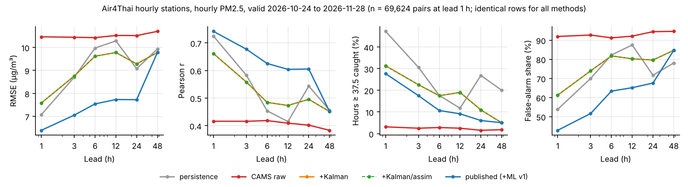

# ที่มา: บทที่ 1 (ปัญหา เป้าหมาย และผลิตภัณฑ์)

## 1.1 ปัญหา PM2.5 และควันไฟในเอเชียตะวันออกเฉียงใต้ภาคพื้นทวีป

ฝุ่นละอองขนาดไม่เกิน 2.5 ไมโครเมตร (fine particulate matter, PM2.5) เป็นปัญหาคุณภาพอากาศที่เกิดซ้ำทุกปีในเอเชียตะวันออกเฉียงใต้ภาคพื้นทวีป (mainland Southeast Asia) ได้แก่ ไทย ลาว เมียนมา กัมพูชา และเวียดนาม
ในฤดูแล้ง ภาคเหนือของไทยและพื้นที่ชายแดนรับควันจากการเผาในที่โล่ง (open biomass burning) ทั้งไฟป่าและการเผาเศษวัสดุการเกษตร
ความเข้มข้นจึงขึ้นลงเร็วตามตำแหน่งไฟ ทิศลม ความสูงชั้นผสม (mixing height) และภูมิประเทศแบบหุบเขา
ช่วงนอกฤดูเผาไหม้ แหล่งกำเนิดในเมือง เช่น การจราจรในกรุงเทพมหานคร มีบทบาทมากกว่า

ในโค้ด ฤดูหมอกควันที่ใช้ฝึกผู้เชี่ยวชาญ hindcast คือ 18 ธันวาคม ถึง 30 เมษายน (วันที่ตามเวลาไทย)
ส่วนฤดูกาลที่ใช้แบ่งคลังข้อมูลฝึกของ ML คือฤดูของกรมอุตุนิยมวิทยา ได้แก่ ฤดูร้อน 16 ก.พ.–15 พ.ค. ฤดูฝน 16 พ.ค.–15 ต.ค. และฤดูหนาว 16 ต.ค.–15 ก.พ.

## 1.3 เป้าหมายของ SEA-HAF

SEA-HAF เป็นระบบพยากรณ์แบบลูกผสม (hybrid) ฟิสิกส์–สถิติ–การเรียนรู้ของเครื่อง (machine learning, ML) มีเป้าหมายดังนี้

1. **พยากรณ์ PM2.5 รายชั่วโมงหลายวันล่วงหน้า** สำหรับเมือง สถานี และแผนที่ ช่วงพยากรณ์จริงขึ้นกับแบบจำลองต้นทาง
   - CAMS ผ่าน Open-Meteo ขอข้อมูล `past_days=2&forecast_days=4` และ pipeline ต้องการให้ CAMS มีค่าถึงอย่างน้อย 24 ชม. ข้างหน้า มิฉะนั้นจะหยุดทำงาน
        - SILAM หนึ่งรอบมี 5 วันของ UTC (`d0`–`d4`) จึงยาวถึงประมาณ 5 วัน
        - เป้าหมาย "1–120 ชม." ในแผนคู่มือจึงเป็นจริงเฉพาะ SILAM ส่วน CAMS ได้สั้นกว่า (ดู ISSUES_A.md)
2. **ปรับแก้ด้วยค่าตรวจวัดทุกชั่วโมง** ใช้ทั้งสถานีอ้างอิงและเซนเซอร์ราคาประหยัด (low-cost sensor) ที่ผ่านการตรวจ ผ่านการปรับแก้ไบแอสหลายขั้น (บทที่ 3)
3. **ให้กฎการเตือนที่ชัดเจน** ใช้เกณฑ์ PM2.5 ของกรมควบคุมมลพิษ (PCD) ซึ่งมีผลตั้งแต่ 1 มิถุนายน 2023
   4. **ทำงานเป็นระบบปฏิบัติการ (operational) แบบฟรีและไม่มี dependency**
   - pipeline หลักเขียนด้วย Node.js ไม่ใช้แพ็กเกจภายนอก
   - ใช้ Python เฉพาะสองขั้นตอน ได้แก่ อ่าน SILAM (NetCDF-4) และอ่านฝน ECMWF open data (GRIB2)
        - รันบน GitHub Actions และเผยแพร่บน GitHub Pages กับ Cloudflare Pages
5. **ตรวจสอบตัวเองได้** ทุกขั้นตอนบันทึก log รายชั่วโมง ขั้นตอนที่เพิ่มเข้ามาภายหลังต้องผ่านประตู (gate) ที่ตัดสินจากผลจริง ก่อนจะถูกเผยแพร่ (หัวข้อ 3.7)

### 1.4.6 ผลิตภัณฑ์หลัก

| ผลิตภัณฑ์ | ไฟล์ | หมายเหตุ |
|---|---|---|
| พยากรณ์ที่สถานีและกริด CAMS ดิบ | `data/latest.json` | `stations[]` มี `raw`, `corr`, `corrA`, `corrM`, `fc24*`, `held` |
| สนามปรับแก้แผนที่ 0.025° | `data/rk-bias.json`, `data/rk-bias-A.json` | integer ×1000 เก็บผลต่างตามแกน x |
| สนามปรับแก้ ML 0.1° | `data/ml-field.json` | ทุก 3 ชม. ถึง 24 ชม. |
| อุตุนิยมวิทยาสำหรับหน้าเว็บ | `data/met-web.json`, `data/met-traj.json` | 36 ชม. ย้อนหลังถึง 75 ชม. ข้างหน้า |
| ฝนสังเกตและเรดาร์ | `data/rain-obs.json` | |
| ฝน ECMWF 0.25° | `data/ecmwf-pr.json` | |
| อุณหภูมิลดขนาด | `data/t2-corr.json` | |
| weather ML | `data/wx-ml.json` | |
| ความแม่นยำ | `data/accuracy.json` | |
| แผนที่ค่าเฉลี่ยรายวัน | `data/pm-days/*.json`, `data/pm-mean.json` | |

หน้าเว็บประกอบค่า PM2.5 ที่แต่ละจุดตามลำดับต่อไปนี้ (บทที่ 3 หัวข้อ 3.3.9 สมการ A.59)

1. CAMS ดิบบนกริด แบบ bilinear
2. บวก increment ของควันไฟ (ถ้ามี)
3. คูณด้วยสนามไบแอสของ regression kriging ที่จางตาม lead
4. คูณด้วยสนาม ML

## 1.5 โครงของภาค A

- **บทที่ 2** แหล่งข้อมูลนำเข้าทุกแหล่ง (ความละเอียด ความถี่ ความหน่วง ตัวแปร สคริปต์ที่อ่าน สัญญาอนุญาต) และการควบคุมคุณภาพค่าวัด
- **บทที่ 3** วิธีการครบทุกขั้น
  - แบบจำลองควันไฟและ assimilation
  - อุตุนิยมวิทยา
  - การปรับแก้ PM2.5 หลายขั้น
  - ฝน
  - weather ML
  - กฎการเตือน
  - หลักการออกแบบที่ใช้ประตูตัดสิน

## เอกสารอ้างอิงของบทนี้

ดูรายการรวมท้ายบทที่ 3 (Inness et al., 2019; Sofiev et al., 2015)

# ที่มา: บทที่ 2 (แหล่งข้อมูล)

## 2.2 ตารางสรุปแหล่งข้อมูล

**ตารางที่ A2.1** แหล่งข้อมูลนำเข้าของ SEA-HAF

| แหล่ง | ตัวแปรที่ใช้ | ความละเอียดที่ใช้ | ความถี่ในการดึง | ความหน่วง | สคริปต์ที่อ่าน | สัญญาอนุญาต / การอ้างอิง |
|---|---|---|---|---|---|---|
| CAMS global (ผ่าน Open-Meteo air-quality API) | `pm2_5` รายชั่วโมง | สุ่มที่สถานี + กริด 0.5°; ความละเอียดดั้งเดิมไม่ระบุในโค้ด | ทุก 12 ชม. (`camsRefreshH`) หรือเมื่อรายชื่อสถานีเปลี่ยน; ย้อนหลัง 2 วัน ถึง 4 วันข้างหน้า | "ออกวันละสองครั้ง" (ความเห็นในโค้ด); ความหน่วงไม่ระบุในโค้ด | `update.mjs` (`camsSeries`) | Copernicus Atmosphere Monitoring Service (Inness et al., 2019) |
| CAMS hindcast (ฤดูเผาไหม้ 2023/24–2025/26) | PM2.5 ทุก 3 ชม. คู่กับ Air4Thai | ทุก 3 ชม., leads 0–72 ชม. | ฝึกครั้งเดียว | – | `hindcast_train.mjs` | Copernicus ADS; มี "modified Copernicus Atmosphere Monitoring Service information" |
| SILAM v6.1 global (FMI) | PM2.5 รายชั่วโมง | 0.2° | ตรวจทุกรอบ, รอบใหม่วันละครั้ง | เผยแพร่ราว 05:00 UTC | `silam.py`, `silam.mjs` | CC BY 4.0 (Sofiev et al., 2015) |
| ECMWF IFS (ผ่าน Open-Meteo, `ecmwf_ifs`) | ลม 10/100 ม., BLH, รังสีคลื่นสั้น, เมฆ, ฝน, T2, RH | กริด north 0.25° [96.5, 14.5, 102.5, 21.5]; domain 1.0° [92, 5, 110, 25] | ทุก 12 ชม.; ย้อนหลัง 3 วัน ถึง 4 วันข้างหน้า; เก็บจาก −60 ชม. | ไม่ระบุในโค้ด | `met.mjs` (`fetchMet`) | ECMWF (เงื่อนไขของ Open-Meteo ไม่ระบุในโค้ด) |
| ECMWF IFS 0.25° ระดับความกดอากาศ (`ecmwf_ifs025`) | T, Z ที่ 850/700 hPa; ลมที่ 925/850/700 hPa | ตาม node ของกริดข้างบน | พร้อม `fetchMet` | ไม่ระบุในโค้ด | `met.mjs` | ECMWF |
| ECMWF open data (IFS oper 0.25°) | ฝนสะสม `tp` → อัตราเฉลี่ยต่อช่วง | 0.25°, box 92–110°E × 5–25°N, steps 0–144 ชม. ทุก 3 ชม. และ 150–168 ชม. ทุก 6 ชม. | ตรวจทุกรอบ, รอบ 00/12 UTC | ไม่ส่งให้หน้าเว็บถ้ารอบเก่ากว่า 36 ชม. | `ecmwf_pr.py` | CC BY 4.0 |
| NASA FIRMS | VIIRS SNPP / NOAA-20 / NOAA-21 NRT: lat, lon, FRP, เวลา, confidence | จุด hotspot (VIIRS 375 ม.; Schroeder et al., 2014) | ทุกรอบ, ย้อนหลัง 2 วัน (`firmsDays`) | ข้อมูลรอบดึกมาถึงประมาณ 3 ชม. หลังดาวเทียมผ่าน | `update.mjs` (`firmsHotspots`) | NASA FIRMS; key ใน `FIRMS_MAP_KEY` |
| Air4Thai (กรมควบคุมมลพิษ) | PM2.5 รายชั่วโมง + WS, WD, TEMP, RH | สถานีภาคพื้นดิน (GROUND) และเครือข่าย กทม. (BKK) | ทุกรอบ ดึง ~2 วันล่าสุด; รายชื่อสถานีทุก 24 ชม. | ค่าเฉลี่ยของชั่วโมงที่จบที่เวลาประทับ ปรากฏราว 20 นาทีหลังจบชั่วโมง | `update.mjs` (`a4tStations`, `a4tHourly`) | ไม่ระบุในโค้ด (PCD Air4Thai) |
| OpenAQ v3 | PM2.5 ล่าสุดของสถานีอ้างอิงและเซนเซอร์ราคาประหยัด | สถานี | ทุกรอบ; รายชื่อทุก 24 ชม. | ไม่รับค่าที่เก่ากว่า 3 ชม. (`obsMaxAgeH`) | `update.mjs` (`oaqStations`, `oaqLatest`) | ไม่ระบุในโค้ด; key ใน `OPENAQ_API_KEY` |
| OpenAQ archive (S3) + Air4Thai history | PM2.5 รายชั่วโมง 3 ปี | สถานี × (เดือน × ชั่วโมง) | ทำครั้งเดียวด้วยมือ | – | `climatology.mjs` | ไม่ระบุในโค้ด |
| IQAir AirVisual (Community plan) | US AQI ระดับเมือง ณ เวลาจริง | 27 เมือง | 9 เมืองต่อรอบ (ครบทุกเมืองราว 3 ชม.) | ใช้ค่าที่อายุไม่เกิน 6 ชม. | `iqair.mjs` | "Data credited to IQAir"; key ใน `IQAIR_API_KEY` |
| ThaiWater (สสน., HAII) | `rain_1h` ของมาตรวัดฝน | จุดมาตรวัด | ทุกรอบ (บริการให้เฉพาะค่าล่าสุด) | ใช้ชั่วโมงเต็มที่อายุไม่เกิน 6 ชม.; เก็บ 48 ชม. | `thaiwater.mjs` | ไม่ระบุในโค้ด |
| เรดาร์ RainViewer (เรดาร์กรมอุตุนิยมวิทยา) | ค่าสี Universal Blue → dBZ → อัตราฝน | tile zoom 6 ขนาด 512 px (≈1.2 กม.) เฉลี่ยลงเซลล์ 0.025°, box [97, 5.5, 106, 21] | ทุกรอบ, เฟรม 10 นาที ของ 2 ชม. ล่าสุด | เกือบเวลาจริง | `radar.mjs` | ไม่ระบุในโค้ด |
| JAXA GSMaP Gauge_NRT v6 / Gauge_NOW | อัตราฝนรายชั่วโมง | 0.1°, crop 92–110°E × 5–25°N | ทุกรอบผ่าน sftp | NRT ช้ากว่าเวลาจริงราว 4–5 ชม.; NOW ราว 1–2 ชม. | `gsmap.mjs` | JAXA; บัญชีใน `GSMAP_USER` / `GSMAP_PASS`; ตรึง host key |
| Google DeepMind PARDIG | อัตราฝนดาวเทียม ทุก 15 นาที | 0.1°, crop 92–110°E × 5–25°N | ทุกรอบ (ไม่เกิน 3 นาทีต่อรอบ) | ช้ากว่าเวลาจริงราว 4–5 ชม. | `pardig.mjs` | CC BY 4.0; bucket สาธารณะ ไม่ต้องใช้ key |
| CHELSA V2.1 (1981–2010) | ฝนรายเดือนภูมิอากาศ | 30 arc-s → ตัวคูณ 0.025° | สร้างครั้งเดียว (`prclim.py`) | – | หน้าเว็บ (`rainFactorAt`), `thaiwater.mjs` | Karger et al. (2017) ตามที่ระบุในโค้ด |
| AWS Terrain Tiles (Terrarium) | ความสูงภูมิประเทศ | zoom 7 เฉลี่ยลงกริด 0.05° (RK) และ 0.025° (อุณหภูมิ) | สร้างครั้งเดียว (เมื่อ key ของกริดเปลี่ยน) | – | `dem.mjs` | ไม่ระบุในโค้ด |
| MODIS MCD12Q1 IGBP (ผ่าน NASA GIBS) | ชนิดสิ่งปกคลุมดิน ณ จุดไฟ | tile zoom 6, 512 px (≈0.0088°, ≈1 กม.) | ปีละครั้ง (ใช้แผนที่ของปีก่อน) | – | `landcover.mjs` | NASA GIBS (เงื่อนไขไม่ระบุในโค้ด) |
| OCHA COD-AB Thailand 2022 (RTSD) | ขอบเขตอำเภอ/ตำบล | ลดรูปด้วย mapshaper, พิกัด 4 ทศนิยม | สร้างครั้งเดียว | – | `admin_bounds.mjs`, `province_bounds.mjs` | CC BY-IGO |

หมายเหตุประกอบตาราง

- **FIRMS** pipeline ดึงเฉพาะ VIIRS (`CFG.firmsSources`) ส่วน MODIS ใช้ได้เฉพาะเมื่อผู้ใช้นำไฟล์ CSV เข้าที่หน้าเว็บ (`rowsToHotspots` รองรับค่า confidence 0–100 ของ MODIS)
  - **GSMaP** README บันทึกว่าบริการไม่พร้อมใช้ตั้งแต่ 18 พ.ย. 2026 ตามประกาศของ JAXA เมื่อ 24 พ.ย. 2026 ระหว่างนี้ PARDIG และเรดาร์ทำงานแทน ข้อมูลนี้มาจาก README ไม่ใช่จากโค้ด
  - **ขอบเขตจังหวัดของประเทศอื่น** ยังใช้ World Bank Official Boundaries และพื้นหลังแผนที่ใช้ Natural Earth / CARTO / OpenTopoMap / Esri ตามที่ README ระบุ
  

# ที่มา: บทที่ 3 (สี กฎเตือน และคะแนนความแม่นยำ)

### 3.6.1 ระดับสีของประเทศไทย

**ตารางที่ A3.17** ระดับ PM2.5 ของกรมควบคุมมลพิษ ใช้ตั้งแต่ 1 มิ.ย. 2023 กับค่าเฉลี่ย 24 ชม. (µg/m³)

| ระดับ | ช่วง | ชื่อ | สี (ธีมสว่าง) |
|---|---|---|---|
| aq1 | ≤ 15 | ดีมาก (Very good) | `#2b8fd9` |
| aq2 | 15.1–25 | ดี (Good) | `#2f9e44` |
| aq3 | 25.1–37.5 | ปานกลาง (Moderate) | `#d4a10b` |
| aq4 | 37.6–75 | เริ่มมีผลกระทบต่อสุขภาพ (Starting to affect health) | `#e8690c` |
| aq5 | > 75 | มีผลกระทบต่อสุขภาพ (Affects health) | `#c92a2a` |

ดัชนีคุณภาพอากาศของไทย (Thai AQI) คำนวณจากค่าเฉลี่ย 24 ชม. $c$ (ตัดลงที่ 0.1) แบบเชิงเส้นเป็นช่วง

$$
I = \frac{I_{hi}-I_{lo}}{C_{hi}-C_{lo}}\,(c - C_{lo}) + I_{lo};\qquad I = 201 + (c - 75.1)\frac{99}{37.4}\ \ (c > 75)
$$
(A.72)

จุดตัดคือ [0–15 → 0–25], [15.1–25 → 26–50], [25.1–37.5 → 51–100], [37.6–75 → 101–200]
`accuracy.mjs` ใช้ขอบเขตชุดเดียวกัน [15, 25, 37.5, 75] สำหรับคะแนน "ระดับสีถูก" (`sameBand`)

### 3.6.2 กฎการเตือน

**เมือง** มีคำเตือนเมื่อพยากรณ์ PM2.5 รวมที่ตัวเมืองมีลักษณะต่อไปนี้
- **ค่าเฉลี่ย 24 ชม. เคลื่อนที่สูงสุดตั้งแต่ปัจจุบัน** > 37.5 µg/m³ (ต้องมี ≥ 18 จาก 24 ค่า) **หรือ**
- **ค่ารายชั่วโมงสูงสุด** > 75 µg/m³

$$
\text{warn}_{\text{town}} \iff \max_{t\ge t_0}\bar c_{24}(t) > 37.5 \;\vee\; \max_{t \ge t_0-23\,\text{h}} c(t) > 75
$$
(A.73)

ใน `seriesStats` ช่วงที่หาค่ารายชั่วโมงสูงสุดเริ่มที่ 23 ชั่วโมงก่อนชั่วโมงปัจจุบัน ไม่ได้เริ่มที่ปัจจุบัน (ดู ISSUES_A.md)
ถ้ายังไม่มีข้อมูล PM2.5 รวม ระบบใช้อนุกรมควันไฟจากแบบจำลองควันในเบราว์เซอร์แทน

**สถานีตรวจวัด** มีคำเตือนเมื่อเป็นไปตามข้อใดข้อหนึ่ง ใช้เฉพาะสถานีอ้างอิงในพื้นที่ที่เลือก เพราะเซนเซอร์ราคาประหยัดอ่านค่าสูงในอากาศชื้น
1. ค่าเฉลี่ย 24 ชม. ที่วัดได้ตอนนี้ > 37.5 (`obs24.valid` หรือค่าของสถานีชนิด `24` ที่อายุ < 6 ชม.)
2. พยากรณ์ที่ปรับแล้วของสถานีเองผ่านกฎเดียวกับเมือง โดยค่าเฉลี่ย 24 ชม. คือค่าที่มากกว่าระหว่างค่าจาก `seriesStats` กับค่าใน `fc24*` ข้างหน้า

**การรวมจุด** สถานีที่มีคำเตือนและอยู่ห่างเมืองที่มีคำเตือนไม่เกิน `WARN_MERGE_KM` = 10 กม. นับเป็นสถานที่เดียวกับเมืองนั้น
ถ้าสถานีนั้นวัดได้เกินมาตรฐานแล้ว เมืองจะถูกทำเครื่องหมายว่า "วัดได้เกินมาตรฐานแล้ว"
จำนวน "พื้นที่ที่มีคำเตือน" = เมืองที่มีคำเตือน + สถานีที่ไม่ได้รวมกับเมือง

### 3.6.3 ระดับของเครื่องหมายเตือน

| ระดับ | เงื่อนไขของค่า $v$ | สี | ความหมาย |
|---|---|---|---|
| `wl1` | 37.5 < v ≤ 55 และกรณีอื่นที่ไม่เข้าเกณฑ์ข้างล่าง | ส้มอ่อน | เริ่มมีผลต่อกลุ่มเสี่ยง |
| `wl2` | 55 < v ≤ 75 | ส้มเข้ม | ไม่ดีต่อสุขภาพ (55 คือขั้น "unhealthy" ของ US EPA) |
| `wl3` | v > 75 | แดง | มีผลกระทบต่อสุขภาพ (ระดับ aq5 ของ PCD) |

- $v$ คือค่าเฉลี่ย 24 ชม. ที่วัดได้ (สถานีที่วัดเกินแล้ว) หรือค่าเฉลี่ย 24 ชม. พยากรณ์สูงสุดข้างหน้า
- เมืองที่ได้คำเตือนจากเกณฑ์รายชั่วโมงอย่างเดียวจึงแสดงสีส้มอ่อน
- จุดทึบตรงกลางหมายถึงวัดได้เกินมาตรฐานแล้ว วงแหวนหมายถึงพยากรณ์ว่าจะเกิน

หน้าเว็บยังสรุปรายพื้นที่ (จังหวัด/อำเภอ) จากจุดแลตทิซ 0.1° ของจังหวัด และแสดงกระดิ่งบนจังหวัดหรืออำเภอที่มีเมืองที่มีคำเตือน (`warnedBy`) เพื่อไม่ให้ค่าเฉลี่ยของพื้นที่ซ่อนคำเตือนของเมือง

### 3.6.5 คะแนนความแม่นยำบนหน้าเว็บ (`accuracy.mjs`)

ตั้งแต่ 26 พ.ย. 2026 ทุกส่วนของหน้าเว็บแสดงตัวเลขเดียวกัน คือ

$$
\text{NRMSE} = 100\,\frac{\sqrt{\frac1n\sum (F_d - O_d)^2}}{\frac1n\sum O_d},\qquad
\text{accuracy} = \max\!\left(0,\ \operatorname{round}(100 - \text{NRMSE})\right)\ [\%]
$$
(A.74)

- $F_d$ คือพยากรณ์ค่าเฉลี่ย 24 ชม. ที่เผยแพร่ (`blend24ML`, ถ้าไม่มีใช้ `blend24A`, ถ้าไม่มีใช้ `blend24`) ของวันตามปฏิทิน (00–24 น. เวลาไทย) จากรอบที่ออก ณ 17 UTC lead 24 ชม. (`m1`) หรือ 48 ชม. (`m2`)
- $O_d$ คือค่าเฉลี่ยของชั่วโมงที่วัดได้ในวันไทยนั้น ต้องมี ≥ 18 ชั่วโมง
- ใช้เฉพาะสถานีอ้างอิงรายชั่วโมงในช่วง 30 วันล่าสุด

| ค่าตั้ง | ค่า | src |
|---|---|---|
| `ACC.month.days` | 30 วัน | `accuracy.mjs:26` |
| `ACC.month.leads` | m1 = 24, m2 = 48 ชม. | `accuracy.mjs:26` |
| `ACC.minHours24` | 18 ชั่วโมง | `accuracy.mjs:23` |
| วันขั้นต่ำต่อป้าย (`ACC_MON_DAYS`) | 15 วัน | `index.html:2335` |
| MAPE ต้องมีวันที่ ≥ 10 µg/m³ | ≥ 8 วัน | `index.html:2335` |
| รัศมี "ที่นี่" (`ACC_NEAR_KM`) | 25 กม. (ถ้าไม่มี ใช้ภูมิภาคของไทย) | `index.html:2287, 2342-2345` |
| คะแนนอื่นที่ยังคำนวณ (7 วัน, รายชั่วโมง) | lead 1/3/6, 12/24, 48 ชม.; ค่าเฉลี่ย 24 ชม. ที่ 24/48 ชม. | `accuracy.mjs:23` |

เซนเซอร์ราคาประหยัดที่ผ่านการตรวจถูกให้คะแนนแยกด้วยวิธีเดียวกัน ไม่รวมกับคะแนนหลัก
เพราะการปรับแก้เรียนจากค่าของเซนเซอร์เอง คะแนนนี้จึงบอกความใกล้กับเซนเซอร์ ไม่ใช่กับค่าจริง
IQAir ใช้วิธีเดียวกันกับค่ารายชั่วโมงใน 7 วัน
- เทียบกับจุดพยากรณ์ของเราที่ใกล้ที่สุดภายใน 15 กม.
- แปลง US AQI กลับเป็น µg/m³ ด้วยค่ากลางของช่วง

คะแนนนี้คือ**ความสอดคล้องกับ IQAir** ไม่ใช่ความแม่นยำเทียบกับค่าวัด

---

## 3.7 หลักการออกแบบ

# ที่มา: บทที่ 4 (ความแม่นยำ: ตารางหลักและข้อจำกัด)

### B.3.1 สถานี Air4Thai รายชั่วโมง

**ตารางที่ B.2** ผลทีละขั้นที่สถานี Air4Thai รายชั่วโมง 103 สถานี ค่าพยากรณ์ที่ valid 24 ต.ค. 2026 01:00 – 28 พ.ย. 2026 01:00 UTC
(n = 69,624 / 69,466 / 68,891 / 68,613 / 67,244 / 64,792 คู่ที่ lead 1 / 3 / 6 / 12 / 24 / 48 ชม.; ชั่วโมงที่ค่าวัด ≥ 37.5 = 2,048 / 2,038 / 2,060 / 2,080 / 2,017 / 1,987)
หน่วยของ bias, MAE, RMSE คือ µg/m³; NRMSE, POD, FAR, Band, SS เป็นร้อยละ

| lead (ชม.) | ขั้น | Bias | MAE | RMSE | NRMSE | r | POD | FAR | Band | SSpers | SSraw |
|---|---|---|---|---|---|---|---|---|---|---|---|
| 1 | persistence | 0.07 | 4.54 | 7.08 | 45 | 0.72 | 47 | 54 | 69 | 0 | 54 |
| 1 | CAMS raw | -4.46 | 7.52 | 10.46 | 67 | 0.42 | 3 | 92 | 60 | -118 | 0 |
| 1 | +Kalman | -0.55 | 5.15 | 7.58 | 49 | 0.66 | 31 | 61 | 65 | -15 | 47 |
| 1 | published (+ML v1) | -0.67 | 4.27 | 6.39 | 41 | 0.74 | 28 | 43 | 69 | 18 | 63 |
| 3 | persistence | 0.04 | 5.73 | 8.71 | 56 | 0.58 | 31 | 70 | 63 | 0 | 30 |
| 3 | CAMS raw | -4.48 | 7.50 | 10.44 | 67 | 0.42 | 3 | 93 | 60 | -44 | 0 |
| 3 | +Kalman | -0.65 | 6.00 | 8.76 | 56 | 0.56 | 23 | 74 | 61 | -1 | 30 |
| 3 | published (+ML v1) | -0.83 | 4.73 | 7.05 | 45 | 0.68 | 18 | 52 | 66 | 34 | 54 |
| 6 | persistence | -0.02 | 6.68 | 9.97 | 64 | 0.45 | 18 | 82 | 58 | 0 | 8 |
| 6 | CAMS raw | -4.49 | 7.51 | 10.43 | 67 | 0.42 | 3 | 91 | 60 | -9 | 0 |
| 6 | +Kalman | -0.79 | 6.64 | 9.62 | 62 | 0.48 | 18 | 82 | 59 | 7 | 15 |
| 6 | published (+ML v1) | -0.93 | 5.10 | 7.54 | 48 | 0.63 | 11 | 63 | 64 | 43 | 48 |
| 12 | persistence | -0.16 | 6.94 | 10.28 | 66 | 0.41 | 12 | 87 | 57 | 0 | 4 |
| 12 | CAMS raw | -4.53 | 7.60 | 10.52 | 67 | 0.41 | 2 | 92 | 60 | -5 | 0 |
| 12 | +Kalman | -1.25 | 6.80 | 9.78 | 62 | 0.47 | 19 | 80 | 59 | 10 | 14 |
| 12 | published (+ML v1) | -1.03 | 5.26 | 7.73 | 49 | 0.60 | 9 | 65 | 63 | 43 | 46 |
| 24 | persistence | -0.06 | 6.06 | 9.07 | 58 | 0.54 | 27 | 72 | 61 | 0 | 26 |
| 24 | CAMS raw | -4.38 | 7.52 | 10.52 | 68 | 0.40 | 2 | 94 | 60 | -34 | 0 |
| 24 | +Kalman | -2.07 | 6.43 | 9.28 | 60 | 0.50 | 11 | 80 | 61 | -5 | 22 |
| 24 | published (+ML v1) | -1.16 | 5.21 | 7.73 | 50 | 0.61 | 6 | 68 | 64 | 27 | 46 |
| 48 | persistence | -0.21 | 6.73 | 9.94 | 64 | 0.46 | 20 | 78 | 58 | 0 | 14 |
| 48 | CAMS raw | -4.41 | 7.64 | 10.70 | 69 | 0.38 | 2 | 95 | 59 | -16 | 0 |
| 48 | +Kalman | -3.14 | 6.88 | 9.78 | 63 | 0.45 | 5 | 85 | 60 | 3 | 16 |
| 48 | published (+ML v1) | -3.14 | 6.88 | 9.78 | 63 | 0.45 | 5 | 85 | 60 | 3 | 16 |

หมายเหตุ: ขั้น +Kalman/assim ให้ค่าเท่ากับ +Kalman แทบทุกแถว (ความต่างสัมบูรณ์เฉลี่ยของ `correctedA` กับ `corrected` เท่ากับ 0.002 µg/m³
ทั้ง log) จึงไม่แสดงแยก ตารางเต็มอยู่ที่ `tables/B_incr_air4thai.csv` ที่ lead 48 ชม. ML v1 ไม่ทำงาน (`MLCFG.applyMaxLeadH = 24`) ค่าที่เผยแพร่จึงเท่ากับ +Kalman

**รูปที่ B.1** RMSE, r, POD และ FAR ตาม lead ของแต่ละขั้นที่สถานี Air4Thai รายชั่วโมง (แถวเดียวกับตารางที่ B.2)

ผลหลักจากตารางที่ B.2 และรูปที่ B.1

1. **CAMS ดิบต่ำกว่าค่าจริงอย่างสม่ำเสมอ** (bias ประมาณ −4.4 ถึง −4.5 µg/m³ เมื่อค่าวัดเฉลี่ย 15.6 µg/m³) และแทบไม่จับชั่วโมงฝุ่นสูงเลย
   (POD 2–3 % โดยการเตือนที่ออกไปเกิดจริงเพียง 5–9 %) r อยู่ที่ 0.38–0.42 และแทบไม่เปลี่ยนตาม lead เพราะความคลาดเคลื่อนหลักเป็นความคลาดเคลื่อนเชิงระบบ ไม่ใช่ความคลาดเคลื่อนจากการพยากรณ์ล่วงหน้า
2. **Kalman filter ลดความเอนเอียงได้มากที่ lead สั้น** (bias −0.55 ที่ 1 ชม.) แต่ผลลดลงตาม lead (−3.14 ที่ 48 ชม.) สอดคล้องกับการลดน้ำหนักของ bias ตาม `biasLeadEfoldH`
   Kalman เพียงอย่างเดียวยังแพ้ persistence ที่ lead 1–3 ชม. (SSpers −15 และ −1)
3. **ML v1 ลด RMSE ต่อจาก Kalman ทุก lead ≤ 24 ชม.** (6.39 เทียบ 7.58 ที่ 1 ชม., 7.73 เทียบ 9.28 ที่ 24 ชม.) และทำให้ค่าที่เผยแพร่ดีกว่า persistence ทุก lead
   (SSpers 18–43 %) ดีกว่า CAMS ดิบ 46–63 % (SSraw) ที่ lead ≤ 24 ชม.
4. **แต่ ML v1 จับชั่วโมงฝุ่นสูงได้น้อยกว่า Kalman** (POD 28 เทียบ 31 % ที่ 1 ชม.; 6 เทียบ 11 % ที่ 24 ชม.) แลกกับ FAR ที่ต่ำลง (43 เทียบ 61 % ที่ 1 ชม.)
   นี่คือปัญหาที่ทำให้พัฒนา ML v2 (หัวข้อ B.6): การเรียนรู้บน $\ln(\mathrm{PM}+1)$ ให้ค่ามัธยฐาน จึงดึงค่าสูงลง
5. ที่ lead 24 ชม. persistence (ค่าเดียวกันเมื่อวาน ณ ชั่วโมงเดียวกันโดยประมาณ) จับชั่วโมงสูงได้ 27 % มากกว่าค่าที่เผยแพร่ (6 %) แสดงว่าชั่วโมงฝุ่นสูงในช่วงนี้มีรูปแบบรายวันที่ซ้ำ ซึ่ง ML v1 ยังไม่ใช้

## B.10 ข้อจำกัดและงานต่อไป

1. **ช่วงข้อมูลสั้น** log รายชั่วโมงที่เก็บได้ครอบคลุมเพียง 35 วัน (24 ต.ค. – 28 พ.ย. 2026) ตามนโยบายเก็บ 35 วันบน branch `history` การเปรียบเทียบ CAMS–SILAM มีเพียง 7 วัน และ ML v2 มี 9 วัน
   ผลแต่ละตารางจึงขึ้นกับสภาพอากาศในช่วงสั้น ๆ นี้ ควรเก็บสรุปผลรายเดือนแยกไว้ก่อนที่ log จะถูกลบ
2. **ฤดูกาล** ต.ค.–พ.ย. เป็นช่วงก่อนฤดูหมอกควัน ชั่วโมงที่ ≥ 37.5 µg/m³ มีเพียง 2.8 % ที่สถานี Air4Thai รายชั่วโมง ทักษะการจับชั่วโมงสูงในบทนี้จึงสะท้อนเหตุการณ์ฝุ่นในเมือง
   (เช่น สมุทรสาคร มาบตาพุด สมุทรปราการ) มากกว่าควันไฟ ขั้น fire assimilation (`correctedA`, `mapA`) ให้ผลเท่ากับไม่ใช้เพราะแทบไม่มีไฟ **จึงยังประเมินไม่ได้** (รอข้อมูลฤดูหมอกควัน 2026/27)
   ทำนองเดียวกัน hindcast expert ทำงานเฉพาะ 18 ธ.ค. – 30 เม.ย. และ climatology blend ยังมีน้ำหนักเป็นศูนย์ (`CFG.climBlend`) โดย log `climfc-*.csv` มีเพียงตั้งแต่ 21 พ.ย. 2026 (ราว 7 วัน)
   ซึ่งน้อยกว่า 2 สัปดาห์ที่กฎของโครงการกำหนดก่อนรัน `fit_clim_blend.mjs` (**ข้อมูลยังไม่พอ**)
3. **ความเอนเอียงของเซนเซอร์ราคาประหยัด** ค่าวัดของเซนเซอร์ใน log เป็นค่าดิบซึ่งอ่านสูงในอากาศชื้น (ใน hindcast 2023/24 ค่าเฉลี่ยของเซนเซอร์ 66.5 µg/m³ เทียบ 37.3 ที่ Air4Thai)
   และการปรับแก้ของแต่ละเซนเซอร์เรียนจากค่าของมันเอง ผลที่เซนเซอร์จึงเป็นความใกล้เคียงกับเซนเซอร์ ไม่ใช่ความถูกต้องเทียบค่าจริง
4. **ความไม่เป็นอิสระของค่าจริงฝน** เรดาร์ถูกปรับด้วยมาตรวัด และมี frequency bias ราว 2 เมื่อเทียบกับมาตรวัด ผลของ ECMWF และ blend ในหัวข้อ B.8.2 จึงเป็นผลเทียบกับเรดาร์ ไม่ใช่เทียบกับมาตรวัดโดยตรง
5. **ประตูที่ยังปิด** ML v2 ยังไม่ผ่าน `pmHighCheck` ทุกวันที่บันทึก (19–27 พ.ย. 2026) SILAM ยังไม่ได้เป็นค่าเริ่มต้นของหน้าเว็บ และ climatology blend ยังเป็นศูนย์
   ประตู nowcast ยังไม่มีการตัดสินที่บันทึก (การคำนวณซ้ำในตารางที่ B.9 บ่งว่าจะผ่าน)
6. **สถานีนอกประเทศไทย** มีสถานีอ้างอิงรายชั่วโมงที่จับคู่ได้เพียง 2 สถานี (ฮานอย) ผลนอกประเทศไทยจึงยังสรุปไม่ได้

---

# ที่มา: บทที่ 8 (ศัพท์และการอ้างอิงข้อมูล)

## 8.1 อภิธานศัพท์ไทย–อังกฤษ (Thai–English glossary)

| ภาษาไทย | English | ความหมายในระบบ SEA-HAF |
|---|---|---|
| ฝุ่นละอองขนาดไม่เกิน 2.5 ไมครอน | PM2.5 (fine particulate matter) | ตัวแปรหลักที่พยากรณ์ หน่วย µg/m³ |
| หมอกควัน | haze / smoke haze | ควันจากการเผา (PM2.5); ต่างจาก "หมอก" (fog) ที่แชตประเมินจากความชื้นและลม |
| จุดความร้อน | hotspot / active fire detection | จุดไฟจากดาวเทียม VIIRS (NASA FIRMS) |
| กำลังการแผ่รังสีของไฟ | fire radiative power (FRP) | MW ต่อจุด ใช้คำนวณการปล่อย PM2.5 |
| ควันไฟจำลอง | modelled fire smoke | PM2.5 จาก puff model ของ hotspot |
| การผสานข้อมูลการปล่อยจากไฟ | fire-emission data assimilation | ปรับตัวคูณการปล่อยของกลุ่มไฟจากค่าวัด 48 ชม. (`assim.mjs`) |
| ส่วนเพิ่ม | increment | ผลต่างของพยากรณ์ที่เกิดจาก assimilation (`inc`) |
| ตัวกรองคาลมาน | Kalman filter | ประมาณไบแอสรายสถานีบน log-ratio |
| ไบแอส / ความเอนเอียง | bias | ค่าพยากรณ์ − ค่าวัด (หรือ ln-ratio ใน Kalman) |
| ไบแอสช้า | slow bias | `kfSlow` ความจำหลายสัปดาห์ |
| การจางตามระยะพยากรณ์ | lead-time fade (e-folding) | การแก้ไบแอสลดลงแบบ exponential ตาม lead |
| ระยะพยากรณ์ | lead time | ชั่วโมงระหว่างเวลาออกพยากรณ์และเวลาที่ใช้ได้ |
| เวลาออกพยากรณ์ | issue time (`issued_utc`) | |
| เวลาที่ใช้ได้ | valid time (`valid_utc`) | |
| ความคงที่ / ค่าเดิมต่อเนื่อง | persistence | ใช้ค่าวัดล่าสุดเป็นพยากรณ์ |
| การผสมตามระยะพยากรณ์ | blend by lead | w·persistence + (1−w)·forecast (`blendByLead`) |
| เขตไฟภาคเหนือ | northern fire belt | กล่อง 97–105.5 E, 17.5–22.5 N (`blendBelt`) |
| การประมาณค่าเชิงพื้นที่แบบถดถอย | regression kriging (RK) | แผนที่แก้ไบแอส 0.025° (`rk.mjs`) |
| วาริโอแกรม | variogram | ความแปรปรวนตามระยะของ residual |
| การลดน้ำหนักกลุ่มสถานีหนาแน่น | declustering | ไม่ให้เครือข่ายกรุงเทพฯ ครอบงำ regression |
| การตรวจแบบเว้นหนึ่ง | leave-one-out (LOO) cross-validation | คะแนนของแผนที่ที่สถานีที่ถูกเว้น |
| เครื่องวัดอ้างอิง | reference monitor | สถานีมาตรฐาน (Air4Thai, AirNow ฯลฯ) |
| เซนเซอร์ราคาประหยัด | low-cost sensor | เช่น AirGradient; แปลงสเกลและผ่าน QC ก่อนใช้ |
| ค่าเฉลี่ยเคลื่อนที่ 24 ชั่วโมง | 24-h running mean | ค่าของสำเนา Air4Thai บน OpenAQ และ BMA feed |
| ค่าผิดปกติแบบยอดแหลม | spike | ค่าวัดผิดของเครื่องมือ (`obsqc.mjs`) |
| ยังไม่ยืนยัน | unconfirmed (held) | ค่าล่าสุดที่ spike check พักไว้ แสดงบนหน้าเว็บแต่ไม่ใช้แก้ |
| การเรียนรู้ด้วยตนเอง | self-learning correction | ML v1/v2 ที่เรียนรู้รายวัน |
| ผู้เชี่ยวชาญ (ในชุดโมเดล) | expert | base, day, week, month, season, hindcast |
| น้ำหนักแบบแบ่งคงที่ | fixed-share weighting | การรวม expert (Herbster & Warmuth 1998) |
| ต้นไม้ตัดสินใจแบบบูสต์ | gradient-boosted trees (GBM) | expert month / season / hindcast |
| การถดถอยริดจ์ | ridge regression | expert week |
| ผู้สมัคร | candidate | ML v2 ที่รันคู่แต่ยังไม่เผยแพร่ |
| ประตูตรวจ | gate / check | การตรวจรายวันที่ตัดสินว่าจะเผยแพร่หรือไม่ |
| ชั่วโมงสูง | high hour | ชั่วโมงที่วัดได้ ≥ 37.5 µg/m³ |
| จับได้ | hit / caught | พยากรณ์ ≥ เกณฑ์ และวัดได้ ≥ เกณฑ์ |
| เตือนผิด | false alarm | พยากรณ์ ≥ เกณฑ์ แต่วัดได้ต่ำกว่า |
| สัดส่วนเตือนผิด | false-alarm share (ratio) | false alarm ÷ จำนวนพยากรณ์ ≥ เกณฑ์ |
| ค่าเฉลี่ยรากที่สองของความคลาดเคลื่อนกำลังสอง | RMSE | |
| RMSE แบบปรับมาตรฐาน | NRMSE | 100 · RMSE ÷ ค่าวัดเฉลี่ย (%) |
| ความแม่นยำ (บนหน้าเว็บ) | accuracy | 100 − NRMSE ของค่าเฉลี่ยรายวัน 30 วัน |
| ระดับความเข้มข้น (สี) | concentration band (PCD colour band) | ขอบ 15 / 25 / 37.5 / 75 µg/m³ |
| ภูมิอากาศของสถานี | station climatology | ค่าเฉลี่ยและ P90 รายเดือน × ชั่วโมงจาก 3 ปี |
| การดึงเข้าหาภูมิอากาศ | climatology blend | `CFG.climBlend` (ยังเป็นศูนย์) |
| การพยากรณ์ย้อนหลัง | hindcast | CAMS ที่เก็บไว้ของฤดูไฟ 2024–2026 |
| การพยากรณ์ระยะสั้นมาก | nowcast | 1–6 ชม. สำหรับ PM2.5, 1–3 ชม. สำหรับเรดาร์ |
| ฝนสังเกต | observed rain | radar, PARDIG, GSMaP |
| มาตรวัดฝน | rain gauge | ThaiWater (HAII) |
| เรดาร์ตรวจอากาศ | weather radar | ผ่าน RainViewer (กรมอุตุนิยมวิทยา) |
| ร่องรอยสะท้อน | echo footprint | พื้นที่ที่ radar เคยเห็นฝน ≥ 2 ชั่วโมง |
| ตัวคูณรูปแบบฝน | rain-pattern factor (CHELSA) | ลดขนาดฝนเป็น 0.025° |
| อัตราการลดลงของอุณหภูมิตามความสูง | lapse rate | 6.5 °C/กม. |
| การลดขนาด | downscaling | ทำให้ละเอียดขึ้น (0.025°) |
| ความสูงชั้นผสม | boundary-layer height (BLH) | m |
| ดัชนีการระบายอากาศ | ventilation index | BLH × ลม 100 ม. (m²/s) |
| วิถีย้อนกลับ | backward trajectory | "อากาศมาจากไหน" 27 สมาชิก |
| เสถียรภาพบรรยากาศ | atmospheric stability (Pasquill–Gifford class) | `cls` A–F |
| ข้อมูลระดับความกดอากาศ | pressure-level data | 925/850/700 hPa |
| แคชของ Actions | Actions cache | ที่เก็บ state ระหว่างรอบ |
| สาขา (git) | branch | `main`, `history`, `mltrain`, `hindcast` |
| ข้อความลับ | secret | key/token ใน GitHub Secrets (ห้ามเขียนลงไฟล์) |
| หน้าสาธารณะ / หน้านักพัฒนา | public page / developer page | `/` / `/dev.html` |
| ภาค (ของประเทศไทย) | region | ภาคเหนือ อีสาน กลาง ตะวันออก ใต้ |
| จังหวัด / อำเภอ / ตำบล | province (ADM1) / district (amphoe, ADM2) / sub-district (tambon, ADM3) | ขอบเขตจาก OCHA COD-AB |

---

## 8.3 การอ้างอิงและสัญญาอนุญาตของข้อมูล (data attributions and licences)

ต้องคงข้อความอ้างอิงเหล่านี้ไว้เมื่อเผยแพร่หรือคัดลอกข้อมูล

| แหล่ง | ข้อมูลที่ใช้ | สัญญาอนุญาต / ข้อความอ้างอิง |
|---|---|---|
| **Copernicus Atmosphere Monitoring Service (CAMS)** | พยากรณ์ PM2.5 global ผ่าน Open-Meteo air-quality API (live) และ ADS `cams-global-atmospheric-composition-forecasts` (`pm2p5`, 0.4°) ใน hindcast | ข้อความใน repo (คัดตามต้นฉบับ): *"Contains modified Copernicus Atmosphere Monitoring Service information 2023–2026 (CAMS global atmospheric composition forecasts, https://doi.org/10.24381/04a0b097). The values were interpolated from the CAMS grid to the stations. Neither the European Commission nor ECMWF is responsible for any use that may be made of the Copernicus information or data it contains."*  และ `hc-model.json` source: "CAMS global forecasts (Copernicus ADS) and Air4Thai via OpenAQ"  |
| **FMI SILAM** | SILAM global air-quality forecast, PM2.5, 0.2°, AWS S3 `fmi-opendata-silam-surface-netcdf` | CC BY 4.0, Finnish Meteorological Institute; source ในไฟล์: "FMI SILAM global air-quality forecast (CC BY 4.0), PM2.5, 0.2°"  |
| **ECMWF** | IFS HRES ผ่าน Open-Meteo (`ecmwf_ifs`, `ecmwf_ifs025`) และ ECMWF Open Data (total precipitation 0.25°) | Open data: CC BY 4.0; source: "ECMWF IFS HRES open data (CC BY 4.0), total precipitation at 0.25°"  |
| Open-Meteo | API ที่ส่ง CAMS และ ECMWF | อ้างใน README ("Copernicus CAMS via Open-Meteo air-quality API · Open-Meteo forecast API")  |
| **NASA FIRMS** | VIIRS NRT (S-NPP, NOAA-20, NOAA-21) active fires | อ้าง "NASA FIRMS (VIIRS NRT)"; ต้องใช้ MAP_KEY  |
| **OpenAQ** | ค่าวัด v3 (live) และ archive บน S3 (climatology, hindcast) | ข้อความใน repo: *"retrieved through OpenAQ (https://openaq.org). The data come from the original providers … Licences are set by each provider; check the provider's terms on OpenAQ before redistributing the observations. Credit OpenAQ and the original provider when using them."*  |
| **IQAir** | US AQI ปัจจุบันของเมือง (AirVisual API แผน Community) | "Data: IQAir (iqair.com)" แสดงพร้อมเครดิต; เป็นการเทียบกับ IQAir ไม่ใช่ความแม่นยำเทียบค่าวัด  |
| **PCD Air4Thai** | ค่าวัดรายชั่วโมงและอากาศที่สถานี จากกรมควบคุมมลพิษ (Pollution Control Department) | อ้าง "Air4Thai (PCD)" / "กรมควบคุมมลพิษ" บนหน้าเว็บ |
| **ThaiWater (HAII)** | มาตรวัดฝน `rain_24h` (ค่าล่าสุด `rain_1h`) ของสถาบันสารสนเทศทรัพยากรน้ำ | อ้าง "ThaiWater (HAII) rain gauges"  |
| **JAXA GSMaP** | Gauge_NRT v6 / Gauge_NOW 0.1° ผ่าน sftp (ต้องมีบัญชี) | อ้าง "JAXA GSMaP"; ใช้ไม่ได้ตั้งแต่ 18 พ.ย. 2026  |
| **Google DeepMind PARDIG** | ฝนดาวเทียม global 0.1° ทุก 15 นาที bucket สาธารณะ `gs://pardig_1` | CC BY 4.0; "Google DeepMind PARDIG near-real-time (CC BY 4.0), hourly mean of the 15-min rain rate"  |
| **OCHA COD-AB Thailand** | ขอบเขตอำเภอและตำบล `tha_admbnda_adm3_rtsd_20220121` (Royal Thai Survey Department, 2022) ผ่าน prasertcbs/thailand_gis | CC BY-IGO; ข้อความ: *"Administrative boundaries: Royal Thai Survey Department (2022) via OCHA HDX COD-AB Thailand, CC BY-IGO; simplified (prasertcbs/thailand_gis, mapshaper)"*  |
| **Amazon MASSIVE 1.1** | ข้อมูลฝึกแชต (th-TH, en-US) | *"MASSIVE: J. FitzGerald et al. (2022), "MASSIVE: A 1M-Example Multilingual Natural Language Understanding Dataset with 51 Typologically-Diverse Languages", arXiv:2204.08582. Copyright Amazon.com Inc. or its affiliates. Licensed under the Creative Commons Attribution 4.0 International licence (CC BY 4.0, https://creativecommons.org/licenses/by/4.0/). Changes: the wake word "olly" removed, intents mapped as above, a sample of the rows."*  |

แหล่งอื่นที่ระบบใช้และควรอ้าง: CHELSA V2.1 (Karger et al. 2017, doi:10.1038/sdata.2017.122; data doi:10.16904/envidat.228) ,
RainViewer (radar ของกรมอุตุนิยมวิทยา) , AWS Terrain Tiles (Terrarium) ,
NASA GIBS / MODIS MCD12Q1 IGBP , World Bank Official Boundaries (จังหวัดของประเทศเพื่อนบ้าน), Natural Earth และ basemap CARTO / OpenTopoMap / Esri 
---

